<div align="center">


### Your coding agents, working as a team — right on your Mac.

Chat with one agent, wire a whole crew together on a canvas, or hand them a board<br>
of tasks and go make coffee. ☕ **Claude Code**, **Cursor Agent** and **Codex**, driven<br>
through their own CLIs and your own logins. No cloud, no account, no telemetry.

<p>
  <a href="https://github.com/geniro-io/geniro-app/releases/latest"></a>
  <a href="https://github.com/geniro-io/geniro-app/actions/workflows/ci.yaml"></a>
  <a href="LICENSE"></a>
  <a href="#-install"></a>
</p>
<p>
  
  
  
  
  
  
</p>

**[Install](#-install)** ·
**[Features](#-whats-inside)** ·
**[Workflows](#-workflows-and-agent-teams)** ·
**[Task board](#-task-board)** ·
**[Artifacts](#-artifacts-and-sharing)** ·
**[Stats](#-stats-cost-and-cpu--ram)** ·
**[Phone](#-your-phone)** ·
**[Privacy](#-local-first-for-real)** ·
**[Gallery](#-gallery)** ·
**[Contribute](#-development)**

<br>

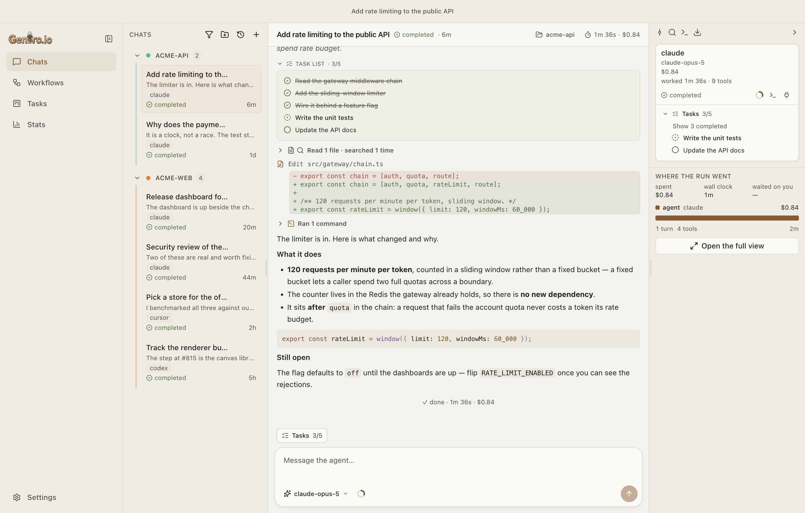

</div>

<br>

## 🤔 Wait, what is this?

You already pay for Claude Code, Cursor or Codex. They are brilliant, and each one lives in its own terminal tab.

**Geniro is the desk they share.** One native window where you can:

- 💬 **chat** with any of them, each in its own folder and branch;
- 🧩 **wire them into a team** — a planner hands work to a backend agent and a frontend agent, and a reviewer checks both;
- 📋 **run a task board** where every card gets its own git worktree and an agent works through the queue;
- 📊 **see what it all costs**: money, tokens, time, CPU and RAM.

What does Geniro charge? **Nothing.** It is open source (Apache 2.0), has no server, and never asks you to sign up. Your agents keep using the subscriptions and logins they already have.

## 🚀 Install

**macOS · Apple Silicon.** With Homebrew:

```sh
brew tap geniro-io/tap
brew trust geniro-io/tap # required for third-party taps on Homebrew 6+
brew install --cask geniro
```

Or download and run the install script:

```sh
curl -fsSL https://raw.githubusercontent.com/geniro-io/geniro-app/main/scripts/install.sh -o /tmp/geniro-install.sh
bash /tmp/geniro-install.sh
```

> [!NOTE]
> The app is signed but not notarized. Both methods above handle macOS quarantine, so install with one of them. Updates install from inside the app. If an update cannot replace your copy, run `brew upgrade --cask geniro` or the script again.

**First run:** open Geniro, install or pick an agent CLI, sign in, and choose your project folder. A missing CLI installs with one press, from onboarding or from Settings. No terminal needed.

## ✨ What's inside

<table>
<tr>
<td width="33%" valign="top">

<b>💬 Chats</b><br>
Pick the agent, model, effort, context window and approval mode. Queue follow-ups, import sessions from the CLIs, search every chat, and export to Markdown.

</td>
<td width="33%" valign="top">

<b>🧩 Workflows</b><br>
Drag agents onto a canvas and wire them up. Independent steps run in parallel. Agents call, message, question and cancel each other.

</td>
<td width="33%" valign="top">

<b>🏊 Agent pools</b><br>
Give one agent up to 8 setups: other accounts, models or CLIs. When one hits its usage limit, the next one takes over.

</td>
</tr>
<tr>
<td valign="top">

<b>📋 Task board</b><br>
Each card gets its own worktree and branch, and runs a chat or a workflow. Autopilot works the queue, and a merged PR closes the card.

</td>
<td valign="top">

<b>🎨 Artifacts</b><br>
Agents publish live HTML pages that open next to the chat. Share one as an encrypted link to a bucket you own.

</td>
<td valign="top">

<b>🃏 Rich cards</b><br>
Charts, comparisons, scorecards, image galleries, review findings, patches, plans, questions and buttons, instead of a wall of text.

</td>
</tr>
<tr>
<td valign="top">

<b>🔬 Thread analyzer</b><br>
An agent studies a finished run, or a workflow's latest runs, shows where the time and money went and why, and proposes fixes with what each should save. Tick the ones you like and press **Apply selected**.

</td>
<td valign="top">

<b>📊 Stats</b><br>
Spend, tokens, cache hits, agent time, lines changed and pull requests, broken down by agent, model, project and thread.

</td>
<td valign="top">

<b>🧮 CPU & RAM</b><br>
See which thread is chewing through your Mac, down to each agent's processes, and stop the leftovers.

</td>
</tr>
<tr>
<td valign="top">

<b>⚡ Fast actions & run configs</b><br>
Your own prompt buttons under the message box, and saved new-chat setups you apply in one click.

</td>
<td valign="top">

<b>🗂 Folders, colours & groups</b><br>
Every chat runs in a folder and branch you pick. Colour your threads, file them into groups and keep notes on them.

</td>
<td valign="top">

<b>🦙 Local models</b><br>
Run tool-capable Ollama models through Claude Code or Codex, offline if you want to.

</td>
</tr>
<tr>
<td valign="top">

<b>🔌 Accounts & MCP</b><br>
Named profiles for several accounts on one CLI. Add, edit and toggle MCP servers. Use skills and slash commands right in the composer.

</td>
<td valign="top">

<b>📱 Phone</b><br>
Pair your phone on Wi-Fi and follow or steer live sessions from the couch, or from anywhere through your own tunnel.

</td>
<td valign="top">

<b>⌨️ Terminal</b><br>
In-app terminal tabs. Or reopen a conversation in your own terminal with its model, profile and session.

</td>
</tr>
</table>

## 🤖 Bring your own agents

Geniro drives each agent headlessly through its own CLI. No SDKs and no API keys of Geniro's own: if the CLI works on your Mac, it works in Geniro.

| Agent | How Geniro talks to it | Good to know |
| --- | --- | --- |
|  | `claude -p`, streaming JSON | Runs Ollama models too |
|  | `cursor-agent acp` (Agent Client Protocol) | Account spend shown from your own login |
|  | `codex app-server` (JSON-RPC) | Runs Ollama models too |

- **Install and sign in from the app.** Geniro runs each vendor's official installer when you press the button, and signs you in without opening a terminal.
- **Several accounts per CLI.** Config profiles give each account a name and a colour. Pick one per chat, or per node in a workflow.
- **MCP servers.** List, add, edit as JSON and toggle the servers each CLI knows, and switch them off for one workflow node.
- **Your instructions, everywhere.** Write custom instructions once, and choose a language every agent replies in.

## 🧩 Workflows and agent teams

Drag agents onto a canvas, connect them, and press run. Dependencies decide what runs first, and independent agents run **in parallel**. Workflows are plain `*.geniro.yaml` files you can export, review and share.

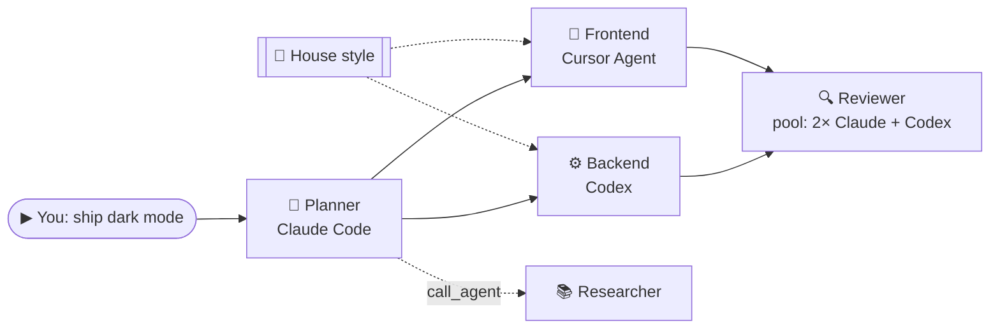

- **Three kinds of nodes:** a **trigger** (your prompt), **agents** (any CLI, model and profile), and **instruction blocks** (shared text wired into the agents that need it, like a house style guide).
- **Agents talk to each other.** An agent can `call_agent` a teammate it is wired to, `message_agent` it mid-task, `await_agent` its answer, `answer_agent` its questions, or `cancel_agent` it when plans change.
- **Team notes:** every agent in a run can write to and read from one shared notebook.
- **Pull request outcomes.** An agent records where each pull request stands: draft or ready, review rounds, and whether you accepted it. Geniro counts the questions it asked you. Each record shows in the chat, and the side panel lists a pull request's whole history under it: how many times it was sent back and how long it took to be accepted.
- **Analyze & improve.** An analysis reads the workflow's latest runs and its whole history: every version with what its runs cost and took, how often its pull requests were sent back and how many questions they asked you, every change made to it with who made it and why, and what earlier analyses recommended and whether you applied, skipped or passed over each item. It compares runs within a version, says whether each earlier change helped, and proposes undoing one that made the runs worse. Its card opens with what Geniro measured over those runs: time and cost per run, failed turns, each agent's share of the working time with its model and cost, and folds for every model, run and call between agents. It then says what costs the most and why, beside the measured figures of the agent at fault, and projects the time and cost per run with the items you tick. It does not suggest again what you passed over unless newer runs give new evidence. Nothing changes until you tick the items and press **Apply selected**.
- **Build it by talking.** A chat dock in the builder edits the workflow from plain-language requests. It also reads the workflow's latest runs, so you can ask it what to change ("which stages should we add?"): it answers with the same report and recommendations card as **Analyze & improve**, and each workflow change you apply comes back as a card showing the exact diff. A chat agent can also propose a whole workflow as a card for you to approve.

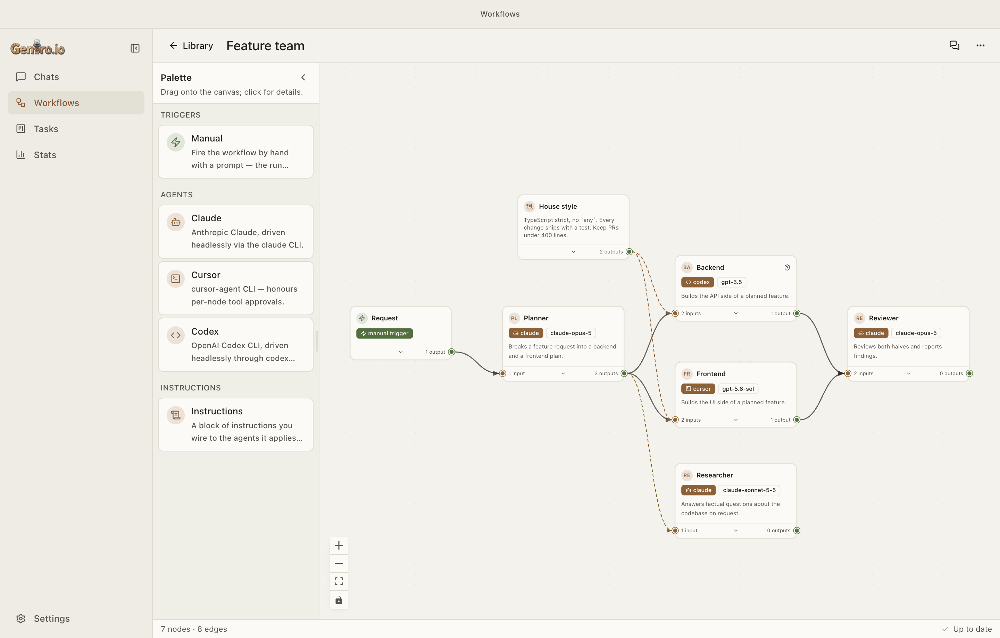

### 🏊 Agent pools

Rate limits are the worst part of a long run. In an agent node's settings, add an **agent pool** with up to 8 members. Each member can have its own CLI, account profile, model, approval mode and MCP settings. A reviewer could use two Claude accounts and one Codex setup, for example.

- Work goes to the first member, in pool order, that is available.
- When a member hits a usage limit or its sign-in expires, Geniro hands the work to the next one. It remembers until when that account is spent, across every workflow run, for calls, workflow steps and direct messages alike.
- Once the limit resets, the next turn or call goes back to the first member and carries the recent conversation over.
- Continuing a call keeps it on the member that handled it.

## 📋 Task board

A project board for agents. Write a card and hit start, or let **autopilot** pick up cards by itself.

- **Each card gets its own git worktree** and branch (`geniro/task-<id>`), so agents never step on each other or on you.
- A card runs a single chat or a whole workflow. Agents write a report onto the card and attach the pull requests they open.
- **Autopilot** starts cards from your intake columns, as many at once as you allow.
- When a card's pull request is merged, the card moves itself to Done.
- Agents can manage the board themselves through Geniro's board tools: list, read, create and update tasks.

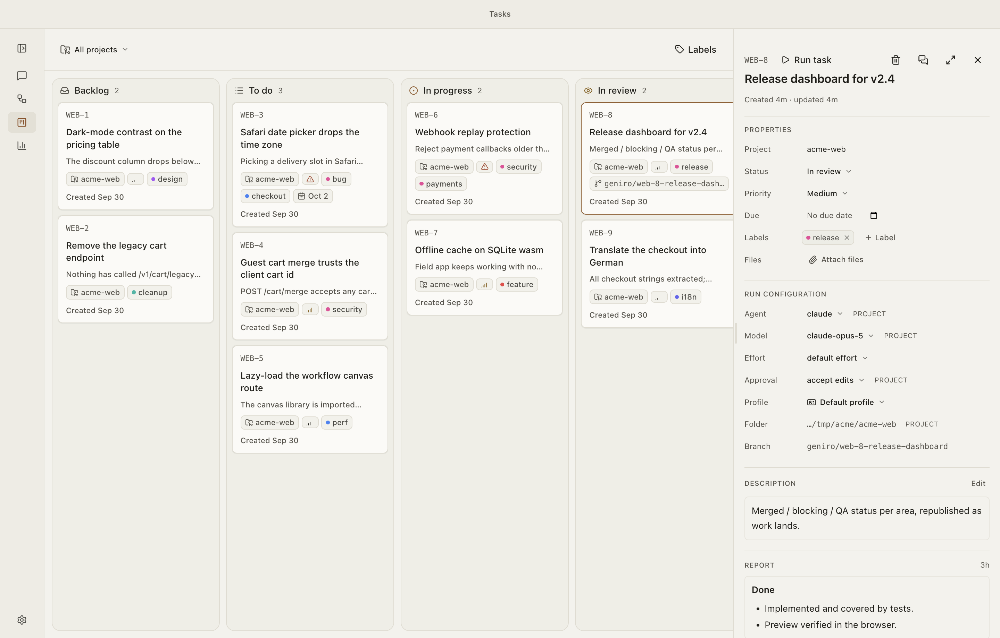

## 🎨 Artifacts and sharing

Sometimes the right answer is a page, not a paragraph. Agents call `show_artifact` to publish an interactive HTML page: a dashboard, a report or a little tool. It opens beside the chat, goes full screen, and can be saved as a file.

- **Sandboxed.** The page runs in a locked-down frame. It can show local pictures and load libraries from a short list of public CDNs, and that's it.
- **Encrypted sharing.** Press share on the page and Geniro encrypts it (AES-256-GCM) and uploads it to a place *you* configured: Google Cloud Storage through `gcloud`, S3 through `aws`, or your own command. The key travels only in the link's `#fragment`, which browsers never send to a server.
- **You stay in control.** Revoke a link, revoke them all, or have links expire after a set number of days. Agents may share pages too, but only if you turn that on (it is off by default).

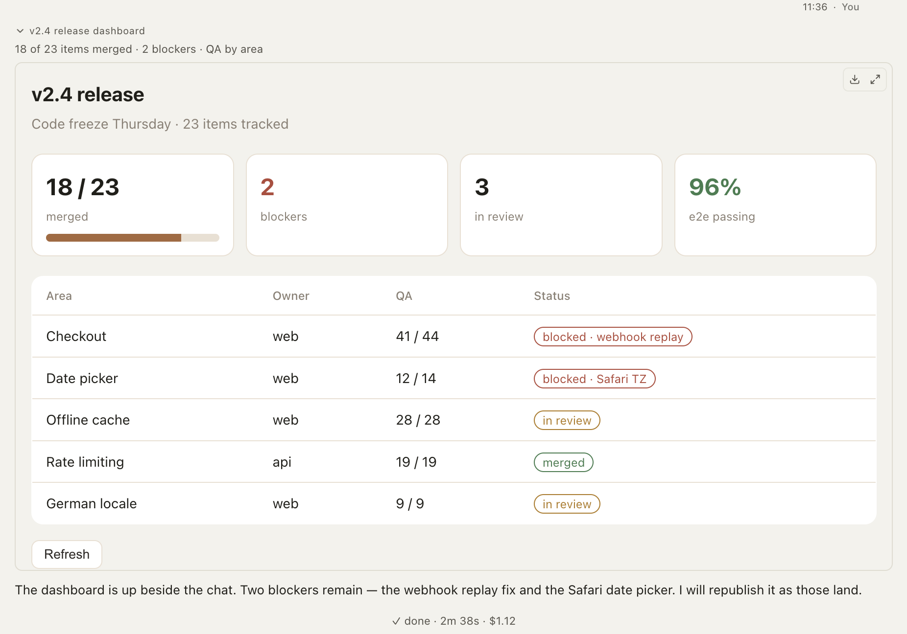

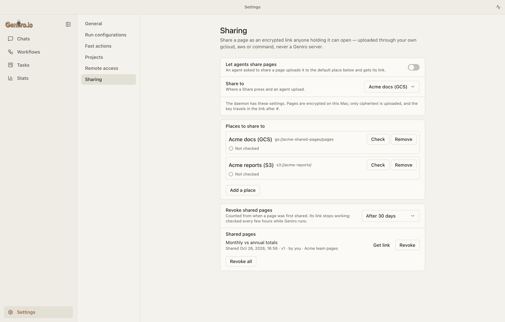

## 🃏 Rich cards

Geniro gives every agent a set of MCP tools for showing results instead of describing them:

| Card | What the agent shows you |
| --- | --- |
| 📈 **Chart** | Its own measurements, plotted |
| ⚖️ **Comparison** | Options scored against criteria, with a recommendation |
| 🔢 **Scorecard** | The headline figures, each with its delta |
| 🖼 **Gallery** | Screenshots and images in a grid, with full-screen zoom |
| 🐞 **Findings** | A code review grouped by file, each finding with a verdict |
| 🩹 **Patch** | A one-file diff you **Approve** or **Deny** |
| 🗺 **Plan** | A plan you approve before any work starts |
| ❓ **Question** | Multiple-choice questions you answer with a click |
| 🔘 **Buttons** | "Press when the PR is merged" or "Stop the preview server" |
| 👀 **Monitor** | A background command (a CI run, a long build, a log) that wakes the agent with what it prints |
| 🔔 **Notify** | A macOS notification when something needs you |

Agents can also search your past chats and read the conversation around any hit.

<table>
<tr>
<td width="33%">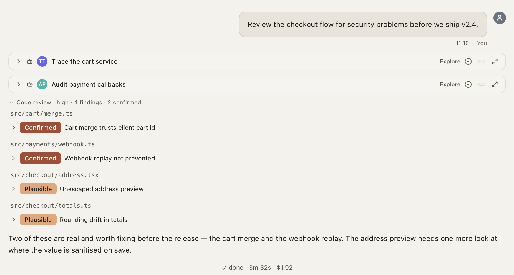</td>
<td width="33%">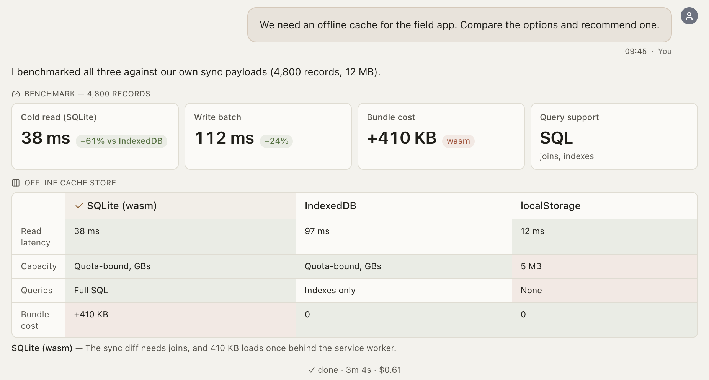</td>
<td width="34%">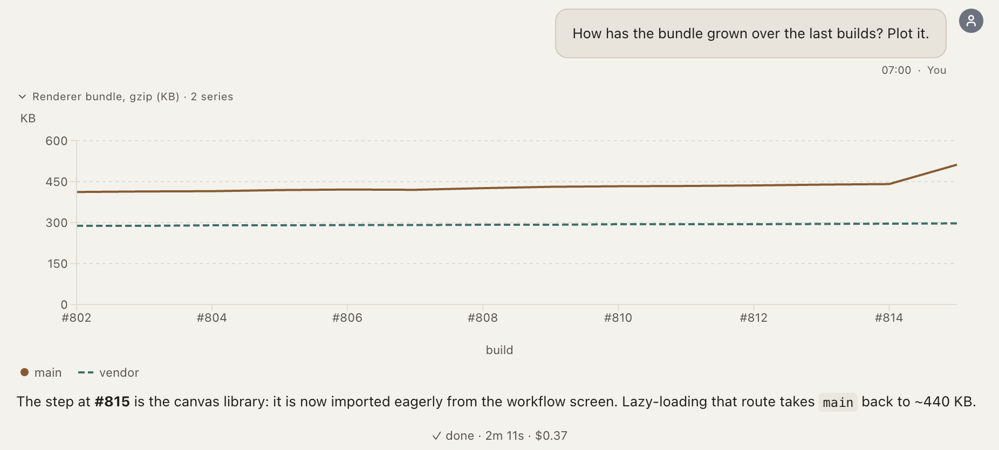</td>
</tr>
<tr>
<td align="center"><b>Findings</b></td>
<td align="center"><b>Scorecard + comparison</b></td>
<td align="center"><b>Charts</b></td>
</tr>
</table>

## 🔬 Thread analyzer

Finished a long run and wondering why it took 40 minutes? Press **Analyze thread**.

1. Pick the agent, account, model and effort that should do the analysis.
2. It reads a snapshot of the thread: timings, slow or failed tools, the critical path and every row.
3. You get a **recommendations card** that explains itself: what cost the most time and money and why, then each fix with its evidence, the minutes and dollars it should save per run and what the next run looks like with it, tagged by where the fix belongs: your workflow, your repo, your own instruction files, or the shared memory.
4. Tick what you want: the card projects the time and cost per run with exactly those fixes. Press **Apply selected**. Workflow edits are saved only if the file has not changed in the meantime, and a backup is written first.

The analysis lives in a popup over the thread it analyzed, so you can come back to it, ask follow-up questions, or start a fresh one.

On a workflow, **Analyze & improve** reads its latest runs together. The card opens with what Geniro measured over them: time and cost per run, failed turns, and each agent's share of the working time with its model and cost per run. Then it names what costs the most and why, next to the measured figures of the agent at fault.


Each fix shows the time and money it should save per run, or add, and what the next runs look like with it. Ticking fixes projects the time and cost per run with exactly those.


## 🧠 Shared memory

Every agent shares one memory, whatever its CLI. An agent searches it, reads an entry, saves a fact it learned, or forgets one that turned out wrong, all through Geniro's own tools. Once you import what the CLIs already remember, each CLI's own memory is switched off in new chats, so nothing is remembered twice. You can switch the CLIs' own memory back on in Settings → Memory.

- **Settings → Memory** lists every entry with who wrote it, when, and for which project, or Global. You can search, filter, add, edit, forget, restore and **Forget all**. Forgotten entries can always be restored.
- **Review.** Set agent notes to **Wait for my review**, and an agent's new note waits at the top of the pane until you approve it. Only the notes you wrote, imported or approved go into the short title index every new chat starts with. Agents reach the rest by searching. A forgotten note comes back in the state it had.
- **Import.** Bring over what each CLI already remembers. Claude's notes come from every profile you use, Codex's from its memories handbook. Notes are grouped by the folder they were written for and the profile they came from, with search, filters and pages. You see each note first, tick the ones you want, and choose its type and project. Notes that look like an entry you already have start unticked. **Sort with AI** has Claude or Codex read the ticked notes and untick task status, session logs and one-off details, giving a one-line reason for each. You pick the model, effort, context window, model options and profile it runs with, the same picker a chat has, and the last choice is remembered. It runs on that agent's account, and you still review every note before anything is imported. The CLIs' files are only read.
- **Export** writes every active and waiting entry to one Markdown file.
- In a chat, a memory tool call is one short line, such as "Saved memory · Use pnpm m12". Hover or click it to see every entry it searched, read, saved or forgot, in full and scrollable, without leaving the chat; each entry can still be opened in Settings from there.
- The thread analyzer can recommend memory changes too, and applying one saves or forgets the entry.

The memory works from your phone as well: you can read, edit, forget and approve there. Import and export happen on the Mac.

## 📊 Stats, cost and CPU & RAM

**Stats page.** Pick a period: today, 7, 30 or 90 days, or all time. See spend, cost per turn, turns, agent time, threads, pull requests, lines changed, tokens in and out, cache reads and writes, and cache hit rate. Break it all down by agent, model, project and thread. Prices come from the public [models.dev](https://models.dev) catalog. A model without a price shows a dash, never a made-up `$0`. The usage ledger survives deleted chats.

**Where the run went.** An interactive waterfall of every agent's turns on one clock, with the critical path, zoom, cost tables and "open in chat" on any span.

**CPU & RAM.** A meter in the title bar splits the app's memory or CPU across your threads, Geniro itself, and anything a deleted thread left running. Open a thread to see every process each agent started, with its CPU and memory, and **Stop** or **Stop all** the strays. Readings are taken only while you are looking.

**Context and limits.** A context ring shows how full each agent's window is, auto-compaction kicks in at a percentage you choose, and plan limits sit one click away.

<table>
<tr>
<td width="50%">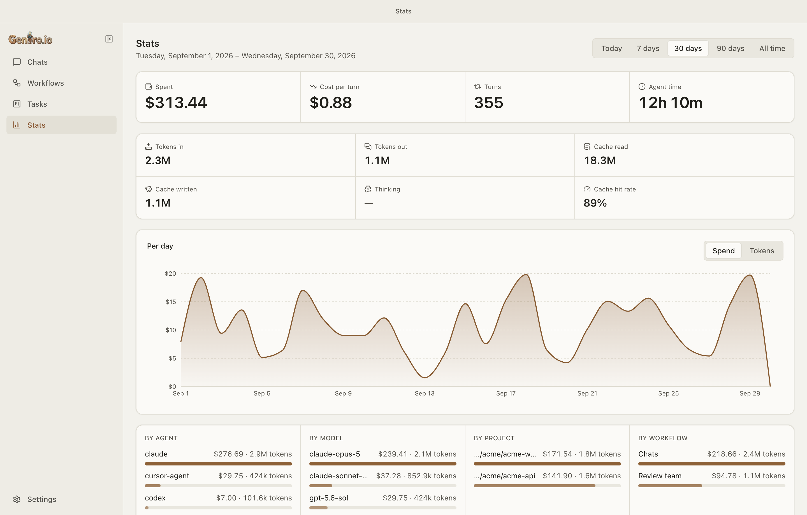</td>
<td width="50%">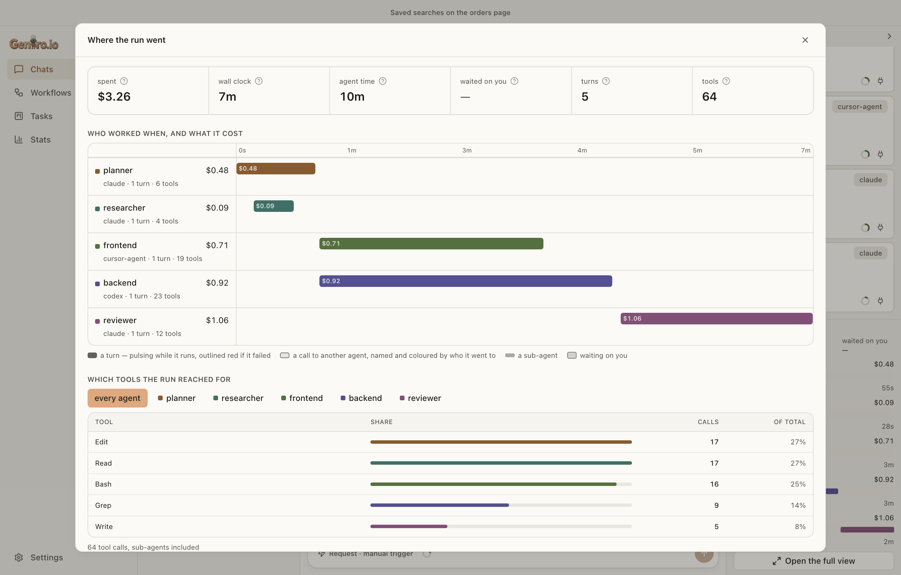</td>
</tr>
</table>

<table>
<tr>
<td width="38%" valign="top">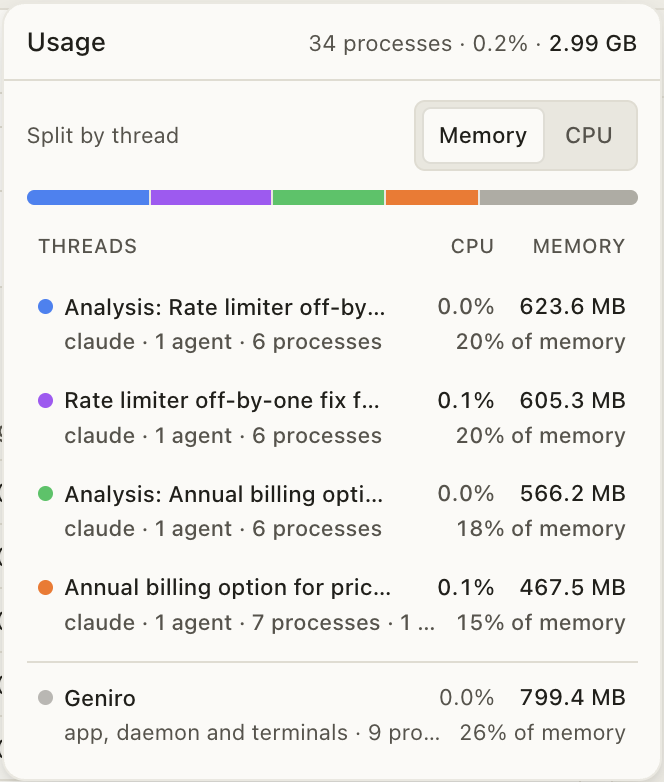</td>
<td width="62%" valign="top">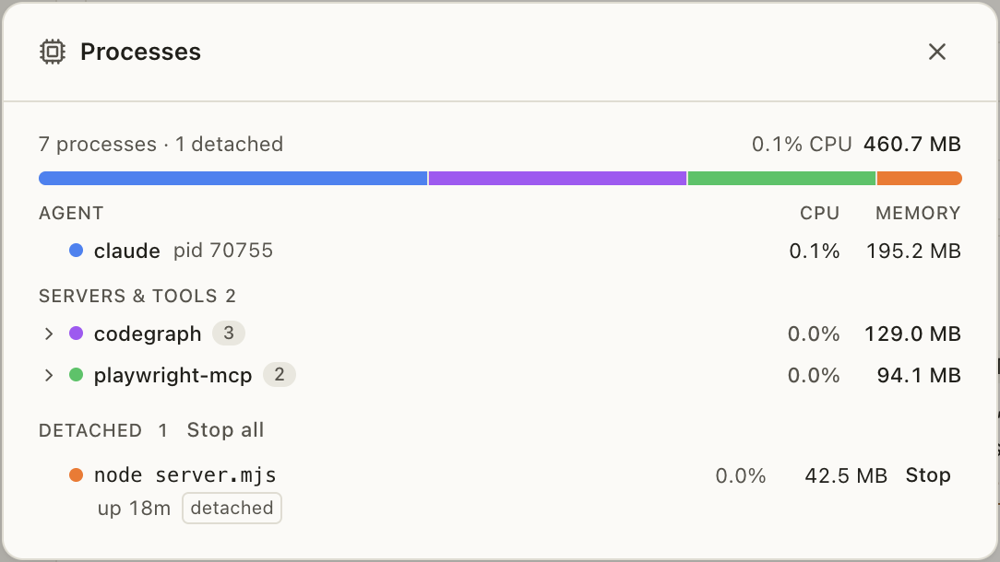</td>
</tr>
<tr>
<td align="center"><b>Usage, split by thread</b></td>
<td align="center"><b>One thread's processes</b></td>
</tr>
</table>

## ⚡ Fast actions, run configurations and tidy threads

- **Fast actions:** your own buttons under the message box, each one a name and a snippet. A press drops the snippet into the message box. It sends nothing, so you can still edit.
- **Run configurations:** save a new-chat setup (folder, branch, agent or workflow, model, effort, context window, approval mode and profile) under a name, and apply it by hovering the **New chat** button.
- **Folders and branches:** each chat runs in its own folder, with your recent folders one click away. Switch the branch right from the composer.
- **Colours and groups:** give a thread one of 8 colours. File threads into colour-coded groups that you can collapse and drag into order. A group can automatically collect every new chat from a folder, or every run of a workflow.
- **Notes:** keep private notes on any thread. They are never sent to the agent.
- **What's waiting on you:** Geniro knows which threads need you (an open question, a failed turn, an unread reply), and <kbd>⌘</kbd> <kbd>J</kbd> jumps to the next one.
- **And the small stuff:** a message queue you can drag to reorder (or **Send now**), pull-request chips, a "what changed" diff view, macOS notifications, light and dark themes, archive with optional auto-cleanup, and a debug log on <kbd>⌥</kbd> <kbd>⌘</kbd> <kbd>L</kbd>.

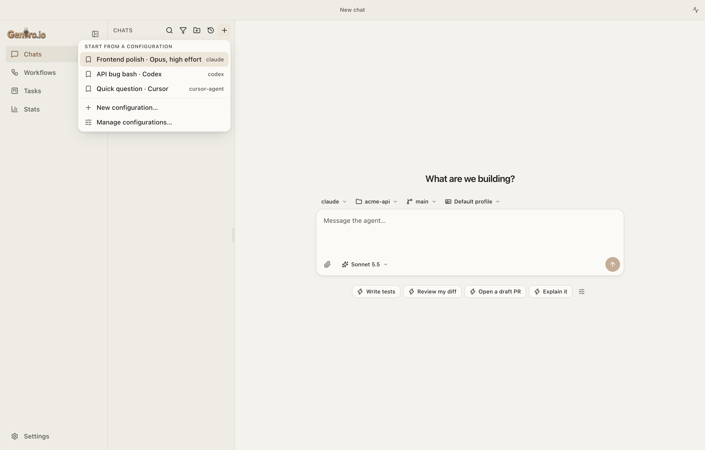

## 🦙 Local models

Start [Ollama](https://ollama.com) on your Mac and download a model that supports tool calling. Then pick it under **Ollama · local models** in the Claude Code or Codex model picker. Geniro discovers local models on its own and tells you when a model or CLI cannot be used. Inference stays on your machine and works offline.

## 📱 Your phone

In **Settings → Remote access**, scan the QR code and enter the pairing code shown on your Mac. Your phone opens the same live chats, workflows and board over your Wi-Fi. For access away from home, **Get an address** starts the `cloudflared` or `ngrok` you already have installed and opens a tunnel from the Mac.

<table>
<tr>
<td width="33%">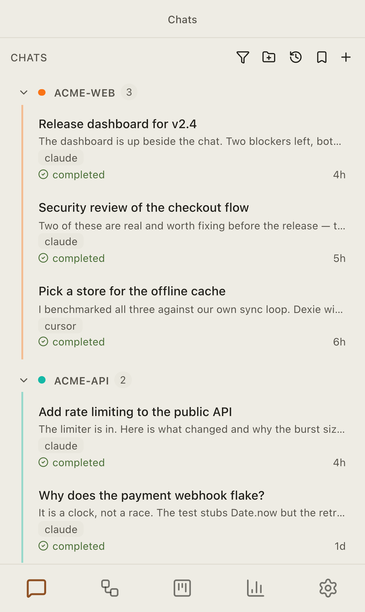</td>
<td width="33%">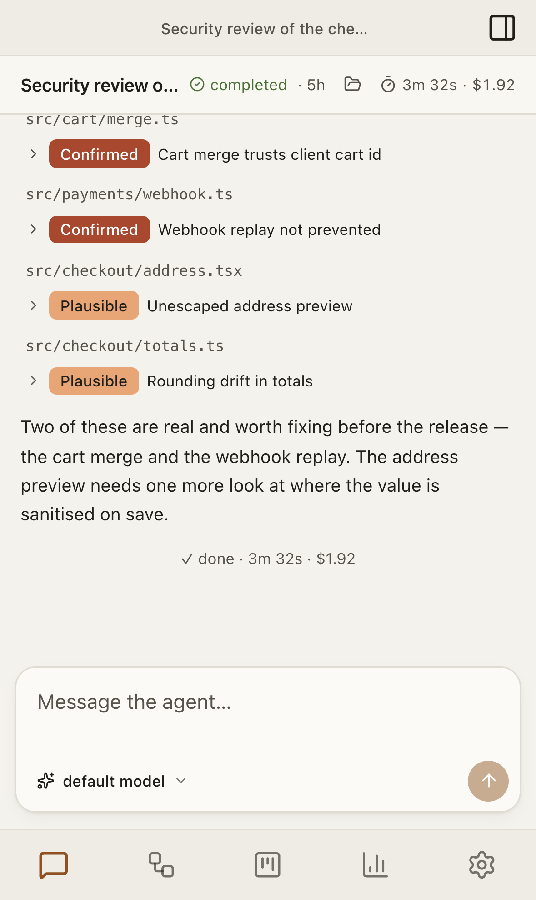</td>
<td width="34%">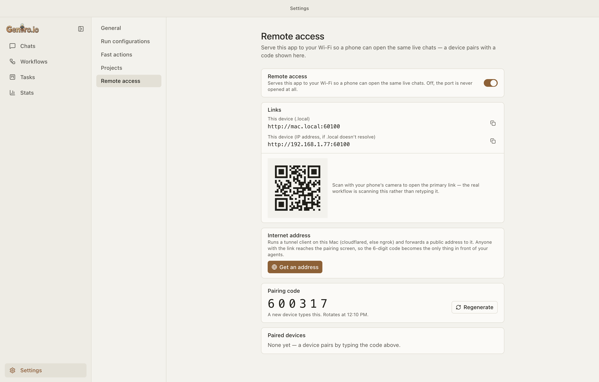</td>
</tr>
</table>

## 🔒 Local-first, for real

Geniro has **no cloud backend, no account and no telemetry**. Chats, workflows and task history live on your Mac. Your agents keep their own logins and talk to their own model providers.

- The daemon listens on loopback only, with a fresh credential every launch.
- Remote access goes through a separate gateway and only works for devices you have paired.
- Secrets live in the macOS Keychain, never in a database or a file.
- Agent-built pages run in a sandbox.
- Geniro's own network calls are few: app updates and the public model price list. CLI installs, the optional Cursor spend lookup, tunnels and sharing happen only when you set them up or press for them.

## 📸 Gallery

<details>
<summary><b>More screenshots:</b> a full workflow run, Settings and the dark theme</summary>

<br>

All screenshots use synthetic data from a fictional `acme-web` / `acme-api` project.

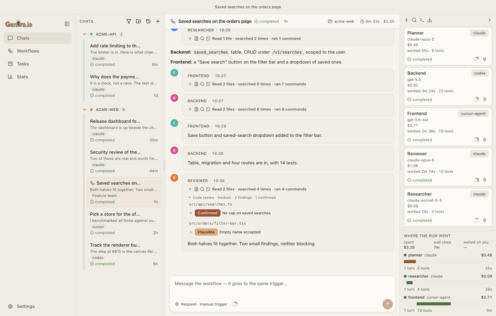

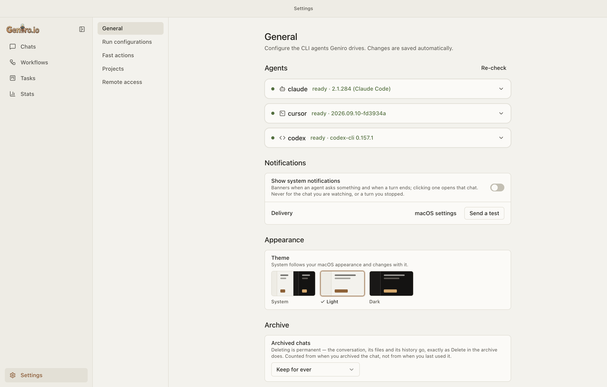

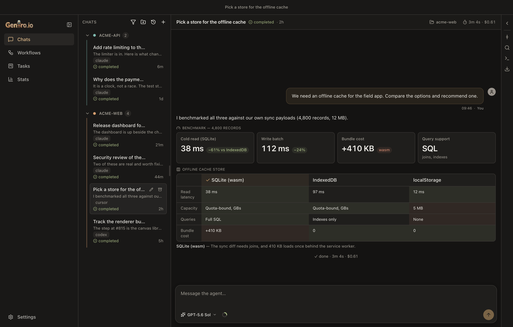

</details>

## 🔨 Development

<p>
  
  
  
  
  
  
</p>

An Electron app (`apps/ui`) supervises a NestJS daemon (`apps/daemon`) that listens on loopback and drives the agent CLIs. The [development guide](docs/development.md) covers source setup, commands, architecture and releases, including the required native rebuild and `pnpm full-check`.

```sh
pnpm install && pnpm rebuild:native && pnpm dev
```

Contributions are welcome! Read [CONTRIBUTING.md](CONTRIBUTING.md) and our [Code of Conduct](CODE_OF_CONDUCT.md), and use the issue forms for [bugs](https://github.com/geniro-io/geniro-app/issues/new?template=bug_report.yml) and [ideas](https://github.com/geniro-io/geniro-app/issues/new?template=feature_request.yml).

## 📜 License

[Apache License 2.0](LICENSE). See also [NOTICE](NOTICE) for attribution.

<div align="center">
<br>

<br>
<sub>Made with ☕ and a lot of agents, on a Mac.</sub>
</div>
