<div align="center">


### Your coding agents, working as a team — right on your Mac.

Chat with one agent, put a whole crew together as a team, or hand them a board<br>
of tasks and go make coffee. ☕ **Claude Code**, **Cursor Agent** and **Codex**, driven<br>
through their own CLIs and your own logins. No cloud, no account, no telemetry.

<p>
  <a href="https://github.com/geniro-io/geniro-app/releases/latest"></a>
  <a href="https://github.com/geniro-io/geniro-app/actions/workflows/ci.yaml"></a>
  <a href="LICENSE"></a>
  <a href="#-install"></a>
</p>
<p>
  
  
  
  
  
  
</p>

**[Install](#-install)** ·
**[Features](#-whats-inside)** ·
**[Teams](#-teams)** ·
**[Task board](#-task-board)** ·
**[Artifacts](#-artifacts-and-sharing)** ·
**[Stats](#-stats-cost-and-cpu--ram)** ·
**[Phone](#-your-phone)** ·
**[Privacy](#-local-first-for-real)** ·
**[Gallery](#-gallery)** ·
**[Contribute](#-development)**

<br>

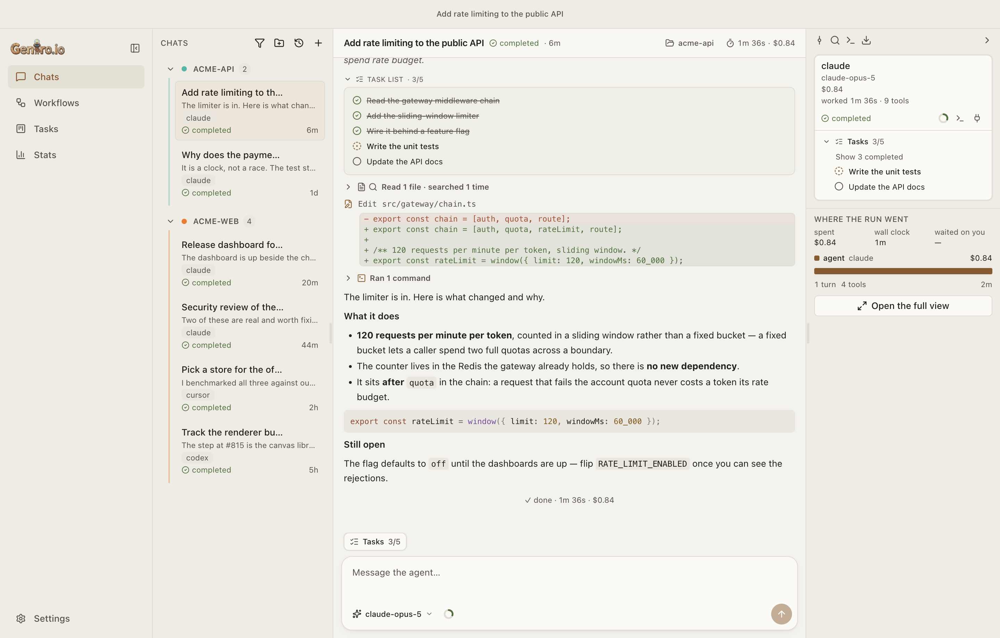

</div>

<br>

## 🤔 Wait, what is this?

You already pay for Claude Code, Cursor or Codex. They are brilliant, and each one lives in its own terminal tab.

**Geniro is the desk they share.** One native window where you can:

- 💬 **chat** with any of them, each in its own folder and branch;
- 🧩 **wire them into a team** — a planner hands work to a backend agent and a frontend agent, and a reviewer checks both;
- 📋 **run a task board** where every card gets its own git worktree and an agent works through the queue;
- 📊 **see what it all costs**: money, tokens, time, CPU and RAM.

What does Geniro charge? **Nothing.** It is open source (Apache 2.0), has no server, and never asks you to sign up. Your agents keep using the subscriptions and logins they already have.

## 🚀 Install

**macOS · Apple Silicon.** With Homebrew:

```sh
brew tap geniro-io/tap
brew trust geniro-io/tap # required for third-party taps on Homebrew 6+
brew install --cask geniro
```

Or download and run the install script:

```sh
curl -fsSL https://raw.githubusercontent.com/geniro-io/geniro-app/main/scripts/install.sh -o /tmp/geniro-install.sh
bash /tmp/geniro-install.sh
```

> [!NOTE]
> The app is signed but not notarized. Both methods above handle macOS quarantine, so install with one of them. Updates install from inside the app. If an update cannot replace your copy, run `brew upgrade --cask geniro` or the script again.

**First run:** open Geniro, install or pick an agent CLI, sign in, and choose your project folder. A missing CLI installs with one press, from onboarding or from Settings. No terminal needed.

## ✨ What's inside

<table>
<tr>
<td width="33%" valign="top">

<b>💬 Chats</b><br>
Pick the agent, model, effort, context window, Fast mode (where the CLI offers it for that model), Claude Code's experimental Code mode (one script that calls many tools; set per chat, team member, project, task or run configuration, and kept for the life of each conversation) and approval mode. Watch the reply and the agent's thinking stream in as they are written. Queue follow-ups, import sessions from the CLIs, search every chat, and export to Markdown.

</td>
<td width="33%" valign="top">

<b>🧩 Teams</b><br>
Give each member a face, a role and its own instructions. A lead takes your message; any member can call, message, question and cancel any other.

</td>
<td width="33%" valign="top">

<b>🏊 Agent pools</b><br>
Give one agent up to 8 setups: other accounts, models or CLIs. When one hits its usage limit, the next one takes over.

</td>
</tr>
<tr>
<td valign="top">

<b>📋 Task board</b><br>
Each card gets its own worktree and branch, and runs a chat or a team. Autopilot works the queue, and a merged PR closes the card. Each project has its own page, with standing instructions every agent run in it receives.

</td>
<td valign="top">

<b>🎨 Artifacts</b><br>
Agents publish live HTML pages that open next to the chat, with audio, video, folder buttons, and answers the agent can read back. Share one as an encrypted link to a bucket you own.

</td>
<td valign="top">

<b>🃏 Rich cards</b><br>
Charts, comparisons, scorecards, image galleries, plans, questions, buttons and A2UI cards you fill in, instead of a wall of text.

</td>
</tr>
<tr>
<td valign="top">

<b>🔬 Thread analyzer</b><br>
An agent studies a finished run, or a team's runs over a period you pick, shows where the time and money went and why, and proposes fixes with what each should save — including to the project's instructions. Tick the ones you like and press **Apply selected**. A **system analysis** in Settings reads every troubled thread of a period, Geniro's own analyses included, and files what Geniro itself should fix as cards on your board.

</td>
<td valign="top">

<b>📊 Stats</b><br>
Spend, tokens, cache hits, agent time, lines changed and pull requests, broken down by agent, model, project and thread.

</td>
<td valign="top">

<b>🧮 CPU & RAM</b><br>
See which thread is chewing through your Mac, down to each agent's processes, stop the leftovers, and get warned before a runaway command or a full disk takes the Mac down.

</td>
</tr>
<tr>
<td valign="top">

<b>⚡ Fast actions & run configs</b><br>
Your own prompt buttons under the message box, and saved new-chat setups you apply in one click.

</td>
<td valign="top">

<b>🗂 Folders, colours & groups</b><br>
Every chat runs in a folder and branch you pick. Colour your threads, file them into groups and keep notes on them.

</td>
<td valign="top">

<b>🦙 Local models</b><br>
Run tool-capable Ollama models through Claude Code or Codex, offline if you want to.

</td>
</tr>
<tr>
<td valign="top">

<b>🔌 Accounts & MCP</b><br>
Named profiles for several accounts on one CLI. Add, edit and toggle MCP servers. Use skills and slash commands right in the composer.

</td>
<td valign="top">

<b>📱 Phone</b><br>
Pair your phone on Wi-Fi and follow or steer live sessions from the couch, or from anywhere through your own tunnel.

</td>
<td valign="top">

<b>⌨️ Terminal</b><br>
In-app terminal tabs. Or reopen a conversation in your own terminal with its model, profile and session.

</td>
</tr>
<tr>
<td valign="top">

<b>🆕 What's new</b><br>
After an update, Geniro opens a page over nearly the whole window with the versions you moved between and every change since the one you last saw, as one list, each new feature with a short description. The full changelog, with search and a jump to any version, is in Settings → What's new, and works offline.

</td>
<td valign="top">

<b>🔍 Review changes</b><br>
Press a thread's changes chip to read everything it changed as a GitHub-style diff with line numbers and highlighting. Tick files Viewed, comment on a line, a range or a whole file right in the diff, and send the comments to the agent as one review; it answers under each one. Comments stay in Geniro, never in git.

</td>
</tr>
</table>

## 🤖 Bring your own agents

Geniro drives each agent headlessly through its own CLI. No SDKs and no API keys of Geniro's own: if the CLI works on your Mac, it works in Geniro.

| Agent | How Geniro talks to it | Good to know |
| --- | --- | --- |
|  | `claude -p`, streaming JSON | Runs Ollama models too |
|  | `cursor-agent acp` (Agent Client Protocol) | Account spend shown from your own login, for every config profile's own account, down to each call of a team member |
|  | `codex app-server` (JSON-RPC) | Runs Ollama models too |

- **Install, sign in and update from the app.** Geniro runs each vendor's official installer when you press the button, and signs you in without opening a terminal. When a CLI says a newer version exists, its card shows **Update available** in its own colour, and the Settings icon and the **General** section count the CLIs waiting. **Update** runs the CLI's own updater and stays busy until the new version answers, even if you leave Settings meanwhile. When an account is signed out, a CLI or a named configuration, the Settings icon shows an amber warning, the **General** section counts the accounts that need signing in, and the card and the configuration's row say **Not signed in**.
- **Several accounts per CLI.** Config profiles give each account a name and a colour. Pick one per chat, or per member in a team. **Sign in to a new configuration** names one, makes its folder in Geniro's data folder and signs you in there straight away; tick the MCP servers your other configurations of that CLI define to copy them in. **Add existing folder** still points at a config folder you already have.
- **MCP servers.** List, add, edit as JSON (**Edit JSON** beside **Add**, to change or remove any server) and toggle the servers each CLI knows (Codex's built-in ChatGPT Apps server, `codex_apps`, included), and switch them off for one team member.
- **Your instructions, everywhere.** Write custom instructions once, and choose a language every agent replies in.

## 🧩 Teams

A team is a set of **members**, each one agent with its own CLI, model and profile. Pick who handles your first message, press run, and that member leads: it calls the others as the work needs them. Teams are plain `*.team.yaml` files you can export, review and share.

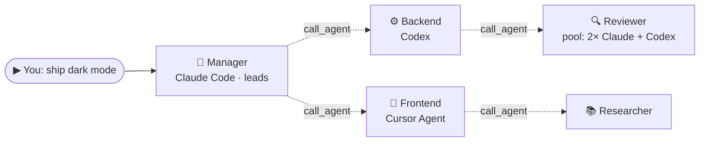

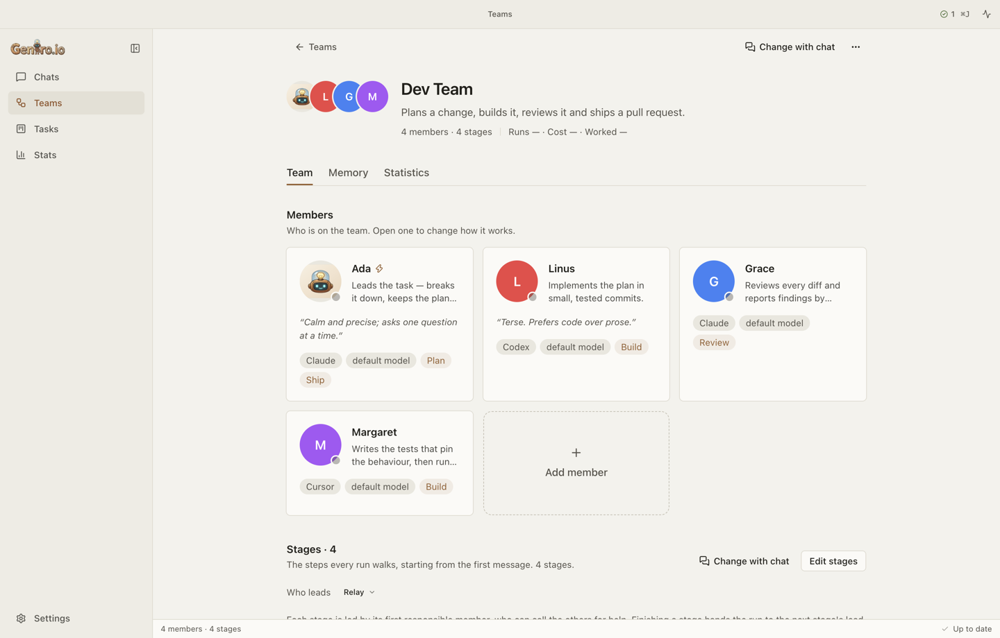

- **A page per team.** The library shows each team as a card with its members' faces. Open one for its page: the team's people, what it is for and what its runs have done, then three tabs — **Team** (members, stages, team instructions), **Memory** and **Statistics**. A long description folds to three lines. Each team instruction block shows roughly how many tokens it takes, and under the blocks every member's always-on instructions are totalled, member by member. **Fresh session** shows what a member's new CLI session already holds before any work, per project its runs worked in: the context it started at in the team's newest runs (approximate, read from each session's first turn), split into Geniro's instructions, the repository's instruction files (`CLAUDE.md`, what it imports, rules that always load) and what the CLI adds itself, with the MCP servers the CLI last reported and when. Plugins, skills and built-in tools, and every part a CLI does not report, are marked "not measured" rather than counted as zero. A team analysis reads the same figures.
- **Members as profiles.** Each member is a card with its face, role, character, CLI and model, and the stages it is responsible for; a dot on its face and a **!** in the corner say when it needs setting up. Click a card to open the member beside the page and change anything about it; another card switches it, and on a phone it opens as a page of its own.
- **Setup warnings.** Geniro checks every member: is its CLI installed and signed in, does its profile folder exist, are its model and reasoning effort offered, and are its MCP servers connected. A member with a problem gets an amber or red **!** on its card; hover it to see what is wrong, each problem with a button that fixes it: sign in, open the MCP server, choose another profile or model, or open Settings. The page lists the servers' state once per profile in the background, showing "checking…" until the answer lands; the library only shows the last known state (sign-in included), with how old the MCP reading is, as **⚠ N** on each card. A red problem (the CLI of the member a run starts with not installed, with no pool member to fall back to; a profile folder that is gone; no member taking your first message) stops a run from starting and says why; an amber one only informs, and a member further down the run whose CLI is missing is amber, since it fails only when the run reaches it.
- **Team memory.** A team keeps its own notes beside the global and project ones. Its runs read them, a member can save one for the team with `memory_save` (scope `team`), and the **Memory** tab lists, searches, adds, edits and forgets them. Settings → Memory files a note under a team too and filters by team. Deleting a team that keeps notes asks what happens to them: forget them (restorable), keep them for a later team of the same name, or move them to Global.
- **Team statistics.** The **Statistics** tab and the page's header figures count every run of the team, deleted runs included: runs, cost (with the part Geniro estimated), turns, agent time and pull-request outcomes, each with a daily line, and what each member cost and worked. It also shows the share of goals achieved, the stage hand-offs, a matrix of who called whom (with failed calls, the called agent's turns and cost), every tool and MCP server the agents called with its errors and time, and how each stage went: completions, skips, reopens and time. **How each member works** sets every member's latest marks from an analysis beside what it did: the calls it answered and how many failed, its tool errors, the goals it recorded and achieved, and how many completions of the stages it is responsible for were reopened. Every figure covers the team's whole history, not just what is on screen; runs from before these were measured read as a dash, not zero.
- **Each member's performance.** A member's panel opens with how it has worked for the team: its runs, turns, cost and time with their spread per run, every change made to it behind a **changes** button that opens each one with what its runs measured before and after — better, worse, mixed or too few runs to tell — and every analysis's marks of it (the newest in full, the earlier ones folded) — how useful its work was and how well it held up, 1 to 5 each (or "not judged" when the runs gave too little to go on), over which runs and versions, the verdict (keep, tune, reconfigure, replace or remove), why, who judged it, and whether the changes behind the verdict were applied. When most of a team runs on the same vendor's models as the agent you pick to analyse it, the dialog says so and offers another, since a judge tends to mark its own vendor's work high.
- **Faces.** Give a member your own picture (cropped to a square on your Mac and stored there), an emoji, or initials on a colour. The face follows the member into every chat it works in, so you can tell at a glance who said what.

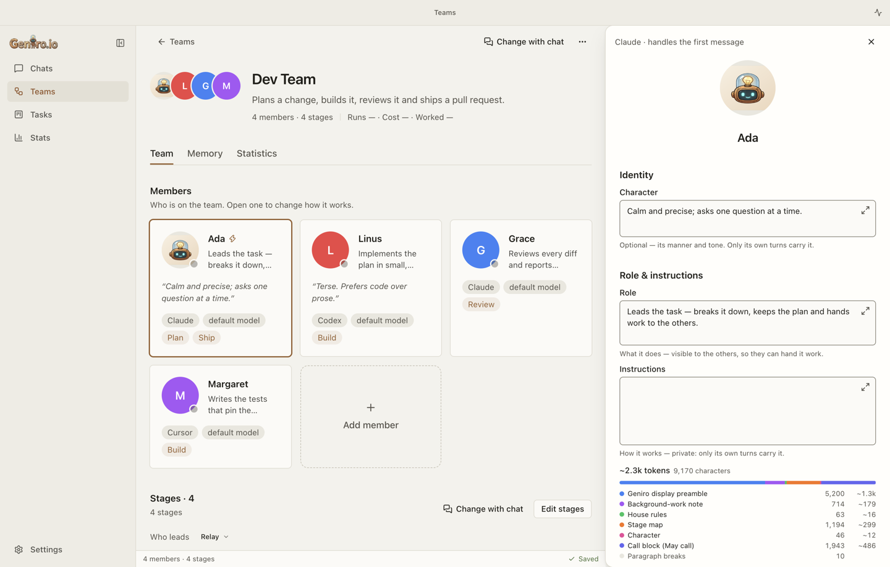

- **Members, not wires.** Each member has a **name**, a public **role** (what it does — every other member reads it to decide whom to call), private **instructions** (how it works — only its own turns see them) and an optional **character** (its manner and tone). Nothing is wired: any member may call any other.
- **One lead or a relay.** Each team picks how its stages run:
  - **One lead** (the default): the team's trigger is your first message, and you choose the member that handles it. That member runs the whole job; the others work when called.
  - **Relay**: each stage is led by its first responsible member, who owns that stage, calls any teammate for help and closes it with `move_stage` and a short summary. Geniro then hands the run to the next stage's lead with a brief: the stage and its goal, your original request, what each finished stage left behind and the unread team notes. A **Now leading** chip above the composer shows who your messages go to, and the transcript marks each hand-off ("Build handed to Ada").

  Either way, a member never calls one that is waiting on its own answer, so calls cannot loop back on themselves.
- **Instruction blocks** hold text several members need, like a house style guide, addressed to **everyone** or to the members you pick.
- **Stages** are the steps every run walks, each with how to work in it, its goal and the members responsible for it (the first one leads it). The page draws them left to right, starting from the card that says who takes your first message, with alternatives stacked side by side; click a stage to edit it.

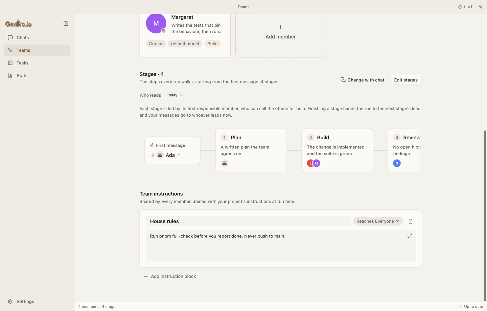
- **Agents talk to each other.** A member can `call_agent` a teammate, `message_agent` it mid-task, `await_agent` its answer, `answer_agent` its questions, or `cancel_agent` it when plans change. Every member can ask, whatever its CLI: a Cursor or Codex member puts up the same question card a Claude one does, its own to you and a called member's to the agent that called it. Each call's card, and each of an agent's conversations in the side panel, shows how long the called agent has been on it, ticking while the call is open, beside its context and cost: its waits on its own monitors and calls count, its waits on you do not. When the agent has ended its turn and the call waits on its monitor or its own calls, the card says `waiting`, and once it wakes the card says what it is doing rather than what it said before. A call an agent makes while answering one is drawn inside that call's card, as a sub-agent is inside a chat, rather than in the thread's own flow. An analysis reads how long each callee worked inside its calls by its CLI's own clock, so it can tell a callee that worked from one that waited. While an agent sits waiting on a call, its working line in the chat names whom it waits for — `Waiting for Tony Stark · call-3` — instead of a rotating word.
- **Call a teammate into one project.** Start a team in a folder that holds several projects, and an agent can `call_agent` a teammate with a `folder` — a subfolder of the chat's folder — so the teammate works there, with that project's own instructions and repository. A conversation stays in the folder it started in; a path outside the chat's folder, or one that does not exist, is refused. The call's card names the subfolder.
- **Updates and restarts don't stop the work.** When the app updates itself or its daemon is restarted, a team run or chat that was working carries on by itself in the same agent sessions: each cut-off agent gets a short note to check what it already did and continue, a call that was in flight continues once under the same call number, and an agent whose monitors were stopped is told which ones, with their commands. The thread shows a grey "work continues" note instead of an error. After a crash or a quit nothing continues by itself.
- **Sub-agents show their work.** A sub-agent's card shows its model requests, messages, tokens processed and an estimated cost, live while it runs, and when you open it loads its own earlier steps.
- **Live as they write.** Every member's reply and thinking stream into its part of the thread, or into the card of the call it is answering, as they are written, as in a chat. Claude shows a summary of its thinking where its CLI can send one; Cursor and Codex stream their own.
- **See who's working.** A small square at the bottom right of a team's chat, just above the chips, shows the face of whoever is working now and how many more runs are out; its ring spins while someone works and a red dot marks a failure you haven't seen yet (the failed agent's face takes the square only once nobody is working); a run cut off by quitting Geniro or a restart reads as stopped, not failed, and raises no dot. Hover it, or click it to keep it open until you click elsewhere, for what's running now: every current run as a card of its own — three runs of one agent are three cards — with the agent's face, its state (`waiting for` the teammate it called, while it holds for that call), who asked, how long they've run and their last three messages, each held to ten lines with **Show more**, beside its name the same terminal, monitor, sub-agent and task counters as the chips row, counting only that run's own (click one for its list), and below them a fold of the runs that have finished. Click any run to open its whole conversation in a popup — with its time, context, cost and tool count, a **Message** box for an agent still working, and **Show in chat** to open its card in the thread. Its bottom bar also carries that run's own terminals, monitors, sub-agents, tasks, team notes and live buttons, above the time and cost line, which act and open there as they do in the chat.
- **Team notes:** every agent in a run can write to and read from one shared notebook.
- **A waiting lead stays cheap to wake.** While a Claude Code lead waits on a teammate's call or on a monitor, Geniro sends a small side request just before its prompt cache would expire (an hour, or five minutes on extra usage), so the reply that wakes it reads its context from the cache instead of paying for all of it again. Each one costs about a thirtieth of a cold wake; it counts in the run's cost and in Stats, adds nothing to the transcript, stops as soon as the lead works again or nothing is owed to it, and gives up after 10 in a row. A lead waiting only for you is not kept warm.
- **Stages can require goals.** Switch on **Require the run's goals** on a stage, and an agent cannot finish it until the run has recorded its goals. The brief a new stage lead gets lists the goals still open.
- **Pull request outcomes.** An agent records where each pull request stands: draft or ready, review rounds, and whether you accepted it. Geniro counts the questions it asked you. Each record shows in the chat, and the side panel lists a pull request's whole history under it: how many times it was sent back and how long it took to be accepted.
- **Analyze & improve.** An analysis reads the team's runs started in the period you pick (the last day to the last 90 days, the last 7 days by default, at most its 30 newest), archived ones included, and its whole history: every version with what its runs cost and took, how often its pull requests were sent back and how many questions they asked you, every change made to it with who made it and why, and what earlier analyses recommended and whether you applied, skipped or passed over each item. It compares runs within a version, says whether each earlier change helped, and proposes undoing one that made the runs worse. Its card opens with how many runs it read of how many the team has, with the average over all of them, then what Geniro measured over the runs it read: time and cost per run, failed turns, each agent's share of the working time with its model and cost, and folds for every model, run and call between agents, with how much of each call's time the called agent spent working. It then says what costs the most and why, beside the measured figures of the agent at fault, and projects the time and cost per run with the items you tick. It also marks every member: how useful its work was and how well it held up, each 1 to 5 with the rows behind it, and a verdict — keep it, tune its instructions, reconfigure its model or effort, replace it or remove it — whose changes are items on the same card, in the team, or in a project's overrides or instructions when that is where the change belongs, so you apply a verdict like any other fix. A fix that belongs in another repository, such as a plugin the team uses, is an item too: applying it files a card on your board for a separate run there, and the analysis itself never touches that repository. The marks are kept after the analysis is gone, and the next analysis checks whether a member's marks rose after the changes made to it. Everything it proposes is an item on the card, never only words in its reply: each weak grade it gives an agent's instructions comes with the item that fixes it, and a fix only Geniro itself or another tool could make is filed as a card on your board. It brings back something you passed over only when it would still help a lot, saying when you passed it over and why it asks again. It also reads how each pull request the runs recorded moved on GitHub after the team said it was done — the pushes, the review threads bots and people opened, the checks that failed, what CI skipped while it was a draft — through your own `gh` login, asks who should have caught each of them earlier, and its card shows the average threads, pushes and failed checks after done per team version, so you can judge an instruction change by them. Nothing changes until you tick the items and press **Apply selected**.
- **Build it by talking.** A chat dock under the team's page edits the team from plain-language requests; it is the same chat you use everywhere else, queue and chips included. It also reads the team's latest runs, so you can ask it what to change ("which stages should we add?"): it answers with the same report and recommendations card as **Analyze & improve**, and the team, overrides and project-instruction changes you apply come back as one card showing the exact diff, written by one **Approve**. Ask it to move rules that only one project needs out of the team, and one card shows both sides — what leaves the team and what joins that project's instructions — and one **Approve** writes both (the project's instructions are put back if the team cannot be saved); a change that would run past the project's instruction limit is caught before the card, never after you approve. It reads even a large team a part at a time and searches it for every place a subject lives, rather than loading the whole file. A chat agent can also propose a new team, or a change to one in the library, as a card for you to approve; a change goes on the card as only what it edits, with the exact diff, so even a large team is changed without being written out again.
- **A team on the fly.** Ask any ordinary chat to have a team do a job and its agent asks what it needs, then shows a card: a short plan, the chat itself as the manager, and up to 12 agents it wants to bring in, each with its role, its own task, CLI and model (new agents ask for permission the way the chat does). Press **Start** and that same chat becomes the team — your conversation stays, and a note typed on **Start** (say, "use Claude for everyone") is applied at once as one marked change. Ask it later to add, remove or change an agent and a card shows every change, each changed text before and after; **Apply** changes the running team: an added agent can be called at once, a changed one keeps its memory and follows the new instructions from its next call, a removed one finishes its current call and leaves. The lead of a library team's run can change that run the same way; the library file never changes. **Start** waits until the chat has no monitor, background command or sub-agent, queued message or other card open, and says which. Such a team is never saved to the library; the chat stays in the list with a "team · N agents" label, and every agent's spend counts in that chat.
- **Change anything from any chat.** A team's chat, a project's chat and an analysis hold the same tools as any other chat: from any of them you can change another team, change another project's instructions or overrides, propose a new team, bring rules over from one project to another, or look across them all. Moving shared text into a project's overrides or instructions goes on one card, written by one **Approve**. Nothing is written until you approve its card.
- **One team, many projects.** A team is the shared harness every project can run. A project whose **default team** it is can add its own **overrides** on top, without copying the team: a member's model, effort, profile, approval, whole agent pool or MCP switches (the servers it runs without) for that project, extra instructions for a member, and instruction blocks only that project's runs carry, addressed to the members you pick (text for every member belongs in the project's instructions). Stages and the team's own blocks stay the team's. You edit them on the project's page, in its **Team** section: the team's members as that project runs them, a member's shared texts read-only (their first lines, with **Open full text** in the same window the editors use), the MCP servers a member loads in that project (those of the profile and agent the project gives it, where you can sign a server in, add one or edit them as JSON in that profile, and switch servers off for the project's runs only), the project's own blocks with **Add block**, **Manage team** to open the team's own page, and every setting live: change one and it is overridden for this project, marked with the project's name and a reset back to the team's value; a member's agent pool is overridden whole by its first change, and **Restore team settings** in a member's sheet puts all of its settings, its pool and its MCP switches back to the team's at once. The team's own page holds no project settings; it only names the projects that use it (**Used by**), each opening that project's page. **Change with chat** in the project page's header opens the project's own chat, which proposes changes to the project's instructions and to its overrides, each on a card you approve (it can also set one default for every member of a CLI, say the work account's profile for every Claude member); it reads the whole team — its members' roles and instructions, its stages and blocks — to answer about it or to start a change from it, and can change it too when you ask, on a card you approve; a change to it reaches every project that uses it. Any other chat, and the lead of a team run, can change a project's overrides and the teams themselves when you ask, too: name the project, and it reads them and puts the change on the same card, written only when you approve. An analysis can recommend overrides too (`O-` items). Every run of the project's default team in that project uses them; the same team picked for a chat in another project, or in this project when it is not the default, runs the shared team. Runs in different projects still count as the same team version, so the team's statistics and versions stay one history.
- **Teams from before members** (graphs of nodes and wires) are converted when Geniro starts, with the original kept in `backups/`; older runs keep showing the team they ran.

### 🏊 Agent pools

Rate limits are the worst part of a long run. In a member's settings, add an **agent pool** with up to 8 configurations. Each configuration can have its own CLI, account profile, model, approval mode and MCP settings. A reviewer could use two Claude accounts and one Codex setup, for example.

- Work goes to the first configuration, in pool order, that is available.
- When one hits a usage limit or its sign-in expires, Geniro hands the work to the next one. It remembers until when that account is spent, across every team run, for calls, team steps and direct messages alike.
- Once the limit resets, the next turn or call goes back to the first configuration and carries the recent conversation over.
- Continuing a call keeps it on the configuration that handled it.
- **Switch the slot yourself.** In a team run, the card of a pooled member in the agents panel shows which slot its own conversation runs on (`Slot 2 of 3 · Codex · gpt-5.5`). Pick another slot there, for the lead or any other pooled member, and the conversation moves to it and stays pinned there: it no longer moves back on its own. An idle member moves at once; one in the middle of a turn finishes it and moves when its next turn starts. The new slot starts a fresh session that carries the recent conversation over. If the pinned slot hits a usage limit or is signed out, the turn still goes on to the next configuration and the pin is released.

## 📋 Task board

A project board for agents. Write a card and hit start, or let **autopilot** pick up cards by itself.

- **Each card gets its own git worktree** and branch (`geniro/task-<id>`), so agents never step on each other or on you. A card whose folder is not a git repository runs in that folder directly, with no branch; two such cards in one folder share it. A worktree removed once the work is done — by the board when you close the card, or by your own scripts — is never re-created: when an agent of that thread is woken or written to again, it works in the folder the work came from — the card's folder, the repository the folder sat in, or the thread's project folder — and the chat says so in one line. Geniro never moves it into your home folder or a disk's root; with no such folder the turn stops and the chat says the folder was deleted.
- A card runs a single chat or a whole team. Agents write a report onto the card and attach the pull requests they open.
- **Autopilot** starts cards from your intake columns, as many at once as you allow. If a run hits your usage limit it waits for the reset and goes on by itself; if runs keep failing it stops until you start it again. Either way the board says so, also when it shows every project.
- When a card's pull request is merged, the card moves itself to Done.
- Agents can manage the board themselves through Geniro's board tools: list, read, create, update and delete tasks. Deleting a card asks you first unless the chat runs in `auto` approval; its chats and branch are kept, and its worktree goes only if it holds no unsaved work.
- **Projects page.** **Projects** in the sidebar opens a gallery of cards, one per project: its card key, name, folder and description, whether it has standing instructions, how many run configurations are bound to it, who runs its board, its autopilot, and how many of its tasks are running and waiting. A card opens the project's own page: a header with its key, name (rename it from the pencil), folder and run settings (the agent or team its tasks run as, with model, effort, context window, model options, approval mode and profile, all of which you can also pick when you create the project), and **Change with chat** — the project's own chat docked under the page, where you ask for a change to its instructions or to how its team works in it and approve it on a card — then its **default agent or team** (what its board's cards and autopilot run as, and what a new chat picks when you choose the project in the composer — you can still pick another), a **Team** section when the default is a team (the team as this project runs it, where its overrides are edited — see *One team, many projects* — with **Open team**), overrides it kept of a team it no longer defaults to, with **Remove**, then cards for the description and standing instructions — titled blocks, like a team's, each showing how many tokens it adds to every run — that save as you type, the board (its running and waiting counts, run settings and autopilot) the project's run configurations, which you create, edit, reorder and delete there, and how many tokens of instructions a run in the project carries on every turn for each CLI — Geniro's preamble, your custom instructions, the project's instructions, the memory index and the knowledge index — opening into what each total is made of. **Open project page** in the board's project picker takes you there.
- **Project instructions.** Every chat and team started in a project receives its instructions after your own custom instructions, every member of a team included. A run belongs to the project its run configuration or the composer's project chip names; otherwise to its card's project, else to the project whose folder holds the run's folder (the closest one, never your home folder or `/`). A chat keeps what it started with, so an edit reaches new chats. Any chat, and the lead of a team run (the member you talk to), can change a project's instructions when you ask: it reads them and puts the change on a card with the old and new text, written only when you press **Apply**, and only if nobody changed them since.

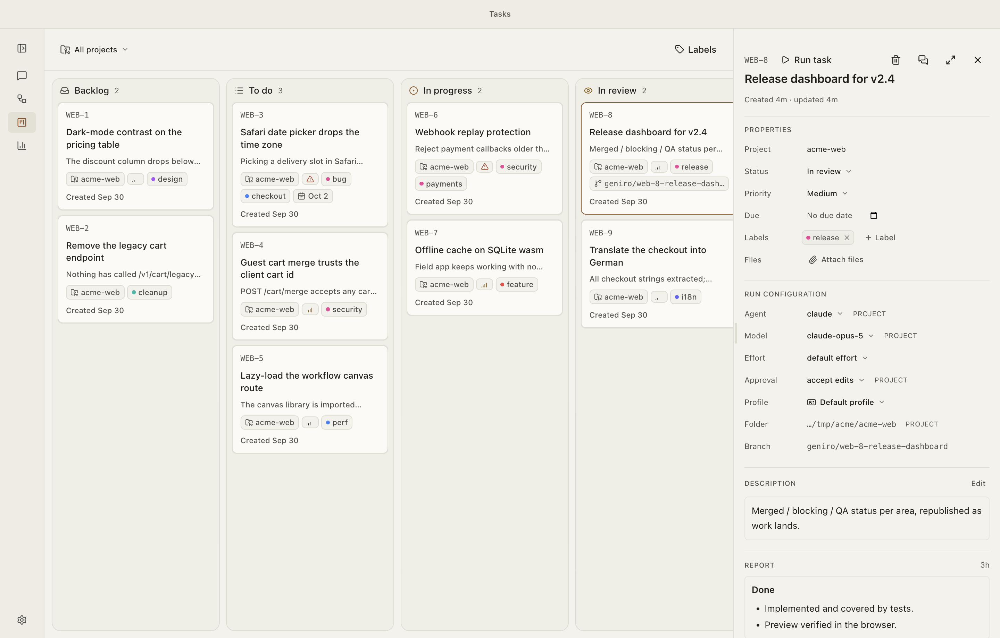

## 🌐 Browser

A browser beside every chat, for your preview stands and any other page.

- **Open it from the globe** in the agents panel (on its rail when the panel is folded): tabs, an address bar (words that are not an address are searched on DuckDuckGo), back, forward and reload, in a pane between the transcript and the agents panel. A page that warns about unsaved changes asks before you reload it or leave it. Close a tab from the × beside its name. **Expand** opens the browser **in a new window** — with all its tabs, the address bar and the controls; **Dock back** or closing the window brings it home without reloading a page, and opens the pane again if you closed it meanwhile — or **full screen** over the whole app. Developer tools, cookies, the system browser and copying the address are in the menu beside the address bar. A link opens in the Geniro browser while its pane is open, otherwise in your system browser; right-click a link to choose either, or copy it. A link an agent gives to a file or folder on your Mac shows it in Finder: a folder opens, a file is selected in its folder, and nothing is launched.
- **Each chat has its own tabs and its own cookies**, so a login in one chat never leaks into another. Cookies are kept between launches, like Cursor's browser, and are cleared when you archive or delete the chat.
- **Agents drive it too.** The chat's agent and every member of a team get Geniro's `browser_*` tools: open and navigate, read the page as a list of elements, click, type, press keys, pick options, scroll, read the console, run a snippet, take a screenshot at any window size (shown in the transcript; the agent looks at the picture itself only when it asks to, which keeps its context small), and set or clear cookies. An agent can open a tab with **its own cookies under a label** — sign in as `anna` in one tab and `boris` in the next — and it never reads a cookie's value back. Every tab an agent opens gets **a short name and a colour** saying what it is for ("Staging login", "API docs"), and it can rename or recolour one later. While an agent works a tab, the pane says so and **Stop** ends it.
- **Name and colour tabs yourself.** Press a tab's colour dot for its colours and **Rename tab…**, or double-click the name. Your name and colour stay: an agent never changes a tab you named or coloured. Empty the name to show the page title again.
- **You stay in charge.** Outside `auto`, the first time an agent opens a new site in a chat you get a card: **Approve**, **Allow for this session** or **Deny**. Your own browsing never asks. Pages get no camera, microphone, location or notifications, downloads land in `~/Downloads`, and only you can click past a certificate warning.
- The rest of Geniro stays offline: only the browser's tabs reach the network, through a proxy of Geniro's own on your Mac. On your phone the browser stays on the Mac, but its screenshots show in the transcript.

## 🎨 Artifacts and sharing

Sometimes the right answer is a page, not a paragraph. Agents call `show_artifact` to publish an interactive HTML page: a dashboard, a report or a little tool. It opens beside the chat, goes full screen, and can be saved as a file.

- **Revised in place.** Each revision is a new version of the same page, and every earlier version still opens from its own card. For a small change an agent sends only the edits, not the whole page again, and edits written against a version someone else has since replaced are refused.
- **Sandboxed.** The page runs in a locked-down frame. It can show local pictures, play local audio and video, and load libraries from a short list of public CDNs, and that's it. A picture in the page opens in Geniro's image viewer when you click it, and Escape closes that viewer first and then the full-screen page, even after you click into the page.
- **Audio and video.** An agent names a sound or a clip on your Mac in the page (`<audio>`, `<video>`), and Geniro copies it in and streams it, with seeking — a voice-over for a walkthrough, a screen recording of a bug. They play in the app; a saved or shared copy of the page leaves them out.
- **Buttons that open a folder.** A button on the page can open a folder in Finder, or show a file selected in its folder. Nothing is ever launched from it: a file, an app or a package is only revealed.
- **Your answers reach the agent.** Pick options, tick boxes or type into a page — approve or reject each line of a review, vote on alternatives — and Geniro keeps what you chose, puts it back when the page opens again, and the agent reads it with `artifact_answers`. No more copying a summary into the chat.
- **Encrypted sharing.** Press share on the page and Geniro encrypts it (AES-256-GCM) and uploads it to a place *you* configured: Google Cloud Storage through `gcloud`, S3 through `aws`, or your own command. The key travels only in the link's `#fragment`, which browsers never send to a server.
- **You stay in control.** Revoke a link, revoke them all, or have links expire after a set number of days. Agents may share pages too, but only if you turn that on (it is off by default).

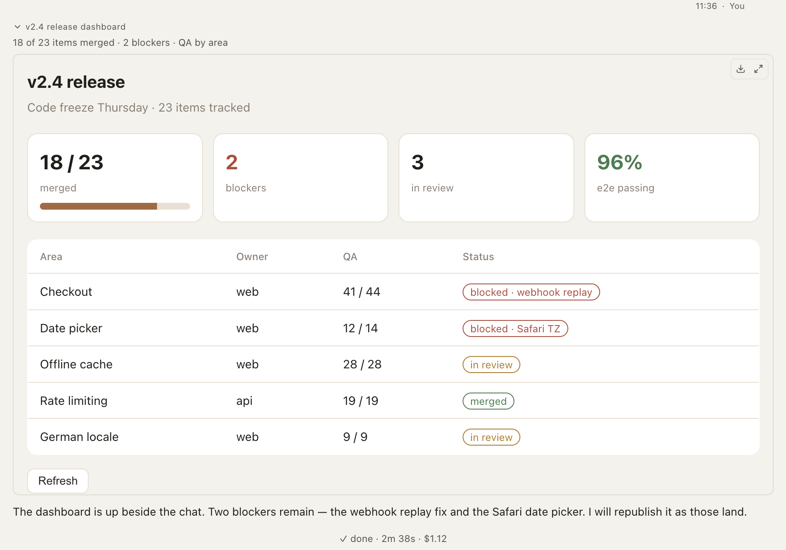

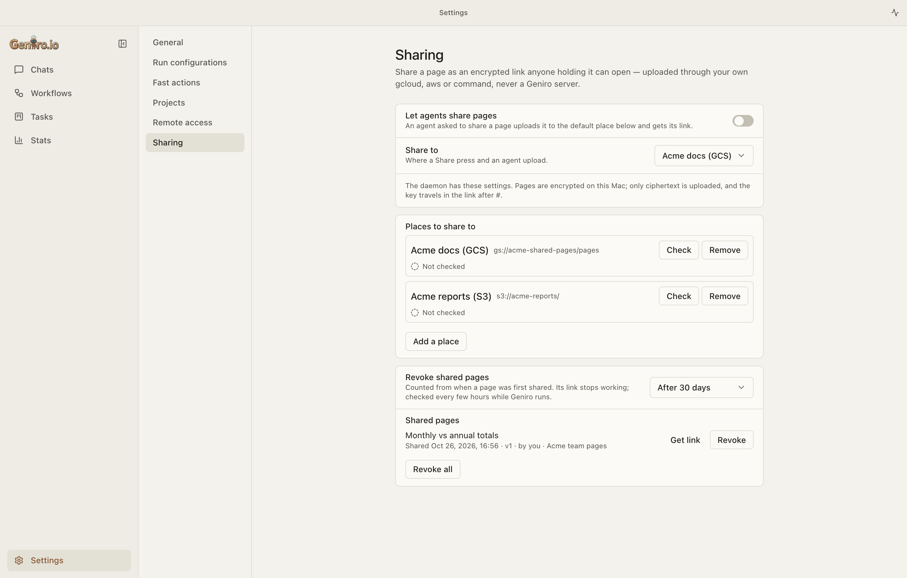

## 🃏 Rich cards

Geniro gives every agent a set of MCP tools for showing results instead of describing them:

| Card | What the agent shows you |
| --- | --- |
| 📈 **Chart** | Its own measurements, plotted |
| ⚖️ **Comparison** | Options scored against criteria, with a recommendation |
| 🔢 **Scorecard** | The headline figures, each with its delta |
| 🖼 **Gallery** | Screenshots and images in a grid, with full-screen zoom |
| 🗺 **Plan** | A plan you approve before any work starts |
| ❓ **Question** | Multiple-choice questions you answer with a click; once answered it folds to the question and your answer, and a click opens it again (in the manager chat, the thread's whole card with it) |
| 🔘 **Buttons** | "Press when the PR is merged" or "Stop the preview server" |
| 🧩 **Card** | An [A2UI](https://a2ui.org) card in the chat: a form you fill in, a choice to make, a status board the agent keeps up to date in place, pictures, video or sound. What you type is kept until you press its button, password fields excepted; the press reaches the agent as your message. If the agent rewrites a field you had changed, its value wins and the field is marked |
| 👀 **Monitor** | A background command (a CI run, a long build, a log) that wakes the agent with what it prints; you are notified when the agent finishes after the command ends, not after each batch of output while it still runs. A monitor stopped by an app update or a restart is not started again: its agent is told which one, with its command, and starts it again if it still needs it |
| 🔔 **Notify** | A macOS notification when something needs you |

Agents can also search your past chats and read the conversation around any hit.

<table>
<tr>
<td width="50%">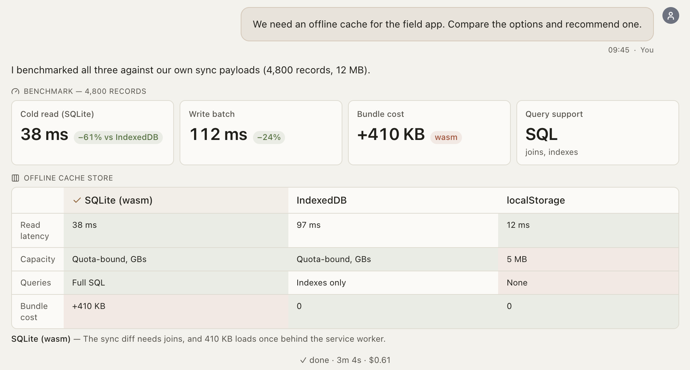</td>
<td width="50%">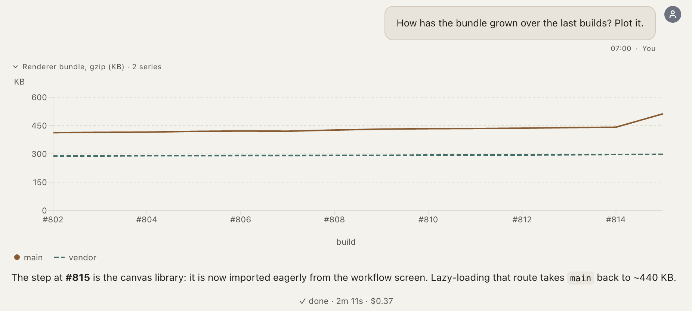</td>
</tr>
<tr>
<td align="center"><b>Scorecard + comparison</b></td>
<td align="center"><b>Charts</b></td>
</tr>
</table>

## 🔌 Plugins

Ask an agent for a block that shows something from your Mac, such as "last prod deploys". The agent proposes a plugin: a shell command and how its result is laid out. Its card shows the exact command, and nothing is saved until you press Approve. After that the block sits under the agent cards in the right panel of every chat in the folders you gave it.

- **Only what you approved runs.** The command runs as the exact text you approved. If the plugin's text changes, its block stops running until you review and approve the new version.
- **Fresh when you look.** The block refreshes when you open it, when you press ↻, and on its own timer (every 5 minutes by default) while it is on screen. Its last result is kept only until Geniro restarts.
- **Ask puts its data in the message box.** Ask adds the block's data to what you are typing, so the agent can act on it.
- **Buttons run commands.** A block can carry buttons, such as one that re-runs a check. A button marked to ask first opens a confirmation with its command line; the others run at once.
- **Settings → Plugins** switches a plugin off, runs it now in a folder you pick (its result shows there and in that folder's chats), changes the folders it shows in or deletes it.

## 🎯 Goals and outcomes

Every chat and team run can say what it set out to do and whether it did it.

- **Goals.** At the start of a task the agent records its goals with Geniro's `goals` tool — a few checkable outcomes, each marked as yours or the agent's — and before it finishes it closes each one as achieved, not achieved or dropped, always with the evidence: the test run, the link, the file, or why it was dropped. When a retry changes how a goal ended, the agent reopens that goal and closes it again, so the attempt does not count as a second goal. In a team run only the lead — the member you talk to — records and closes them, in its own conversation; every other member can read them but not change them, so a teammate answering a call cannot replace the run's goals with its own checklist. The **Progress** window holds them on its **Goals** tab — where you can add, reword, close or reopen a goal yourself — beside the thread's **Timeline** and, in a team run, its **Stages**, under one summary of where the goals stand and how the thread ended; the side panel's **Goals** row says where they stand and opens that tab. The **Progress** chip above the message box is there even before any goal is set, so you can set the first one.
- **What happened on a thread, at a glance.** The **Progress** chip and the timeline icon in the side panel open the Progress window on its **Timeline**: your messages — each with how long the work took, its messages, tokens and cost — and what happened in between, newest first and grouped by day: work started, stage moves, pull requests opened, reviews recorded, failures in red, problems found in yellow, questions still waiting on you, and how the thread finished. **Key steps** is the default; **Everything** adds agents' calls, team notes, published pages and achieved goals, and the choice is remembered per thread. A press on a row takes you to that place in the transcript; a pull request's row opens the pull request from its own link. Agents add their own important steps with Geniro's `milestone` tool — one line each, marked as progress, a problem found, or done — which also shows as a compact line in the transcript and needs no permission card.
- **Outcome.** An agent records how the whole thread ended — success, partial, failed or abandoned — with `record_outcome`, beside its pull-request outcomes. Without one, the goals decide once all are closed: all achieved is a success, some is partial, none is failed. When an agent records a success while a goal is still open or was not achieved, the Progress window marks it **Diverges from goals**, and so does the side panel's Goals row.
- **Counted for good.** Goals, outcomes, every tool and MCP-server call, every stage move and every call between team members are written to ledgers that outlive the chat, so the Stats page and a team's Statistics tab keep counting them after a thread is deleted. An analysis reads the goals with their evidence, the outcome, the traps the team noted (its newest pitfall notes), each MCP server's calls and failures, the stage moves and the calls between members.

## ✉️ Messages between threads

An agent in one thread can tell another thread something while it works: a finding, a decision, a warning. It looks the thread up with `list_threads` and writes with `message_thread`, on claude, cursor-agent and codex alike, in chats and team runs; a team's lead receives what is sent to its run.

- **It works like any other tool.** It follows the sending chat's approval mode: in `auto` it goes out with no question, and otherwise you approve it on a card that shows the target thread and the whole text, unless the mode refuses tools outright, as claude's `plan` does. The receiving thread's mode does not matter: its agent reads an ordinary message, marked as coming from another agent, and it gives no permission to anything.
- **It finds its way in.** A working agent reads it at its next step, without stopping what is running; cursor-agent gets it when its turn ends. An idle thread opens a turn for it. A stopped or failed thread, or one with a question for you, starts nothing, and the message goes out with its next turn.
- **It has brakes.** The sender can leave a thread asleep with `wake: false`, a large idle thread whose cache has gone cold is not woken, and a thread is woken at most six times an hour and takes at most 30 messages an hour into a running turn. A message that has to wait says why, in the sender's chat and in a strip above the receiver's composer that names the sender and shows the first lines. **Deliver now** opens a turn for it when it waits only for one (the sender asked not to wake the thread, or a brake held it back), and **Remove** takes it away. A removed message never reaches the agent and the sender is told.
- **One card for every exchange.** A message sent, a message received, a turn a message started and, in the command center, a thread that finished are all drawn as the same card in the transcript: what happened, the other thread a click away, and the message itself — the sender's own text included, drawn as markdown with its pictures, a long one folded behind **Show more**, and the message it answers quoted above a reply. In the command center the card is headed the way the thread's node on the graph is: the agent's icon or the team's faces (the manager's mast for the manager), the thread's title, its pull request, and its status, agent or team, board card and project with that project's colour. Inside a team's chat the same card tells what happens between its members and their monitors, headed by that member's face: a call finished (with the start of its answer), failed or was cancelled, a member asked a question (and what it was answered, or that no answer came), the lead wrote into a running call, a monitor reported or stopped — each as two short lines, with **Open call** on the first, to the call's card. A monitor's card is one line — the monitor, whether it is still running or how it ended, and how many lines it printed — and opens on a click onto its command, timeout and output. Chats recorded before this draw their old notes as the same cards.
- **Any thread on this Mac**, except archived ones and the app's own team-builder, project and analysis chats. A message survives a restart of the app.
- **Which threads were worked on, and when.** `list_threads` gives each thread when it was created, when it was last active and when you last wrote in it, and takes a window — `activeSince` and `activeUntil` — so an agent writing your daily standup can ask for every thread touched since the previous one, archived ones included with `includeArchived`, one project's with `project`, a page at a time. `search_chats` takes the same window.

Claude Code's own messaging between sessions stays closed on Geniro's turns: a terminal `claude` session cannot write into a Geniro thread, and `SendMessage` keeps its other job of resuming background sub-agents.

## 🛰️ Command center

One agent that runs every thread at work for you, and one picture of them all. Open **Command center** in the rail.

- **A manager you talk to in plain words.** One manager chat for the whole app. You pick its agent, account, model, effort, context window, tool-approval mode and auto-compact (the last choice is remembered), and **New chat** in its header starts a fresh manager conversation on those settings — the current one and its roster are deleted, the threads themselves are not. Write "ask billing and cache to rebase on main" and it works out which threads you mean, sends them one message in a single step, and asks back when a name is ambiguous. Ask it for a new thread and it starts one in the project's folder, like a normal chat, after your **Start** (at once when the manager runs in `auto`) — with no card on the board unless you ask for a card in so many words, which then gets its own worktree and branch; a started thread joins its roster with a quiet "Started" line, and only a failed start wakes it. Each new thread appears in the manager chat as a card: its title, project, agent or team and board card, where its start stands right now (waiting for your Start, starting, started, not started), and **Open thread** once it runs. Tell it to archive threads ("archive the docs and release threads") and it archives exactly those, the way the sidebar does — nothing is deleted, and it never archives a thread on its own. It keeps a finished thread on its roster until you archive it, and it can read the whole graph as it stands — every thread with its column, status, pull request and board card — whenever it needs the current picture. Its messages to the threads it manages go out without an approval card, and a thread's reply to its question wakes it even past its usual wake budget. Each message it sends and each reply arrives as one card headed by the thread the way the graph shows it — its face, title, pull request, status, agent or team, board card and project — with the text inside and, on a reply, the line it answers quoted above it. Beside the chat button on the graph, a small tile shows the faces of the threads at work; hover it for the list — the threads waiting on you first, then the working ones, each headed like its node on the graph (its face, title, pull request, status, agent or team, board card and project), with when it last moved, what it still runs in the background (a held turn, sub-agents, commands, monitors), its latest message, and a button that opens its card on the graph.
- **It speaks only when it has news.** A thread going idle or busy never wakes the manager, so its chat holds no status chatter. When a thread on its roster is done, the chat shows that thread's card — what it reported (its recorded outcome or its latest message, kept current while the thread is on the graph, a long one folded behind **Show more**), its pull request, **Open chat**, **Dismiss** (folds it to one line on this device; **Show** brings it back) and **Archive** — with no manager turn, once per finish: a finished thread that runs again and changes nothing (say, after you write to it yourself) brings no second card, and one that finishes again with something new keeps one card, showing its newest finish. A thread that finished while Geniro was closed gets its card on the next start. A thread that still runs a monitor is not done yet: it stays among the working threads, and its card comes once the monitor ends. Once the thread is archived — from that card, the graph or the sidebar — the card turns compact and dimmed with an **Archived** badge and **Unarchive**, and follows the thread back if it is unarchived anywhere. Ask the manager to watch a thread or tell you when it finishes ("start the billing fix and tell me when it's done"), and that thread's next finish also wakes it once, so it tells you in a line or two what it finished; after that the watch is over until you ask again. If that finish came while Geniro was closed or restarting, the manager hears of it once at the next start. When a thread asks you a question or waits on an approval, that very card appears in the manager chat, headed by the thread as its node on the graph shows it and marked **Waiting on you** until you answer, with no manager turn; your answer there goes straight to the thread, and a card answered in the thread itself closes here.
- **The graph, with the manager's chat a click away.** The page is always the graph. The chat button in its bottom-right corner opens the manager's chat in a window over it: drag it by its head, resize it from any edge or corner, minimise it to its head, maximise it to fill the page, and close it again from its head or the same button — what you wrote and its place stay while it is closed. On a phone the chat covers the whole screen and closes from its head. A thread link to the manager itself opens that window. While the chat fills the page (maximised, or on a phone), its header shows a face for each thread at work, in the graph's order, with the same running green border its card wears on the graph; a press on one opens that thread's card on the graph, and a "+N" lists the rest, each row opening its thread wherever you press it.
- **What waits for your review, in the same chat.** An agent's memory entry waiting for your approval, a lesson waiting for review and a knowledge document change waiting for review each appear in the manager chat by themselves, once, with no manager turn — the same row and buttons Settings and Knowledge offer (**Approve** and **Forget** on a memory entry, the lesson's **Save to …** with its targets, **Edit** and **Reject**, **Review** with **Approve** and **Reject** on a knowledge change), plus a link to open it there. More than five of one kind at once arrive as one card listing them. Decide it in the chat or in Settings: either way the card stays, dimmed, and says what became of it — approved, forgotten, saved, rejected.
- **Questions with their context.** A thread's question in the manager chat carries **Open chat**, which opens that thread's card on the graph and brings it into view, and the thread's last three messages before it asked and the pages and pictures it showed in that turn, shown at once right inside the card (**Hide messages** folds them), so you can answer without leaving the chat. What you pick on such a page is saved to that thread, as in the thread itself. The graph's **Answer** popover shows the same, and a question asked inside a team member's call shows that call's messages and pages.
- **Answer every thread from one place.** When a thread asks you a question or waits on an approval, its card on the graph gets an **Answer** button and the header's **Needs you** count goes up. **Answer** opens that thread's question or approval in a popover right at the button; the Needs you button in the header opens a panel on the right that lists every such card. Either way it is the very question or approval card the thread shows, and your answer reaches the thread exactly as if you had answered there, so you never have to open it, and its card stops saying **Question for you** the moment you answer.
- **Several threads at once, right on the graph.** The chat icon at the bottom of a card — or a press on its title — turns that card into the live thread: the same head on top, its transcript and composer under it, exactly as in Chats, in the card's own place on the graph. Resize it from the grip in its corner or from its bottom or right edge (it remembers its size), open as many as you want side by side, and fold one back into its card with the chevron; an open thread zooms with the graph, so it always stays on its own place, and keeps that place while its thread works. Leave the page and come back: the open threads are still there, with nothing loaded again. Every thread link on the page — a reply in the manager chat, Needs you, the timeline — opens its card right there instead of leaving the page, switching the project filter when it has to; only the arrow icon in a head takes you to the thread in Chats. On a phone the open thread fills the screen, and back returns to the graph.
- **One live graph of every active thread, sorted by what needs you.** The manager sits on top — its agent, how many threads it runs, how many are working, waiting on its reply or waiting for your Start — and every thread not archived hangs under it as a card, however long ago it last moved — a finished one too, until you archive it. Cards stand in one block per project — a dashed frame in the project's colour, headed by its name, how many threads it holds and how many work — side by side under the manager and wrapping onto a new line, with the threads of no project in a last **No project** block. Inside a block working cards come first, then those blocked (failed, or held at an approval) and those waiting on your answer, then quiet ones, those nobody touched for a day greyed out, and finished ones dimmed last. One wire runs from the manager to each block, dotted while it is lit. A working card, and the manager while it works, shows a small spinner, and a thread waiting on you is tinted amber; nothing else on the graph moves on its own, so it stays light on your Mac while threads work. A team run's card shows its members' faces. Each card shows its status, its agent or team, its project with that project's colour — a stripe along the card's top and a dot on its label — its pull request and board card, the manager's note on it, its latest message as the thread list shows it, and when it last moved; a long title folds onto a second line and the labels run onto more lines rather than being cut at the card's edge. A wire lights up for five minutes after a message either way, a dot travels along it as each message goes, and it turns amber while the manager waits for that thread's reply. Drag to pan as far as you like — the canvas has no edge, and **Fit** brings the graph back — pinch, or use the zoom buttons. A two-finger scroll that starts on the graph keeps moving the graph when the pointer crosses an open thread or the manager's window, while one that starts in a chat scrolls that chat. Once you zoom away from the view the page opens at, **Reset zoom** above the zoom buttons takes you back.
- **Arrange the graph by hand.** Drag a card, or an open thread by its head, wherever you want it — its wire follows it as it moves: it stays there on this device — through new threads, status changes and restarts — out of its project's block, which closes up around the rest, and only what it lands on moves aside; while you drag a card over its own block, the block makes room and shows a dashed slot where it will land, and dropping it there puts it in that place in the block — an order this device keeps for that project until you reset it, whatever the threads' statuses do, with new threads joining where the automatic order puts them. Drag a block by its header to move the whole project with its cards; it stays there on this device, and only a block it lands on moves aside, while dragging empty space inside a frame still pans the canvas. **Reset layout**, beside the zoom buttons once you moved or reordered something, gives every card and block back to the automatic layout. Once you pan or zoom yourself, the graph never moves your view on its own again until the window is resized.
- **Archive from the page.** Every thread on the graph carries an archive icon at the bottom of its card, as does an open card's head and every card of it in the manager chat, and a finished thread offers **Archive** in plain sight. Archiving always asks first with the sidebar's own dialog, **Extract lessons** included: a thread with nothing left running gets a plain **Archive**, and one with work still going lists exactly what archiving stops — the team members at work, and each background sub-agent, command and monitor by name, with the member it belongs to. A toast offers **Undo** afterwards. A thread archived anywhere else, from the sidebar or by the manager, leaves the graph at once.
- **A timeline of everything.** The Timeline button opens a right sidebar beside the graph and the chat with every event of the manager and its threads, newest first and grouped by day: what you wrote, the manager's messages and the threads' replies, threads started and Starts requested, pull requests opened, questions and approvals, stage changes, outcomes and failures. Each row about a thread names it by its board card, with the card's key and its current name, and by its project, a thread with no card showing its own title. A press on a row opens that thread's card on the graph; a question or approval still waiting on you offers **Reply**, which opens the same answer popover right by the row in any view; a finished thread's row offers **Archive**, asking first and then offering Undo. Nothing in it leaves the page.
- **Your own standing instructions.** Write them in **Settings**, in the **Command center** group ("answer in Russian", "never start threads on Fridays"); the manager reads them from its next turn, and they reach no other chat.
- **It does not forget.** The manager's roster — which threads, why, and its note on each — lives in its instructions and survives compaction; each of its turns also carries a fresh status of every thread.
- **On your phone too**, as one column you scroll with a finger — the manager first, each project's threads in a dashed frame in its colour, headed by its name as on the desktop — with the manager chat a tap away.

## 🔬 Thread analyzer

Finished a long run and wondering why it took 40 minutes? Press **Analyze thread**. An archived thread can be analyzed like any other.

1. Pick the agent, account, model and its settings that should do the analysis. Analyses and the team and project chats open on the setup you last used in any of them, including a change you made inside the chat; the team and project chats keep their own approval mode. You can add a focus in your own words and paste or attach screenshots to it; the analysis gets them with its first message.
2. It reads a snapshot of the thread: timings, slow or failed tools, the critical path and every row.
3. You get a **recommendations card** that explains itself: what cost the most time and money and why, then each fix with its evidence, the minutes and dollars it should save per run and what the next run looks like with it, tagged by where the fix belongs: your team, your repo, your own instruction files, the shared memory, the project's instructions, or a knowledge document. It also suggests moving text between instructions and knowledge: a long procedure most turns never use becomes a document with one line pointing at it, and a rule agents keep missing in a document moves into the instructions.
4. Tick what you want: the card projects the time and cost per run with exactly those fixes. Press **Apply selected**. Team edits are saved only if the file has not changed in the meantime, and a backup is written first. A project-instructions fix is shown to you as a card with the old and new text, in every approval mode, and written only when you press **Apply** there — only for the items you ticked, and only if nobody changed the instructions since the agent read them; the next analysis sees every change made to them and who made it. A move is two ticks that go together. Pressing **Apply selected** is your review of a knowledge document's text, so it goes live at once and the document is written before the text leaves its source, so it is never in neither place.

The analysis lives in a popup over the thread it analyzed, so you can come back to it, ask follow-up questions, or start a fresh one. The popup is an ordinary chat: the same header, message queue, model and approval chips and shelf you have in any thread.

On a team, **Analyze & improve** reads the runs of the period you pick together, and says before you start how many runs that period holds and how many it will read. It can open any other run of that team, archived ones too, when a question needs it, so you pay only for what it reads. The card opens with what Geniro measured over them: time and cost per run, failed turns, and each agent's share of the working time with its model and cost per run. Then it names what costs the most and why, next to the measured figures of the agent at fault, and says how each member did: its usefulness and quality marks, its verdict, and the fixes that carry the verdict out. An analysis of one team run marks its members too, as the thin sample one run is.


Each fix shows the time and money it should save per run, or add, and what the next runs look like with it. Ticking fixes projects the time and cost per run with exactly those.


### Flags and the system analysis

- **Agents flag what went wrong.** Every agent — in a chat, a team, an analysis or a lessons chat — has a `flag_issue` tool for something that cost real work or ended in a disagreement with you: a tool that failed, an instruction that misled it, a memory that was wrong. Each conversation may raise up to ten, and the same problem once per thread. Geniro also raises a flag itself, marked automatic, when a team run is cut off by a quit, an update or a crash, when one of its own tools times out or fails inside Geniro, and when the same tool refuses an agent three times running in one conversation — once per cause per thread. Flags outlive the thread, so an analysis of a deleted thread's period still reads them, and every analysis — of a thread, of a team, the lessons reflection and its check — reads a thread's flags before its transcript.
- **System analysis.** Settings → **System analysis** picks a period (the last day to the last 30 days, 7 by default), shows how many threads in it had trouble — flags, failed tool calls, failed outcomes, unmet goals, refusals and your corrections — including Geniro's own analyses and lessons chats, which no other analysis reads, and lists them with **Show threads**. Pick the agent and model and press **Start**: it reads up to the 30 most troubled of your threads and up to 10 of Geniro's own analyses and lessons chats, earlier system analyses included, what earlier system analyses proposed and what became of it, and reports what to change in Geniro itself (`G-` items: its tools, code and system instructions), in your own agent instructions (`U-`) and in shared memory (`M-`). The report opens in a popup; the button under it **creates cards** for the Geniro items in the project you pick, **implements right away** (creates them and starts each on the project's default agent or team), or **keeps it as a report**. Your-instructions and memory items are applied by the analysis agent, as in any analysis. **Past analyses** lists each with its period, what it read and proposed, and what became of it.

## 📚 Knowledge

Long guides do not belong in instructions every run pays for. Put them in a document, leave one line in the instructions such as "before a release, read the knowledge document `release-checklist`", and an agent reads the text only when it helps.

- **Knowledge** in the sidebar lists documents across every project, team and Global, with search, a status filter and a place picker. A document has a title, a one-line *when to read*, a stable handle and Markdown text. **Copy reference** gives you the line to paste into instructions.
- Each agent gets a short index of what it may read, at most 2 KB, plus `knowledge_search` and `knowledge_read`. A run sees its project, its team and Global; when a handle is held in several, the nearest wins. A chat outside any project sees Global only, and builder and analysis chats have no team of their own. A team's chat, a project's chat and an analysis can also search, read and change the documents of any other project or team when you name it; the index they start with stays their own.
- Agents write, and you choose what every chat starts with. By default `knowledge_save` saves an agent's document at once: other agents find it by search right away, and the page marks it **Search only** until you choose **Load into every chat** in its More menu, which puts it in the index; **Search only** in the same menu takes one back out. Settings → Knowledge can instead make agent writes wait for review — a new document or a change waits in **Waiting for review**, where you see the diff, then Approve or Reject, and other agents keep reading the current text until then — let agents only read, or switch the tools off. A change whose document moved on cannot overwrite it.
- Every save is a version, and invisible characters in text you save are removed: **History** shows the diff from the one before, and a restore becomes a new version. A document can be archived, or exported as Markdown.
- The project page shows how many documents it holds. Deleting a project or team that holds documents asks whether to move them to Global or delete them.
- It works on all three CLIs and from your phone: read, edit and approve there. Export happens on the Mac.

## 🧠 Shared memory

Every agent shares one memory, whatever its CLI. An agent searches it, reads an entry, saves a fact it learned, or forgets one that turned out wrong, all through Geniro's own tools. A search lists the entries that match, best first: how well the title and text match counts most, and a clearly better match always comes first; among close matches, entries agents found helpful, read lately, or filed for your team or project rise above the rest. When no entry matches every word it asks for, it finds those matching any of them. Once you import what the CLIs already remember, each CLI's own memory is switched off in new chats, so nothing is remembered twice. You can switch the CLIs' own memory back on in Settings → Memory.

- **Settings → Memory** sums your entries up under **Entries**: how many titles fit every new chat, how many wait for your review and how many are forgotten. **Open…** shows them in a window with a tab for each list: every entry with who wrote it, when, and for which project or team, or Global. You can search, filter, add, edit, forget, restore and **Forget all**. Forgotten entries can always be restored.
- **In every chat or search only.** Every new chat starts with a short index of entry titles, at most 4 KB; the titles matching the chat's first message come first, and the rest follow in the order below. Agents find every other entry by searching. Two tabs show which is which. **In every chat** holds the notes you wrote or imported and any agent note you loaded, and says how many of their titles a new chat in the scope you picked actually starts with (say 22 of 326) — its team's first, then its project's, then Global, most recently used first. **Search only** holds the agent notes saved at once. Each row keeps its actions in a ⋯ menu that shows on hover: **Load into every chat** moves an agent's note into the index, and **Search only** takes it back out; your own and imported notes are always in it.
- **Review.** Agent notes are saved at once by default. Set them to **Wait for my review**, and an agent's new note waits on the **Waiting for review** tab, which counts them, seen by no agent until you **Approve** it. A forgotten note comes back in the state it had.
- **Import.** Bring over what each CLI already remembers. Claude's notes come from every profile you use, Codex's from its memories handbook. Notes are grouped by the folder they were written for and the profile they came from, with search, filters and pages. You see each note first, tick the ones you want, and choose its type and project. Notes that look like an entry you already have start unticked. **Sort with AI** has Claude or Codex read the ticked notes and untick task status, session logs and one-off details, giving a one-line reason for each. You pick the model, effort, context window, model options and profile it runs with, the same picker a chat has, and the last choice is remembered. It runs on that agent's account, and you still review every note before anything is imported. The CLIs' files are only read.
- **Clean up.** A panel at the top of Settings → Memory counts how many entries agents actually read, and **Review…** opens a dialog of the least used ones: entries at least 14 days old that no agent read in 90 days, each with one short line on why it is listed (never read, not read lately, or naming a repo file that no longer exists). **Ask AI what to forget** has your agent (Claude or Codex, the model and profile you pick, the same choice as Conflicts) read every listed entry, including the ones off the page, and then shows its suggestion: which entries to forget, each with a one-line reason, already ticked, and one **Forget** button. Entries that look like a rule are listed but left unticked. It runs on that agent's account and nothing is forgotten until you press Forget. You can also tick entries yourself, or press **Select all**, and **Forget** them as one batch; **Undo** brings the whole batch back as it was, right away or later from **Recent cleanups** on the Forgotten tab or the panel. Corrections you gave, notes about you, your own notes and notes that state a limit carry a **Looks like a rule** mark, and Select all leaves them for you to tick one by one. **Keep** takes an entry off the list for good; the Kept tab lists them. On the Forgotten tab, **Delete permanently…** erases one entry for good after a question that says so: its text, its forget reason and any finding quoting it are gone, its number is never reused and its read counts stay; chats that already showed it keep what they showed. It is on the Mac only. **Forget cold entries automatically** (Off by default, Mac only) arms a once-a-day pass that forgets every entry nobody has read, edited, approved or restored for 30, 90 or 180 days, leaving kept entries, entries with a warning, entries waiting for review and entries of a project or team with no new chat in 30 days; turning it on first says how many it would forget now. Each pass is one batch in Recent cleanups, marked **Automatic cleanup**, with **Undo**, and it never deletes. A note you forgot or deleted is marked **Forgotten earlier** and left unticked when you import again.
- **Agents' marks.** After relying on an entry from its memory index or one it read, an agent marks it **helped**, **not useful** or **misleading** with a one-line reason, and a lessons reflection marks the entries a thread followed or was misled by. Each thread counts once, its latest mark winning. When, within 90 days, three more threads marked an entry not useful than helped, it is forgotten — any entry, yours and imported ones included — and **Recent cleanups** names the threads and their reasons, with **Undo**. Thirty days later it is deleted for good; restoring it first discards the old marks. Each entry shows how many runs it was shown in, how often it was read and how many threads found it helpful or not, and whether it is in every chat or **Search only**. **Remove entries agents mark as not useful** (on by default, under Clean up) switches the forgetting off; marks keep counting.
- **Duplicates & contradictions.** The **Conflicts** tab of the same dialog has your own agent (Claude or Codex, the model you pick) check likely pairs of entries — ones sharing uncommon words that some chat sees together — a batch at a time, with the number of pairs and an estimate of the cost before you press **Check**. It only proposes: each finding shows both entries side by side with the words of each that show the duplicate or the contradiction, and you choose **Keep A**, **Keep B**, **Merge…** (edit one new entry of yours that replaces both, filed in the scope you pick — the narrower one unless you change it), **Both are true** or **Decide later**. Keeping one or merging can be undone like any cleanup, and a pair checked is not asked again until either text changes. **Stop** ends the check; the batch already asked still finishes and is billed. The check starts only from the Mac; findings can be decided on your phone too.
- **Export** writes every active and waiting entry to one Markdown file.
- In a chat, a memory tool call is one short line, such as "Saved memory · Use pnpm m12". Hover or click it to see every entry it searched, read, saved or forgot, in full and scrollable, without leaving the chat; each entry can still be opened in Settings from there.
- The thread analyzer can recommend memory changes too, and applying one saves or forgets the entry.

The memory works from your phone as well: you can read, edit, forget, approve and clean up there. Import and export happen on the Mac.

## 🔎 Search by meaning

Word search finds an entry only when it shares your words. Turn on **Settings → Search → Search by meaning** and memory search, knowledge search and chat search also find what means the same in other words or in another language: a Russian question finds an English note. One switch covers all three, for your agents' searches and for your own (the chat search dialog and the Knowledge page).

- **On your Mac, downloaded once.** Turning it on downloads the search model (EmbeddingGemma 2, about 346 MB) from Geniro's own release, checks every file against its published checksum and runs it on this Mac only; nothing you write leaves it. A row shows the download with **Cancel**; if it fails you get a notification, a plain reason and **Try again**, and search keeps matching words.
- **Indexing.** Memory and knowledge are indexed at once. Your whole chat history is indexed in the background, newest first, at low priority, and waits while the Mac runs on battery. Very short chat replies ("OK", "Done.") are found by their words only. The page shows how far each of the three has got.
- **Choose what is indexed.** Under the switch, Memory, Knowledge and Chats each have a switch of their own, and **Index chats from** keeps only the last 7, 30 or 90 days of chats, or any number of days you type. A source you switch off, and chats older than the window, leave the meaning index and stop costing CPU and disk; word search still finds them, and a search says when meaning search left part of it to words. Switching a source back on or widening the window indexes what it now takes in, with the progress on the page. Nothing you wrote is deleted.
- **Off and delete.** Turning it off brings word search back at once and keeps the model and the index on disk, so turning it on again is instant. **Delete model and index…** removes both; Settings → Storage lists and deletes them too.
- **Updates.** When a later Geniro pins a newer model, the page offers **Update model** with its size; search keeps using the current one until the new index is built.
- macOS 14 or later. The model is Google's EmbeddingGemma 2 under Apache-2.0; deployments must adhere to the [Gemma Prohibited Use Policy](https://ai.google.dev/gemma/prohibited_use_policy).

## 💡 Lessons

Agents repeat mistakes from one thread to the next. When you **archive** a thread, Geniro has a separate, hidden agent read what happened in it since its last reflection and file at most three lessons into the shared memory. A lesson needs evidence from outside the agent's own opinion: you correcting it after it said it was done, an approval you declined, a step that failed and then passed, a failed outcome, a goal closed not achieved or dropped, a trap the team recorded in a pitfall note, a reopened stage or a review finding. It quotes that message, and Geniro checks the quote. A thread with no such signal is not reflected on at all and costs nothing; zero lessons is the normal outcome.

- **When it runs.** Archiving a thread is where it is decided: when the thread has something to learn from, the archive dialog shows **Extract lessons from this thread** with one line under it of what such runs usually cost and take — the median of the last 20 finished runs, on the same model when there are enough of them, or "not measured yet" before the first one; hovering the box explains what it does (a background agent on the named model reads the thread and saves up to 3 lessons). It is ticked when lessons are on for that thread (Settings → Memory → Lessons, the project and the team) — untick it to skip this one, or tick it to reflect once while lessons are off. Deleting a thread from the archive never reflects. **Reflect now** (in a thread's menu in the sidebar, or the lightbulb in its agents panel) runs one whenever you like. Nothing else starts a reflection, and they run one at a time.
- **Where lessons go.** Each lesson is saved to the shared memory (project, team or global) as an entry agents find when they search — not into the memory index every new chat starts with. It enters the index once you approve it, or once agents in two threads mark it helped and none not useful. A lesson no thread marked helped in 90 days is forgotten (**Recent cleanups**: "Auto lessons nobody confirmed in 90 days", with **Undo**) and deleted for good 30 days later. The lessons card at the end of the thread shows each one with its rule, why and the evidence, with **Undo** (forgets the entry, restorable from Settings → Memory) and **Edit** (the entry becomes your own). While you review agent writes, a lesson waits for your **Approve**. Lessons you undo are not filed again in that project or team without new evidence.
- **Beyond memory.** A rule that must hold in every run of a project can be proposed for the project's instructions, a role's lesson for that team member's own instructions, and a long procedure as a knowledge document of the project. These never change anything by themselves: the card shows them with **Save** and **Reject**, and you can move any lesson to another place before saving — memory, the project's instructions, one member's instructions, or a new or existing knowledge document. Saving adds one line to the project's **Lessons** block or to the member's instructions (the team file is backed up first and the change shows in the team's history), or files the document. A lesson that improves an existing memory entry offers **Update rule** instead of a second entry; one whose rule agents had and broke anyway offers **Move up** into the memory index every chat starts with — the smallest step; the project's instructions are one pick away in the same menu. When that entry is an agent's note you have not approved, the update or the move up applies by itself (not while you review agent writes): the card says so, and **Undo** puts the old text back or takes the note out of the index again. If memory already holds an entry that reads like the lesson, Save, Update and Edit name it, and pressing again keeps your change anyway.
- **Watch it run.** The layers icon in the title bar is Geniro's background work: a spinner and a count while an extraction is queued or running. Its panel lists what runs now and the latest finished runs — how many lessons each saved or left waiting for review (with **Review in Memory**), "No lessons found", or why it failed, such as a usage limit — with its cost, time and when; a row opens its thread. **All runs** opens the whole history.
- **Waiting for review.** **Settings → Memory → Waiting for review → Lessons** (the tab's count includes them) lists every lesson still waiting for you, from every thread — including threads you deleted since, whose card is gone — with the same actions as the card. Below them, **Saved to memory** lists the lessons that went into memory as entries of their own, each with **Undo** and **Edit**, and the ones that updated an agent's note by themselves, with **Undo**. The Settings count beside the sidebar includes the waiting lessons, and a notification names the thread when a reflection saves or proposes lessons.
- **History.** **Settings → Memory → Lessons → History** counts every lesson ever found — how many were saved, how many wait for you (the same count as Waiting for review), how many a second model is still checking and how many were not saved — and **Open…** lists them all, newest first, a page at a time: when each was found, the chat it came from (also one you deleted since), its rule and why, and what became of it — saved to memory, to the project's or a member's instructions or to knowledge, waiting for review, being checked, rejected or dropped by the check with the reason, undone, or already in memory. A waiting lesson keeps the card's actions there, and one saved to memory as its own entry keeps **Undo** and **Edit**.
- **Which model.** **Settings → Memory → Lessons → Memory model** is the one model memory work runs on, picked with the same agent and model picker as the composer: any installed CLI, its profile (subscription), model and effort. By default it is **Same as the thread** — exactly the CLI, profile, model and effort the thread itself ran on, with no switch to a lighter model. A run that fails shows in the spend readout with why, in plain words — the agent's usage limit was reached (and when it resets) or it needs you to sign in again; Geniro never switches to another CLI or account by itself.
- **Check found lessons with** (off by default) adds a second model, picked the same way, that re-checks each lesson before it is saved. It runs only when the first model found something; what it drops stays on the card with its reason.
- **Cost.** There is no limit; what lessons cost is shown everywhere: the archive dialog shows what finished runs typically cost, the title bar's background work shows each run's cost, the card's footer shows what the reflection and the check actually took and cost, Settings → Memory → Lessons shows today's and this month's spend split into reflections and checks, and **Stats** shows both under **Lessons**.
- **Off.** Settings → Memory → Lessons switches reflections off everywhere. A project's page and a team's **Memory** tab can switch them on or off for their own threads (the team's setting wins over the project's). Reflect now works either way. These settings are on the Mac only; Undo, Edit, Approve, Save and Reject work from your phone too.

## 📊 Stats, cost and CPU & RAM

**Stats page.** Pick a period: today, 7, 30 or 90 days, or all time. See spend, cost per turn, turns, agent time, threads, pull requests, lines changed, tokens in and out, cache reads and writes, and cache hit rate. Break it all down by agent, model, project, team and thread. See the share of threads that recorded goals, how many goals were achieved and how threads ended, and every tool and MCP server the agents called, with its errors and average time. Prices come from the public [models.dev](https://models.dev) catalog, refreshed every hour. A model without a price shows a dash, never a made-up `$0`. The usage ledger survives deleted chats.

**Model prices.** A model's list price per million tokens — input, then output — shows in every model picker, on each agent's card and pool slot in the agents panel, in the context readout (beside the model, or with the plan limits when the reading names no model), under each row of **Stats → By model**, and in **Where the run went → By model**. Hover a price, or a picker row, for the cache read and write rates and any long-context rates. cursor-agent's models show their maker's price; Cursor's own models (Composer, Auto), local Ollama models and a model the catalog does not list show none.

**Where the run went.** Opens as a sequence diagram of the run: a column per agent with its turns, time running down, a numbered arrow for every call and a dashed one back for each answer its caller waited on, calls made at once framed together and long idle stretches cut short. **Lanes** switches to the waterfall of every agent's turns on one clock, with its call links, sideways scroll and zoom. Both have the critical path, cost tables and "open in chat" on any span.

**CPU & RAM.** A meter in the title bar splits the app's memory or CPU across your threads, Geniro itself, and anything a deleted thread left running. Open a thread to see every process each agent started, with its CPU and memory, and **Stop** or **Stop all** the strays. Readings are taken only while you are looking.

**Memory and disk warnings.** While agents are running, Geniro checks every 30 seconds whether one thread's processes have passed 8 GB or have grown by 1 GB a minute for about three minutes running, whether macOS reports critical memory pressure, and whether the disk is down to 10 GB free. A one-off jump, such as a code index a tool loads when an agent opens a project, does not count as growth. A thread whose growth warning has cleared, or that you put away, stays quiet for 30 minutes. It tells you with a system notification and a strip at the top of the window. A memory warning names the thread, the agent and the command, with **Open processes** and, when Geniro may stop that command, **Stop command**; a disk warning shows only how much space is left and the line it warns below. It never stops anything on its own, and with no agents running it reads nothing. Settings → Notifications switches both off; the thresholds still live in `settings.json` under `resourceAlerts`.

**Context and limits.** A context ring shows how full each agent's window is, with the model's price beside its name; auto-compaction kicks in at a percentage you choose, and plan limits sit one click away.

<table>
<tr>
<td width="50%">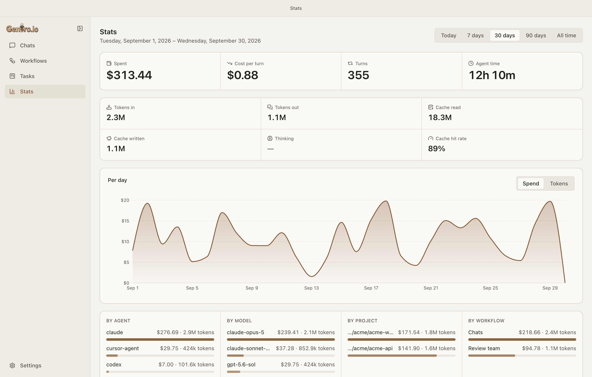</td>
<td width="50%">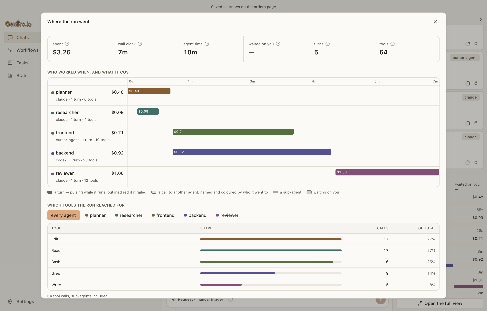</td>
</tr>
</table>

<table>
<tr>
<td width="38%" valign="top">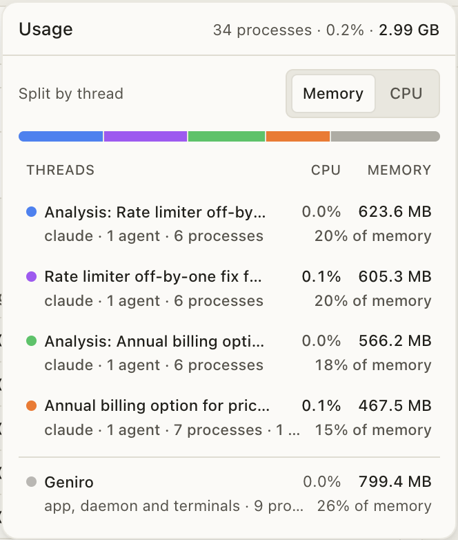</td>
<td width="62%" valign="top">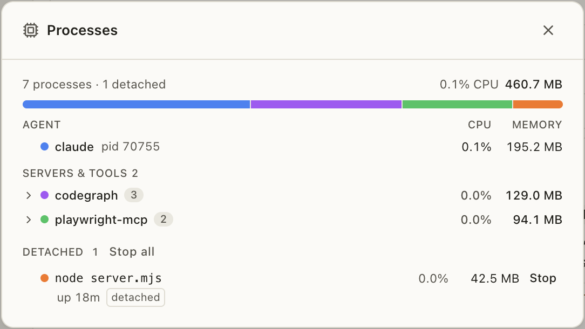</td>
</tr>
<tr>
<td align="center"><b>Usage, split by thread</b></td>
<td align="center"><b>One thread's processes</b></td>
</tr>
</table>

## ⚡ Fast actions, run configurations and tidy threads

- **Fast actions:** your own buttons under the message box, each one a name and a snippet. A press drops the snippet into the message box. It sends nothing, so you can still edit.
- **Run configurations:** save a new-chat setup (folder, branch, agent or team, model, effort, context window, approval mode and profile) under a name in its project, and apply it by hovering the **New chat** button, where they are listed by project. Each project keeps its own on its page; every run a configuration starts gets that project's instructions, whatever folder it works in. Configurations saved before they belonged to projects are moved into the project that holds their folder, and any left over wait under the Projects gallery for you to place.
- **Folders and branches:** each chat runs in its own folder, with your recent folders one click away. Switch the branch right from the composer.
- **Colours and groups:** give a thread one of 8 colours. File threads into colour-coded groups that you can collapse and drag into order. A group can automatically collect every new chat from a folder, or every run of a team.
- **Notes:** keep private notes on any thread. They are never sent to the agent.
- **Filter by when you last worked in a thread:** the filter icon above the thread list shows active chats, all of them or archived ones only, and narrows any of the three to the threads active **Today**, **Since yesterday**, **This week** or in a range of days you pick. A thread counts when something happened in it then — your message, an agent's turn, a team member's message — however long ago it was started, and archiving it later does not hide it from **Show all**.
- **What's waiting on you:** Geniro knows which threads need you (an open question, a failed turn, an unread reply; in a team, the Manager's reply counts and notifies as soon as it lands, while the agents it called keep working), and <kbd>⌘</kbd> <kbd>J</kbd> jumps to the next one. The menu counts it too: **Chats** shows every thread waiting on you, and **Settings** the memory entries waiting for your review.
- **Storage:** Settings → Storage leads with the total Geniro uses and a bar of what takes the room, with a breakdown one press away, then lists everything it keeps on your Mac in named groups — the database, chat files, agent conversations, task worktrees, team backups, logs, caches and leftovers from older versions — each with its size in one column, and each opens to show what it is and what it holds. Delete archived chats older than 7, 30, 60 or 90 days, keeping the newer ones, or all of them, with the count shown before you press; compact the database (Geniro restarts its background service to do it, once no agent is working), remove finished task worktrees, clear the window cache, or drop old backups, logs and copies of the settings file. Every button has a ? beside it that says what it does, how it works and whether it is worth pressing (for a compaction, how much of the database file is empty room). Every delete asks first in a confirmation dialog, and nothing that holds unsaved work is removed. The page keeps its last figures between visits and says how old they are, measuring again on its own only once they are a few minutes old.
- **Settings that explain themselves:** every page of Settings is split into named groups, each with its icon, a one-line note and a **?** that says in plain words what the group is for. Every setting has its own **?** saying what it does and when you would change it, and every button says what pressing it does when you point at it. The pages use the window's width, with each group's name beside its settings, and long lists (memory entries, shared pages, devices, fast actions) show their first few, with the rest one press away.
- **Agents kept warm:** each chat, and each agent of a team, keeps its CLI and MCP servers running between messages, so the next one starts at once. Settings → General sets how long an idle agent stays (60 minutes by default) and how many stay at once: Automatic picks a number from your Mac's memory, or set 2–64 yourself, with the memory it can take shown as you change it (about 1 GB per agent). When the limit is reached, an agent that was only called by another closes first, then the one idle the longest, and its next message starts cold, 10–15 seconds slower; a chat you used in the last 10 minutes, or an agent still working, is never closed to make room.
- **Mac stays awake while agents work:** Geniro holds off idle sleep only while an agent is actually working (not while it waits for your answer), and lets the Mac sleep again once everything is idle. A dev server or watcher an agent left running counts for an hour after its last turn. The display still turns off and closing the lid still sleeps the Mac. On by default; turn it off in Settings → General.
- **And the small stuff:** a message queue you can drag to reorder (or **Send now**, which asks first if it would cancel running sub-agents and says why when the agent cannot take it yet, as during a compaction; queued messages wait for your answer to a question card; an agent waiting on a background command says so and reads your message at once; a cursor agent whose background command finishes after its turn is started again to carry on with the result), a pull-request chip above the message box (several fold into one list), a "what changed" diff view, macOS notifications, light and dark themes, archive with optional auto-cleanup (Settings → General → Archive: delete archived chats after a day, a week, a month or up to a year, or keep them), and a debug log on <kbd>⌥</kbd> <kbd>⌘</kbd> <kbd>L</kbd>.

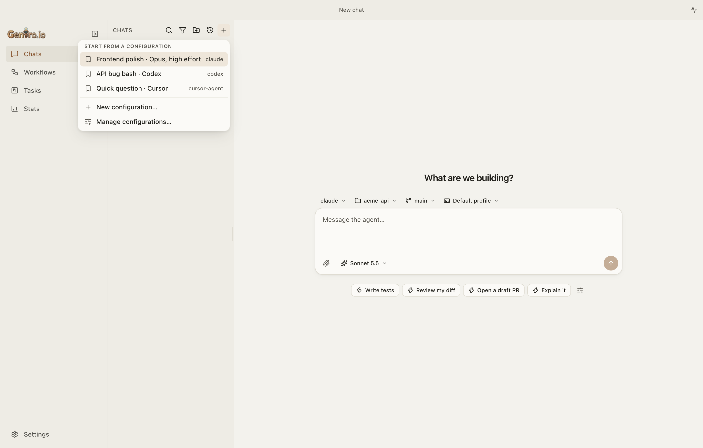

## 🦙 Local models

Start [Ollama](https://ollama.com) on your Mac and download a model that supports tool calling. Then pick it under **Ollama · local models** in the Claude Code or Codex model picker. Geniro discovers local models on its own and tells you when a model or CLI cannot be used. Inference stays on your machine and works offline.

## 📱 Your phone

In **Settings → Remote access**, scan the QR code and enter the pairing code shown on your Mac. Your phone opens the same live chats, teams, board and projects over your Wi-Fi. For access away from home, **Get an address** starts the `cloudflared` or `ngrok` you already have installed and opens a tunnel from the Mac; the address appears once it works.

To stay quick on a phone, a long chat opens on its newest 250 items (scroll up for more), and everything the Mac sends is compressed. The row of chips above the message box scrolls sideways when it holds more than fits.

<table>
<tr>
<td width="50%">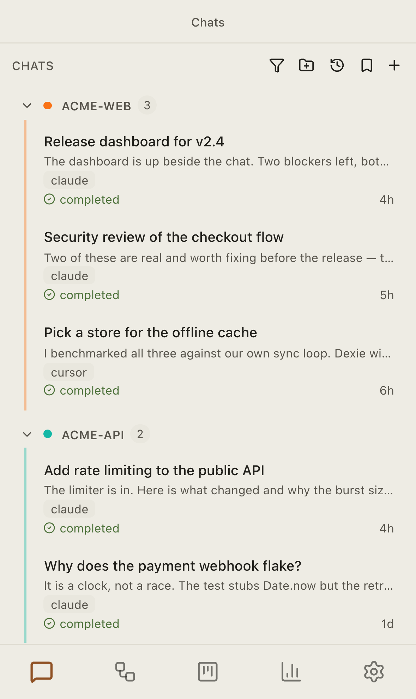</td>
<td width="50%">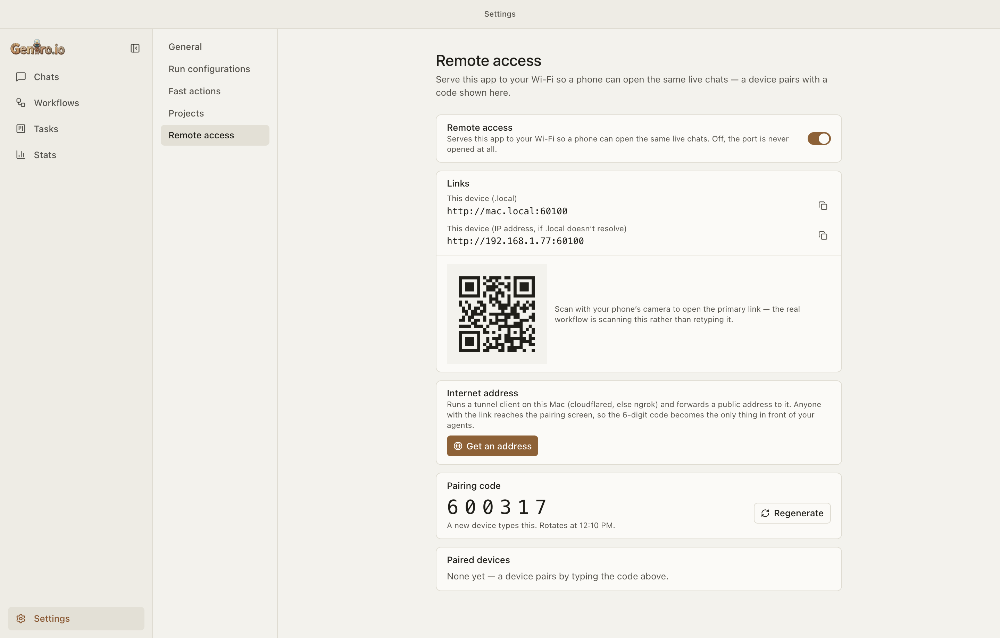</td>
</tr>
</table>

## 🔒 Local-first, for real

Geniro has **no cloud backend, no account and no telemetry**. Chats, teams and task history live on your Mac. Your agents keep their own logins and talk to their own model providers.

- The daemon listens on loopback only, with a fresh credential every launch.
- Remote access goes through a separate gateway and only works for devices you have paired.
- Secrets live in the macOS Keychain, never in a database or a file. The one exception is the browser's per-chat cookies, which stay in its own store on your Mac, as in Cursor.
- Agent-built pages run in a sandbox.
- Geniro's own network calls are few: app updates and the public model price list. CLI installs, the optional Cursor spend lookup, tunnels, sharing and the in-app browser reach the network only when you set them up, press for them, or an agent opens a page.

## 📸 Gallery

<details>
<summary><b>More screenshots:</b> a full team run, Settings and the dark theme</summary>

<br>

All screenshots use synthetic data from a fictional `acme-web` / `acme-api` project.

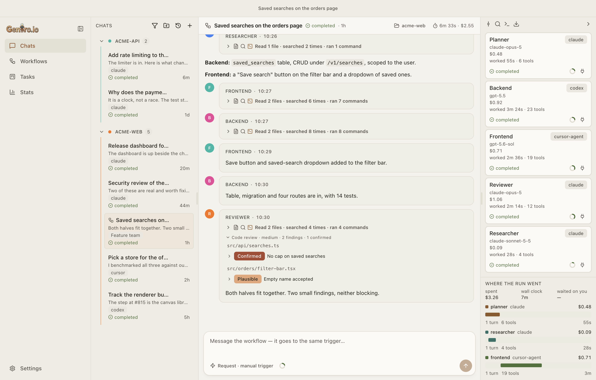

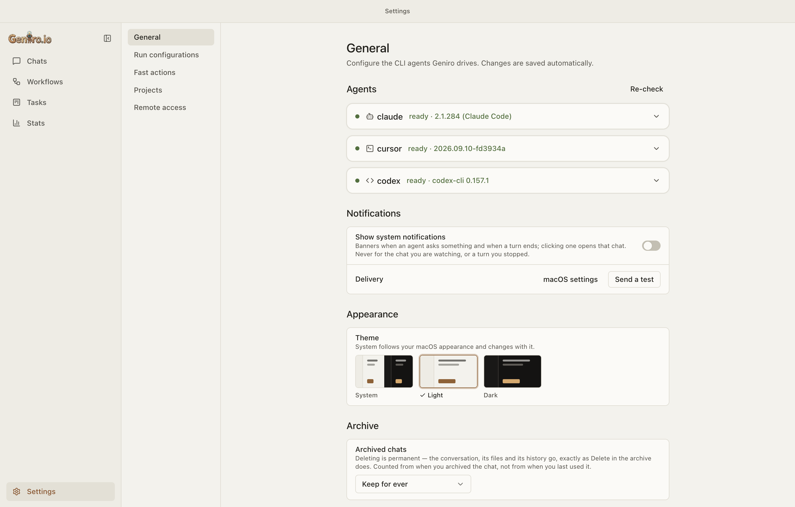

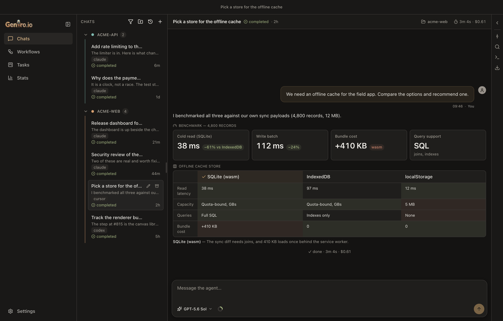

</details>

## 🔨 Development

<p>
  
  
  
  
  
  
</p>

An Electron app (`apps/ui`) supervises a NestJS daemon (`apps/daemon`) that listens on loopback and drives the agent CLIs. The [development guide](docs/development.md) covers source setup, commands, architecture and releases, including the required native rebuild and `pnpm full-check`.

```sh
pnpm install && pnpm rebuild:native && pnpm dev
```

Contributions are welcome! Read [CONTRIBUTING.md](CONTRIBUTING.md) and our [Code of Conduct](CODE_OF_CONDUCT.md), and use the issue forms for [bugs](https://github.com/geniro-io/geniro-app/issues/new?template=bug_report.yml) and [ideas](https://github.com/geniro-io/geniro-app/issues/new?template=feature_request.yml).

## 📜 License

[Apache License 2.0](LICENSE). See also [NOTICE](NOTICE) for attribution.

<div align="center">
<br>

<br>
<sub>Made with ☕ and a lot of agents, on a Mac.</sub>
</div>
