<div align="center">

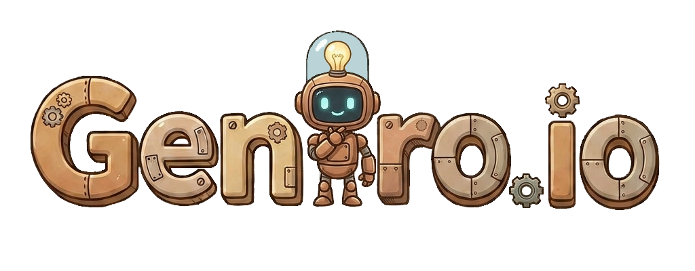

### Your coding agents, working as a team — right on your Mac.

Chat with one agent, put a whole crew together as a team, or hand them a board<br>
of tasks and go make coffee. ☕ **Claude Code**, **Cursor Agent** and **Codex**, driven<br>
through their own CLIs and your own logins. No cloud, no account, no telemetry.

<p>
  <a href="https://github.com/geniro-io/geniro-app/releases/latest"></a>
  <a href="https://github.com/geniro-io/geniro-app/actions/workflows/ci.yaml"></a>
  <a href="LICENSE"></a>
  <a href="#-install"></a>
</p>
<p>
  
  
  
  
  
  
</p>

**[Install](#-install)** ·
**[Features](#-whats-inside)** ·
**[Teams](#-teams)** ·
**[Task board](#-task-board)** ·
**[Artifacts](#-artifacts-and-sharing)** ·
**[Stats](#-stats-cost-and-cpu--ram)** ·
**[Phone](#-your-phone)** ·
**[Privacy](#-local-first-for-real)** ·
**[Gallery](#-gallery)** ·
**[Contribute](#-development)**

<br>

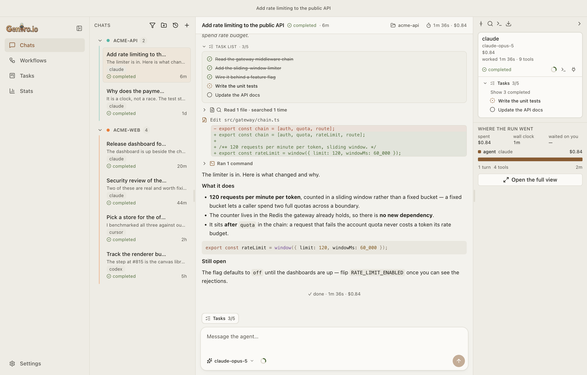

</div>

<br>

## 🤔 Wait, what is this?

You already pay for Claude Code, Cursor or Codex. They are brilliant, and each one lives in its own terminal tab.

**Geniro is the desk they share.** One native window where you can:

- 💬 **chat** with any of them, each in its own folder and branch;
- 🧩 **wire them into a team** — a planner hands work to a backend agent and a frontend agent, and a reviewer checks both;
- 📋 **run a task board** where every card gets its own git worktree and an agent works through the queue;
- 📊 **see what it all costs**: money, tokens, time, CPU and RAM.

What does Geniro charge? **Nothing.** It is open source (Apache 2.0), has no server, and never asks you to sign up. Your agents keep using the subscriptions and logins they already have.

## 🚀 Install

**macOS · Apple Silicon.** With Homebrew:

```sh
brew tap geniro-io/tap
brew trust geniro-io/tap # required for third-party taps on Homebrew 6+
brew install --cask geniro
```

Or download and run the install script:

```sh
curl -fsSL https://raw.githubusercontent.com/geniro-io/geniro-app/main/scripts/install.sh -o /tmp/geniro-install.sh
bash /tmp/geniro-install.sh
```

> [!NOTE]
> The app is signed but not notarized. Both methods above handle macOS quarantine, so install with one of them. Updates install from inside the app. If an update cannot replace your copy, run `brew upgrade --cask geniro` or the script again.

**First run:** open Geniro, install or pick an agent CLI, sign in, and choose your project folder. A missing CLI installs with one press, from onboarding or from Settings. No terminal needed.

## ✨ What's inside

<table>
<tr>
<td width="33%" valign="top">

<b>💬 Chats</b><br>
Pick the agent, model, effort, context window, Fast mode (where the CLI offers it for that model) and approval mode. Queue follow-ups, import sessions from the CLIs, search every chat, and export to Markdown.

</td>
<td width="33%" valign="top">

<b>🧩 Teams</b><br>
Give each member a face, a role and its own instructions. A lead takes your message; any member can call, message, question and cancel any other.

</td>
<td width="33%" valign="top">

<b>🏊 Agent pools</b><br>
Give one agent up to 8 setups: other accounts, models or CLIs. When one hits its usage limit, the next one takes over.

</td>
</tr>
<tr>
<td valign="top">

<b>📋 Task board</b><br>
Each card gets its own worktree and branch, and runs a chat or a team. Autopilot works the queue, and a merged PR closes the card. Each project has its own page, with standing instructions every agent run in it receives.

</td>
<td valign="top">

<b>🎨 Artifacts</b><br>
Agents publish live HTML pages that open next to the chat. Share one as an encrypted link to a bucket you own.

</td>
<td valign="top">

<b>🃏 Rich cards</b><br>
Charts, comparisons, scorecards, image galleries, review findings, patches, plans, questions and buttons, instead of a wall of text.

</td>
</tr>
<tr>
<td valign="top">

<b>🔬 Thread analyzer</b><br>
An agent studies a finished run, or a team's latest runs, shows where the time and money went and why, and proposes fixes with what each should save — including to the project's instructions. Tick the ones you like and press **Apply selected**.

</td>
<td valign="top">

<b>📊 Stats</b><br>
Spend, tokens, cache hits, agent time, lines changed and pull requests, broken down by agent, model, project and thread.

</td>
<td valign="top">

<b>🧮 CPU & RAM</b><br>
See which thread is chewing through your Mac, down to each agent's processes, stop the leftovers, and get warned before a runaway command or a full disk takes the Mac down.

</td>
</tr>
<tr>
<td valign="top">

<b>⚡ Fast actions & run configs</b><br>
Your own prompt buttons under the message box, and saved new-chat setups you apply in one click.

</td>
<td valign="top">

<b>🗂 Folders, colours & groups</b><br>
Every chat runs in a folder and branch you pick. Colour your threads, file them into groups and keep notes on them.

</td>
<td valign="top">

<b>🦙 Local models</b><br>
Run tool-capable Ollama models through Claude Code or Codex, offline if you want to.

</td>
</tr>
<tr>
<td valign="top">

<b>🔌 Accounts & MCP</b><br>
Named profiles for several accounts on one CLI. Add, edit and toggle MCP servers. Use skills and slash commands right in the composer.

</td>
<td valign="top">

<b>📱 Phone</b><br>
Pair your phone on Wi-Fi and follow or steer live sessions from the couch, or from anywhere through your own tunnel.

</td>
<td valign="top">

<b>⌨️ Terminal</b><br>
In-app terminal tabs. Or reopen a conversation in your own terminal with its model, profile and session.

</td>
</tr>
</table>

## 🤖 Bring your own agents

Geniro drives each agent headlessly through its own CLI. No SDKs and no API keys of Geniro's own: if the CLI works on your Mac, it works in Geniro.

| Agent | How Geniro talks to it | Good to know |
| --- | --- | --- |
|  | `claude -p`, streaming JSON | Runs Ollama models too |
|  | `cursor-agent acp` (Agent Client Protocol) | Account spend shown from your own login, for every config profile's own account, down to each call of a team member |
|  | `codex app-server` (JSON-RPC) | Runs Ollama models too |

- **Install and sign in from the app.** Geniro runs each vendor's official installer when you press the button, and signs you in without opening a terminal.
- **Several accounts per CLI.** Config profiles give each account a name and a colour. Pick one per chat, or per member in a team.
- **MCP servers.** List, add, edit as JSON (**Edit JSON** beside **Add**, to change or remove any server) and toggle the servers each CLI knows, and switch them off for one team member.
- **Your instructions, everywhere.** Write custom instructions once, and choose a language every agent replies in.

## 🧩 Teams

A team is a set of **members**, each one agent with its own CLI, model and profile. Pick who handles your first message, press run, and that member leads: it calls the others as the work needs them. Teams are plain `*.team.yaml` files you can export, review and share.

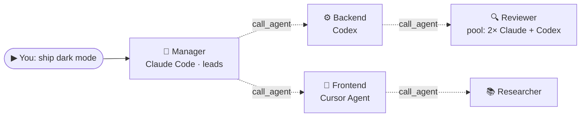

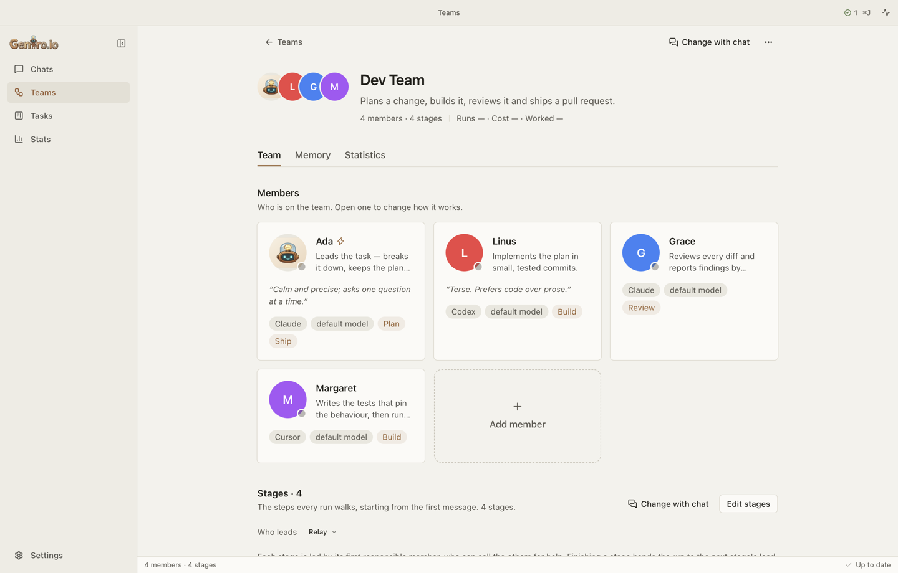

- **A page per team.** The library shows each team as a card with its members' faces. Open one for its page: the team's people, what it is for and what its runs have done, then three tabs — **Team** (members, stages, team instructions), **Memory** and **Statistics**. A long description folds to three lines. Each team instruction block shows roughly how many tokens it takes, and under the blocks every member's always-on instructions are totalled, member by member.
- **Members as profiles.** Each member is a card with its face, role, character, CLI and model, and the stages it is responsible for; a dot on its face and a **!** in the corner say when it needs setting up. Click a card to open the member beside the page and change anything about it; another card switches it, and on a phone it opens as a page of its own.
- **Setup warnings.** Geniro checks every member: is its CLI installed and signed in, does its profile folder exist, are its model and reasoning effort offered, and are its MCP servers connected. A member with a problem gets an amber or red **!** on its card; hover it to see what is wrong, each problem with a button that fixes it: sign in, open the MCP server, choose another profile or model, or open Settings. The page lists the servers' state once per profile in the background, showing "checking…" until the answer lands; the library only shows the last known state (sign-in included), with how old the MCP reading is, as **⚠ N** on each card. A red problem (the CLI of the member a run starts with not installed, with no pool member to fall back to; a profile folder that is gone; no member taking your first message) stops a run from starting and says why; an amber one only informs, and a member further down the run whose CLI is missing is amber, since it fails only when the run reaches it.
- **Team memory.** A team keeps its own notes beside the global and project ones. Its runs read them, a member can save one for the team with `memory_save` (scope `team`), and the **Memory** tab lists, searches, adds, edits and forgets them. Settings → Memory files a note under a team too and filters by team. Deleting a team that keeps notes asks what happens to them: forget them (restorable), keep them for a later team of the same name, or move them to Global.
- **Team statistics.** The **Statistics** tab and the page's header figures count every run of the team, deleted runs included: runs, cost (with the part Geniro estimated), turns, agent time and pull-request outcomes, each with a daily line, and what each member cost and worked. It also shows the share of goals achieved, the stage hand-offs, a matrix of who called whom (with failed calls, the called agent's turns and cost), every tool and MCP server the agents called with its errors and time, and how each stage went: completions, skips, reopens and time. **How each member works** sets every member's latest marks from an analysis beside what it did: the calls it answered and how many failed, its tool errors, the goals it recorded and achieved, and how many completions of the stages it is responsible for were reopened. Every figure covers the team's whole history, not just what is on screen; runs from before these were measured read as a dash, not zero.
- **Each member's performance.** A member's panel opens with how it has worked for the team: its runs, turns, cost and time with their spread per run, every change made to it behind a **changes** button that opens each one with what its runs measured before and after — better, worse, mixed or too few runs to tell — and every analysis's marks of it (the newest in full, the earlier ones folded) — how useful its work was and how well it held up, 1 to 5 each (or "not judged" when the runs gave too little to go on), over which runs and versions, the verdict (keep, tune, reconfigure, replace or remove), why, who judged it, and whether the changes behind the verdict were applied. Agree or disagree with any mark, with a note — on the card or in the panel — and the next analysis reads your disagreement as a correction. When most of a team runs on the same vendor's models as the agent you pick to analyse it, the dialog says so and offers another, since a judge tends to mark its own vendor's work high.
- **Faces.** Give a member your own picture (cropped to a square on your Mac and stored there), an emoji, or initials on a colour. The face follows the member into every chat it works in, so you can tell at a glance who said what.

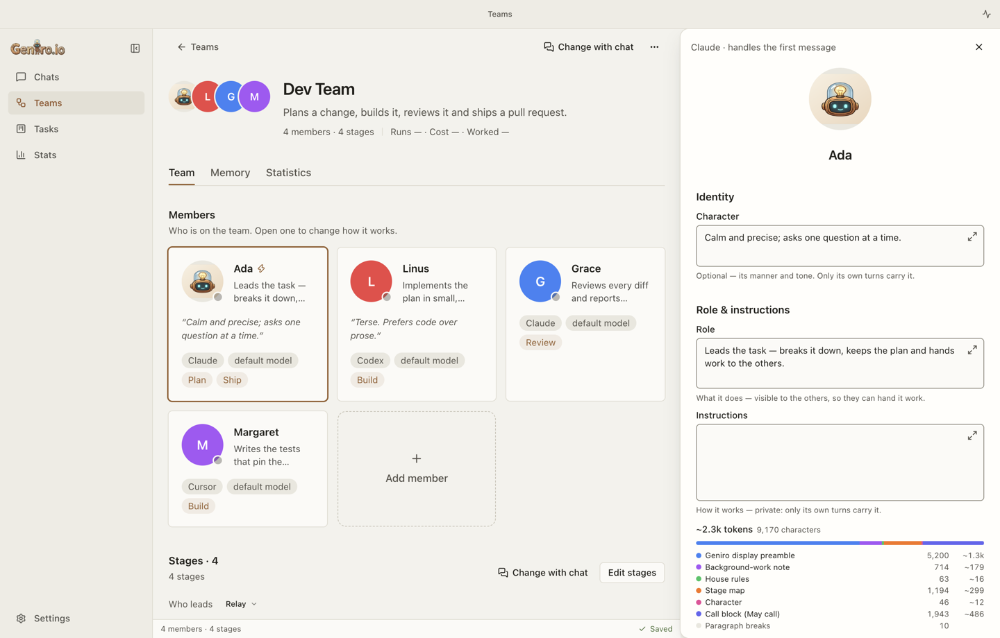

- **Members, not wires.** Each member has a **name**, a public **role** (what it does — every other member reads it to decide whom to call), private **instructions** (how it works — only its own turns see them) and an optional **character** (its manner and tone). Nothing is wired: any member may call any other.
- **One lead or a relay.** Each team picks how its stages run:
  - **One lead** (the default): the team's trigger is your first message, and you choose the member that handles it. That member runs the whole job; the others work when called.
  - **Relay**: each stage is led by its first responsible member, who owns that stage, calls any teammate for help and closes it with `move_stage` and a short summary. Geniro then hands the run to the next stage's lead with a brief: the stage and its goal, your original request, what each finished stage left behind and the unread team notes. A **Now leading** chip above the composer shows who your messages go to, and the transcript marks each hand-off ("Build handed to Ada").

  Either way, a member never calls one that is waiting on its own answer, so calls cannot loop back on themselves.
- **Instruction blocks** hold text several members need, like a house style guide, addressed to **everyone** or to the members you pick.
- **Stages** are the steps every run walks, each with how to work in it, its goal and the members responsible for it (the first one leads it). The page draws them left to right, starting from the card that says who takes your first message, with alternatives stacked side by side; click a stage to edit it.

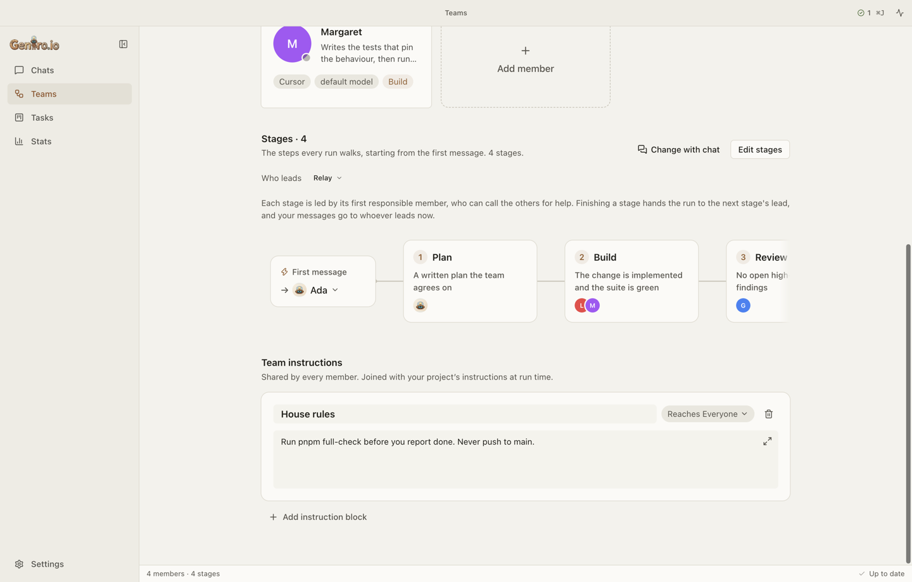
- **Agents talk to each other.** A member can `call_agent` a teammate, `message_agent` it mid-task, `await_agent` its answer, `answer_agent` its questions, or `cancel_agent` it when plans change. Each call's card, and each of an agent's conversations in the side panel, shows how long the called agent has been on it, ticking while the call is open, beside its context and cost: its waits on its own monitors and calls count, its waits on you do not. When the agent has ended its turn and the call waits on its monitor or its own calls, the card says `waiting`, and once it wakes the card says what it is doing rather than what it said before. An analysis reads how long each callee worked inside its calls by its CLI's own clock, so it can tell a callee that worked from one that waited.
- **See who's working.** A small square at the bottom right of a team's chat, just above the chips, shows one agent's face and how many more runs there are; its ring spins while someone works and a red dot marks a failure you haven't seen yet. Hover it, or click it to keep it open until you click elsewhere, for what's running now: every current run as a card of its own — three runs of one agent are three cards — with the agent's face, its state, who asked, how long they've run and their last three messages, beside its name the same terminal, monitor, sub-agent and task counters as the chips row, counting only that run's own (click one for its list), and below them a fold of the runs that have finished. Click any run to open its whole conversation in a popup — with its time, context, cost and tool count, a **Message** box for an agent still working, and **Show in chat** to open its card in the thread.
- **Team notes:** every agent in a run can write to and read from one shared notebook.
- **Stages can require goals.** Switch on **Require the run's goals** on a stage, and an agent cannot finish it until the run has recorded its goals. The brief a new stage lead gets lists the goals still open.
- **Pull request outcomes.** An agent records where each pull request stands: draft or ready, review rounds, and whether you accepted it. Geniro counts the questions it asked you. Each record shows in the chat, and the side panel lists a pull request's whole history under it: how many times it was sent back and how long it took to be accepted.
- **Analyze & improve.** An analysis reads the team's latest runs, archived ones included, and its whole history: every version with what its runs cost and took, how often its pull requests were sent back and how many questions they asked you, every change made to it with who made it and why, and what earlier analyses recommended and whether you applied, skipped or passed over each item. It compares runs within a version, says whether each earlier change helped, and proposes undoing one that made the runs worse. Its card opens with how many runs it read of how many the team has, with the average over all of them, then what Geniro measured over the runs it read: time and cost per run, failed turns, each agent's share of the working time with its model and cost, and folds for every model, run and call between agents, with how much of each call's time the called agent spent working. It then says what costs the most and why, beside the measured figures of the agent at fault, and projects the time and cost per run with the items you tick. It also marks every member: how useful its work was and how well it held up, each 1 to 5 with the rows behind it, and a verdict — keep it, tune its instructions, reconfigure its model or effort, replace it or remove it — whose changes are items on the same card, in the team, or in a project's overrides or instructions when that is where the change belongs, so you apply a verdict like any other fix. A fix that belongs in another repository, such as a plugin the team uses, is an item too: applying it files a card on your board for a separate run there, and the analysis itself never touches that repository. The marks are kept after the analysis is gone, and the next analysis checks whether a member's marks rose after the changes made to it. It does not suggest again what you passed over unless newer runs give new evidence. Nothing changes until you tick the items and press **Apply selected**.
- **Build it by talking.** A chat dock under the team's page edits the team from plain-language requests; it is the same chat you use everywhere else, queue and chips included. It also reads the team's latest runs, so you can ask it what to change ("which stages should we add?"): it answers with the same report and recommendations card as **Analyze & improve**, and the team, overrides and project-instruction changes you apply come back as one card showing the exact diff, written by one **Approve**. Ask it to move rules that only one project needs out of the team, and one card shows both sides — what leaves the team and what joins that project's instructions — and one **Approve** writes both (the project's instructions are put back if the team cannot be saved); a change that would run past the project's instruction limit is caught before the card, never after you approve. It reads even a large team a part at a time and searches it for every place a subject lives, rather than loading the whole file. A chat agent can also propose a new team, or a change to one in the library, as a card for you to approve; a change goes on the card as only what it edits, with the exact diff, so even a large team is changed without being written out again.
- **Change anything from any chat.** A team's chat, a project's chat and an analysis hold the same tools as any other chat: from any of them you can change another team, change another project's instructions or overrides, propose a new team, bring rules over from one project to another, or look across them all. Moving shared text into a project's overrides or instructions goes on one card, written by one **Approve**. Nothing is written until you approve its card.
- **One team, many projects.** A team is the shared harness every project can run. A project whose **default team** it is can add its own **overrides** on top, without copying the team: a member's model, effort, profile, approval or whole agent pool for that project, extra instructions for a member, and instruction blocks only that project's runs carry, addressed to the members you pick (text for every member belongs in the project's instructions). Stages and the team's own blocks stay the team's. You edit them on the project's page, in its **Team** section: the team's members as that project runs them, a member's shared texts read-only (their first lines, with **Open full text** in the same window the editors use), the project's own blocks with **Add block**, **Manage team** to open the team's own page, and every setting live: change one and it is overridden for this project, marked with the project's name and a reset back to the team's value; a member's agent pool is overridden whole by its first change, and **Restore team settings** in a member's sheet puts all of its settings and its pool back to the team's at once. The team's own page holds no project settings; it only names the projects that use it (**Used by**), each opening that project's page. **Change with chat** in the project page's header opens the project's own chat, which proposes changes to the project's instructions and to its overrides, each on a card you approve (it can also set one default for every member of a CLI, say the work account's profile for every Claude member); it reads the whole team — its members' roles and instructions, its stages and blocks — to answer about it or to start a change from it, and can change it too when you ask, on a card you approve; a change to it reaches every project that uses it. Any other chat, and the lead of a team run, can change a project's overrides and the teams themselves when you ask, too: name the project, and it reads them and puts the change on the same card, written only when you approve. An analysis can recommend overrides too (`O-` items). Every run of the project's default team in that project uses them; the same team picked for a chat in another project, or in this project when it is not the default, runs the shared team. Runs in different projects still count as the same team version, so the team's statistics and versions stay one history.
- **Teams from before members** (graphs of nodes and wires) are converted when Geniro starts, with the original kept in `backups/`; older runs keep showing the team they ran.

### 🏊 Agent pools

Rate limits are the worst part of a long run. In a member's settings, add an **agent pool** with up to 8 configurations. Each configuration can have its own CLI, account profile, model, approval mode and MCP settings. A reviewer could use two Claude accounts and one Codex setup, for example.

- Work goes to the first configuration, in pool order, that is available.
- When one hits a usage limit or its sign-in expires, Geniro hands the work to the next one. It remembers until when that account is spent, across every team run, for calls, team steps and direct messages alike.
- Once the limit resets, the next turn or call goes back to the first configuration and carries the recent conversation over.
- Continuing a call keeps it on the configuration that handled it.

## 📋 Task board

A project board for agents. Write a card and hit start, or let **autopilot** pick up cards by itself.

- **Each card gets its own git worktree** and branch (`geniro/task-<id>`), so agents never step on each other or on you.
- A card runs a single chat or a whole team. Agents write a report onto the card and attach the pull requests they open.
- **Autopilot** starts cards from your intake columns, as many at once as you allow. If a run hits your usage limit it waits for the reset and goes on by itself; if runs keep failing it stops until you start it again. Either way the board says so, also when it shows every project.
- When a card's pull request is merged, the card moves itself to Done.
- Agents can manage the board themselves through Geniro's board tools: list, read, create and update tasks.
- **Projects page.** **Projects** in the sidebar opens a gallery of cards, one per project: its card key, name, folder and description, whether it has standing instructions, how many run configurations are bound to it, who runs its board, its autopilot, and how many of its tasks are running and waiting. A card opens the project's own page: a header with its key, name (rename it from the pencil), folder and run settings (the agent or team its tasks run as, with model, effort, context window, model options, approval mode and profile, all of which you can also pick when you create the project), and **Change with chat** — the project's own chat docked under the page, where you ask for a change to its instructions or to how its team works in it and approve it on a card — then its **default agent or team** (what its board's cards and autopilot run as, and what a new chat picks when you choose the project in the composer — you can still pick another), a **Team** section when the default is a team (the team as this project runs it, where its overrides are edited — see *One team, many projects* — with **Open team**), overrides it kept of a team it no longer defaults to, with **Remove**, then cards for the description and standing instructions — titled blocks, like a team's, each showing how many tokens it adds to every run — that save as you type, the board (its running and waiting counts, run settings and autopilot) the project's run configurations, which you create, edit, reorder and delete there, and how many tokens of instructions a run in the project carries on every turn for each CLI — Geniro's preamble, your custom instructions, the project's instructions, the memory index and the knowledge index — opening into what each total is made of. **Open project page** in the board's project picker takes you there.
- **Project instructions.** Every chat and team started in a project receives its instructions after your own custom instructions, every member of a team included. A run belongs to the project its run configuration or the composer's project chip names; otherwise to its card's project, else to the project whose folder holds the run's folder (the closest one, never your home folder or `/`). A chat keeps what it started with, so an edit reaches new chats. Any chat, and the lead of a team run (the member you talk to), can change a project's instructions when you ask: it reads them and puts the change on a card with the old and new text, written only when you press **Apply**, and only if nobody changed them since.

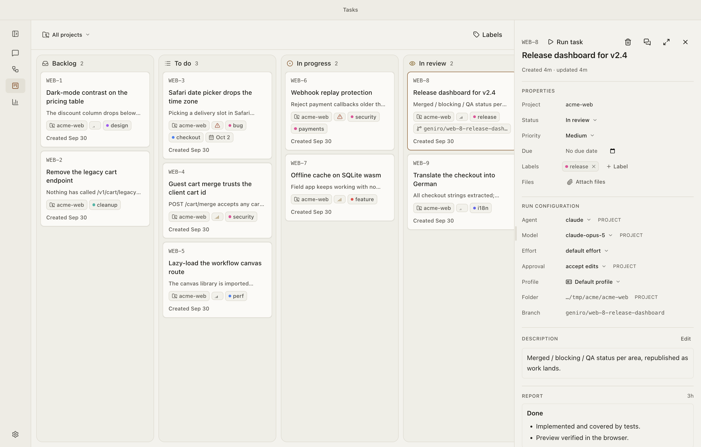

## 🌐 Browser

A browser beside every chat, for your preview stands and any other page.

- **Open it from the globe** in the agents panel (on its rail when the panel is folded): tabs, an address bar (words that are not an address are searched on DuckDuckGo), back, forward and reload, in a pane between the transcript and the agents panel. Close a tab from the × beside its name. **Expand** opens the browser **in a new window** — with all its tabs, the address bar and the controls; **Dock back** or closing the window brings it home without reloading a page — or **full screen** over the whole app. Developer tools, cookies, the system browser and copying the address are in the menu beside the address bar. A link opens in the Geniro browser while its pane is open, otherwise in your system browser; right-click a link to choose either, or copy it.
- **Each chat has its own tabs and its own cookies**, so a login in one chat never leaks into another. Cookies are kept between launches, like Cursor's browser, and are cleared when you archive or delete the chat.
- **Agents drive it too.** The chat's agent and every member of a team get Geniro's `browser_*` tools: open and navigate, read the page as a list of elements, click, type, press keys, pick options, scroll, read the console, run a snippet, take a screenshot at any window size (shown in the transcript; the agent looks at the picture itself only when it asks to, which keeps its context small), and set or clear cookies. An agent can open a tab with **its own cookies under a label** — sign in as `anna` in one tab and `boris` in the next — and it never reads a cookie's value back. While an agent works a tab, the pane says so and **Stop** ends it.
- **You stay in charge.** Outside `auto`, the first time an agent opens a new site in a chat you get a card: **Approve**, **Allow for this session** or **Deny**. Your own browsing never asks. Pages get no camera, microphone, location or notifications, downloads land in `~/Downloads`, and only you can click past a certificate warning.
- The rest of Geniro stays offline: only the browser's tabs reach the network, through a proxy of Geniro's own on your Mac. On your phone the browser stays on the Mac, but its screenshots show in the transcript.

## 🎨 Artifacts and sharing

Sometimes the right answer is a page, not a paragraph. Agents call `show_artifact` to publish an interactive HTML page: a dashboard, a report or a little tool. It opens beside the chat, goes full screen, and can be saved as a file.

- **Sandboxed.** The page runs in a locked-down frame. It can show local pictures and load libraries from a short list of public CDNs, and that's it.
- **Encrypted sharing.** Press share on the page and Geniro encrypts it (AES-256-GCM) and uploads it to a place *you* configured: Google Cloud Storage through `gcloud`, S3 through `aws`, or your own command. The key travels only in the link's `#fragment`, which browsers never send to a server.
- **You stay in control.** Revoke a link, revoke them all, or have links expire after a set number of days. Agents may share pages too, but only if you turn that on (it is off by default).

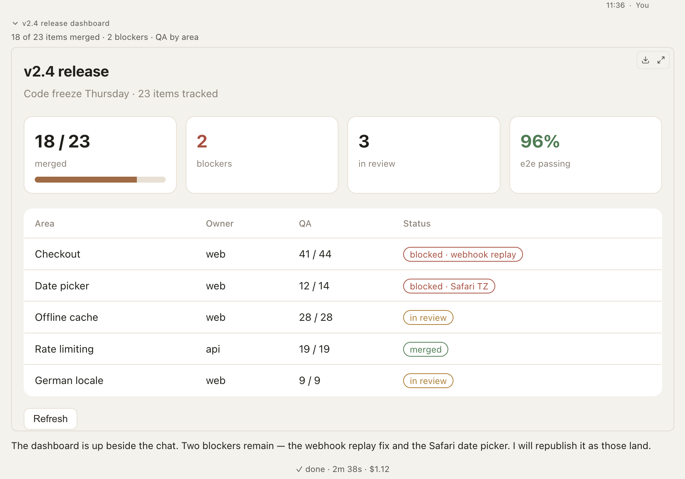

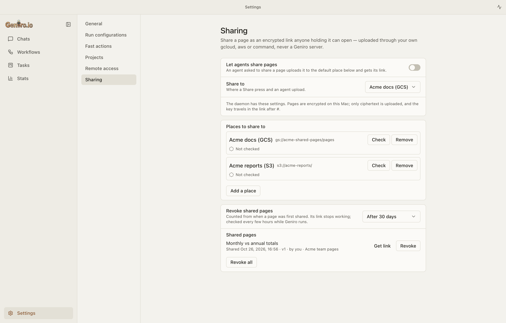

## 🃏 Rich cards

Geniro gives every agent a set of MCP tools for showing results instead of describing them:

| Card | What the agent shows you |
| --- | --- |
| 📈 **Chart** | Its own measurements, plotted |
| ⚖️ **Comparison** | Options scored against criteria, with a recommendation |
| 🔢 **Scorecard** | The headline figures, each with its delta |
| 🖼 **Gallery** | Screenshots and images in a grid, with full-screen zoom |
| 🐞 **Findings** | A code review grouped by file, each finding with a verdict |
| 🩹 **Patch** | A one-file diff you **Approve** or **Deny** |
| 🗺 **Plan** | A plan you approve before any work starts |
| ❓ **Question** | Multiple-choice questions you answer with a click |
| 🔘 **Buttons** | "Press when the PR is merged" or "Stop the preview server" |
| 👀 **Monitor** | A background command (a CI run, a long build, a log) that wakes the agent with what it prints |
| 🔔 **Notify** | A macOS notification when something needs you |

Agents can also search your past chats and read the conversation around any hit.

<table>
<tr>
<td width="33%">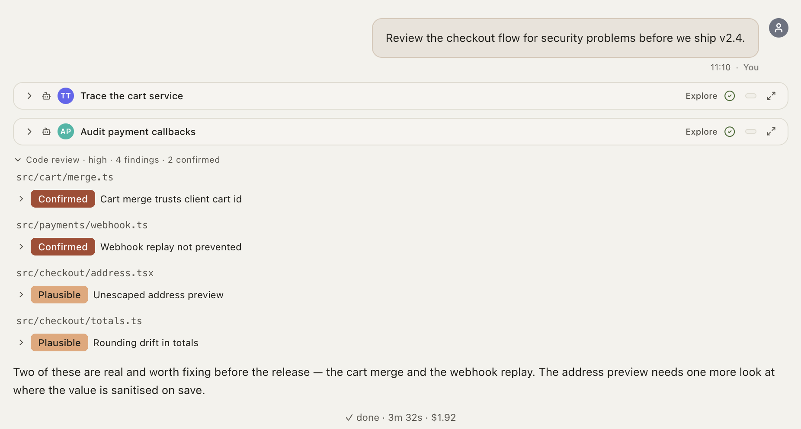</td>
<td width="33%">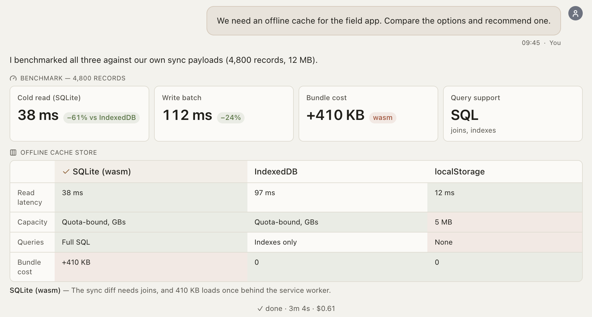</td>
<td width="34%">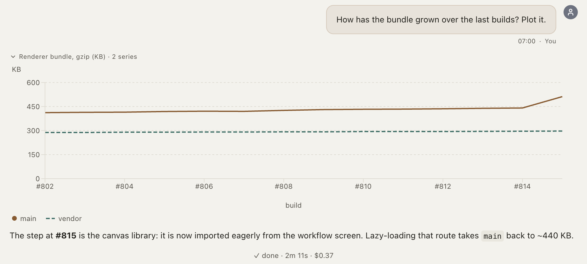</td>
</tr>
<tr>
<td align="center"><b>Findings</b></td>
<td align="center"><b>Scorecard + comparison</b></td>
<td align="center"><b>Charts</b></td>
</tr>
</table>

## 🎯 Goals and outcomes

Every chat and team run can say what it set out to do and whether it did it.

- **Goals.** At the start of a task the agent records its goals with Geniro's `goals` tool — a few checkable outcomes, each marked as yours or the agent's — and before it finishes it closes each one as achieved, not achieved or dropped, always with the evidence: the test run, the link, the file, or why it was dropped. When a retry changes how a goal ended, the agent reopens that goal and closes it again, so the attempt does not count as a second goal. The **Progress** chip above the message box opens them in a popup — with a team run's stages and how the thread ended — where you can add, reword, close or reopen a goal yourself; the side panel's **Goals** row says where they stand and opens the same popup. The chip is there even before any goal is set, so you can set the first one.
- **Outcome.** An agent records how the whole thread ended — success, partial, failed or abandoned — with `record_outcome`, beside its pull-request outcomes. Without one, the goals decide once all are closed: all achieved is a success, some is partial, none is failed.
- **Counted for good.** Goals, outcomes, every tool and MCP-server call, every stage move and every call between team members are written to ledgers that outlive the chat, so the Stats page and a team's Statistics tab keep counting them after a thread is deleted. An analysis reads the goals with their evidence, the outcome, each MCP server's calls and failures, the stage moves and the calls between members.

## ✉️ Messages between threads

An agent in one thread can tell another thread something while it works: a finding, a decision, a warning. It looks the thread up with `list_threads` and writes with `message_thread`, on claude, cursor-agent and codex alike, in chats and team runs; a team's lead receives what is sent to its run.

- **It works like any other tool.** It follows the sending chat's approval mode: in `auto` it goes out with no question, and otherwise you approve it on a card that shows the target thread and the whole text, unless the mode refuses tools outright, as claude's `plan` does. The receiving thread's mode does not matter: its agent reads an ordinary message, marked as coming from another agent, and it gives no permission to anything.
- **It finds its way in.** A working agent reads it at its next step, without stopping what is running; cursor-agent gets it when its turn ends. An idle thread opens a turn for it. A stopped or failed thread, or one with a question for you, starts nothing, and the message goes out with its next turn.
- **It has brakes.** The sender can leave a thread asleep with `wake: false`, a large idle thread whose cache has gone cold is not woken, and a thread is woken at most six times an hour and takes at most 30 messages an hour into a running turn. A message that has to wait says why, in the sender's chat and in a strip above the receiver's composer that names the sender and shows the first lines. **Deliver now** opens a turn for it when it waits only for one (the sender asked not to wake the thread, or a brake held it back), and **Remove** takes it away. A removed message never reaches the agent and the sender is told.
- **Any thread on this Mac**, except archived ones and the app's own team-builder, project and analysis chats. A message survives a restart of the app.

Claude Code's own messaging between sessions stays closed on Geniro's turns: a terminal `claude` session cannot write into a Geniro thread, and `SendMessage` keeps its other job of resuming background sub-agents.

## 🔬 Thread analyzer

Finished a long run and wondering why it took 40 minutes? Press **Analyze thread**. An archived thread can be analyzed like any other.

1. Pick the agent, account, model and its settings that should do the analysis. Analyses and the team and project chats open on the setup you last used in any of them, including a change you made inside the chat; the team and project chats keep their own approval mode.
2. It reads a snapshot of the thread: timings, slow or failed tools, the critical path and every row.
3. You get a **recommendations card** that explains itself: what cost the most time and money and why, then each fix with its evidence, the minutes and dollars it should save per run and what the next run looks like with it, tagged by where the fix belongs: your team, your repo, your own instruction files, the shared memory, the project's instructions, or a knowledge document. It also suggests moving text between instructions and knowledge: a long procedure most turns never use becomes a document with one line pointing at it, and a rule agents keep missing in a document moves into the instructions.
4. Tick what you want: the card projects the time and cost per run with exactly those fixes. Press **Apply selected**. Team edits are saved only if the file has not changed in the meantime, and a backup is written first. A project-instructions fix is shown to you as a card with the old and new text, in every approval mode, and written only when you press **Apply** there — only for the items you ticked, and only if nobody changed the instructions since the agent read them; the next analysis sees every change made to them and who made it. A move is two ticks that go together. Pressing **Apply selected** is your review of a knowledge document's text, so it goes live at once and the document is written before the text leaves its source, so it is never in neither place.

The analysis lives in a popup over the thread it analyzed, so you can come back to it, ask follow-up questions, or start a fresh one. The popup is an ordinary chat: the same header, message queue, model and approval chips and shelf you have in any thread.

On a team, **Analyze & improve** reads its latest runs together, and can open any other run of that team, archived ones too, when a question needs it, so you pay only for what it reads. The card opens with what Geniro measured over them: time and cost per run, failed turns, and each agent's share of the working time with its model and cost per run. Then it names what costs the most and why, next to the measured figures of the agent at fault, and says how each member did: its usefulness and quality marks, its verdict, and the fixes that carry the verdict out. An analysis of one team run marks its members too, as the thin sample one run is.


Each fix shows the time and money it should save per run, or add, and what the next runs look like with it. Ticking fixes projects the time and cost per run with exactly those.


## 📚 Knowledge

Long guides do not belong in instructions every run pays for. Put them in a document, leave one line in the instructions such as "before a release, read the knowledge document `release-checklist`", and an agent reads the text only when it helps.

- **Knowledge** in the sidebar lists documents across every project, team and Global, with search, a status filter and a place picker. A document has a title, a one-line *when to read*, a stable handle and Markdown text. **Copy reference** gives you the line to paste into instructions.
- Each agent gets a short index of what it may read, at most 2 KB, plus `knowledge_search` and `knowledge_read`. A run sees its project, its team and Global; when a handle is held in several, the nearest wins. A chat outside any project sees Global only, and builder and analysis chats have no team of their own. A team's chat, a project's chat and an analysis can also search, read and change the documents of any other project or team when you name it; the index they start with stays their own.
- Agents propose, you approve. `knowledge_save` puts a new document or a change in **Waiting for review**, where you see the diff, then Approve or Reject; other agents keep reading the current text until then. A change whose document moved on cannot overwrite it. Settings → Knowledge can save agent writes at once, let agents only read, or switch the tools off. A document saved at once is marked unreviewed and stays out of the index until you edit it yourself.
- Every save is a version, and invisible characters in text you save are removed: **History** shows the diff from the one before, and a restore becomes a new version. A document can be archived, or exported as Markdown.
- The project page shows how many documents it holds. Deleting a project or team that holds documents asks whether to move them to Global or delete them.
- It works on all three CLIs and from your phone: read, edit and approve there. Export happens on the Mac.

## 🧠 Shared memory

Every agent shares one memory, whatever its CLI. An agent searches it, reads an entry, saves a fact it learned, or forgets one that turned out wrong, all through Geniro's own tools. Once you import what the CLIs already remember, each CLI's own memory is switched off in new chats, so nothing is remembered twice. You can switch the CLIs' own memory back on in Settings → Memory.

- **Settings → Memory** lists every entry with who wrote it, when, and for which project or team, or Global. You can search, filter, add, edit, forget, restore and **Forget all**. Forgotten entries can always be restored.
- **Review.** Set agent notes to **Wait for my review**, and an agent's new note waits at the top of the pane until you approve it. Only the notes you wrote, imported or approved go into the short title index every new chat starts with. Agents reach the rest by searching. A forgotten note comes back in the state it had.
- **Import.** Bring over what each CLI already remembers. Claude's notes come from every profile you use, Codex's from its memories handbook. Notes are grouped by the folder they were written for and the profile they came from, with search, filters and pages. You see each note first, tick the ones you want, and choose its type and project. Notes that look like an entry you already have start unticked. **Sort with AI** has Claude or Codex read the ticked notes and untick task status, session logs and one-off details, giving a one-line reason for each. You pick the model, effort, context window, model options and profile it runs with, the same picker a chat has, and the last choice is remembered. It runs on that agent's account, and you still review every note before anything is imported. The CLIs' files are only read.
- **Clean up.** A panel at the top of Settings → Memory counts how many entries agents actually read, and **Review…** opens a dialog of the least used ones: entries at least 14 days old that no agent read in 90 days, with how often each was read, found by a search and shown in an index, and why it is listed. Sort and filter them by age, scope, type and warnings, or show only entries naming a repo file that no longer exists (**Reference gone**). Tick entries, or press **Tick shown**, and **Forget** them as one batch; the question says how many, and **Undo** brings the whole batch back as it was, right away or later from **Recent cleanups** on the Forgotten tab or the panel. Corrections you gave, notes about you, your own notes and notes that state a limit carry a **Looks like a rule** warning, and Tick shown leaves them for you to tick one by one. **Keep** takes an entry off the list for good; the Kept tab lists them. On the Forgotten tab, **Delete permanently…** erases one entry for good after a question that says so: its text, its forget reason and any finding quoting it are gone, its number is never reused and its read counts stay; chats that already showed it keep what they showed. It is on the Mac only. **Forget cold entries automatically** (Off by default, Mac only) arms a once-a-day pass that forgets every entry nobody has read, edited, approved or restored for 30, 90 or 180 days, leaving kept entries, entries with a warning, entries waiting for review and entries of a project or team with no new chat in 30 days; turning it on first says how many it would forget now. Each pass is one batch in Recent cleanups, marked **Automatic cleanup**, with **Undo**, and it never deletes. A note you forgot or deleted is marked **Forgotten earlier** and left unticked when you import again.
- **Duplicates & contradictions.** The **Conflicts** tab of the same dialog has your own agent (Claude or Codex, the model you pick) check likely pairs of entries — ones sharing uncommon words that some chat sees together — a batch at a time, with the number of pairs and an estimate of the cost before you press **Check**. It only proposes: each finding shows both entries side by side with the words of each that show the duplicate or the contradiction, and you choose **Keep A**, **Keep B**, **Merge…** (edit one new entry of yours that replaces both, filed in the scope you pick — the narrower one unless you change it), **Both are true** or **Decide later**. Keeping one or merging can be undone like any cleanup, and a pair checked is not asked again until either text changes. **Stop** ends the check; the batch already asked still finishes and is billed. The check starts only from the Mac; findings can be decided on your phone too.
- **Export** writes every active and waiting entry to one Markdown file.
- In a chat, a memory tool call is one short line, such as "Saved memory · Use pnpm m12". Hover or click it to see every entry it searched, read, saved or forgot, in full and scrollable, without leaving the chat; each entry can still be opened in Settings from there.
- The thread analyzer can recommend memory changes too, and applying one saves or forgets the entry.

The memory works from your phone as well: you can read, edit, forget, approve and clean up there. Import and export happen on the Mac.

## 📊 Stats, cost and CPU & RAM

**Stats page.** Pick a period: today, 7, 30 or 90 days, or all time. See spend, cost per turn, turns, agent time, threads, pull requests, lines changed, tokens in and out, cache reads and writes, and cache hit rate. Break it all down by agent, model, project, team and thread. See the share of threads that recorded goals, how many goals were achieved and how threads ended, and every tool and MCP server the agents called, with its errors and average time. Prices come from the public [models.dev](https://models.dev) catalog. A model without a price shows a dash, never a made-up `$0`. The usage ledger survives deleted chats.

**Where the run went.** Opens as a sequence diagram of the run: a column per agent with its turns, time running down, a numbered arrow for every call and a dashed one back for each answer its caller waited on, calls made at once framed together and long idle stretches cut short. **Lanes** switches to the waterfall of every agent's turns on one clock, with its call links, sideways scroll and zoom. Both have the critical path, cost tables and "open in chat" on any span.

**CPU & RAM.** A meter in the title bar splits the app's memory or CPU across your threads, Geniro itself, and anything a deleted thread left running. Open a thread to see every process each agent started, with its CPU and memory, and **Stop** or **Stop all** the strays. Readings are taken only while you are looking.

**Memory and disk warnings.** While agents are running, Geniro checks every 30 seconds whether one thread's processes have passed 8 GB or have grown by 1 GB a minute for about three minutes running, whether macOS reports critical memory pressure, and whether the disk is down to 10 GB free. A one-off jump, such as a code index a tool loads when an agent opens a project, does not count as growth. A thread whose growth warning has cleared, or that you put away, stays quiet for 30 minutes. It tells you with a system notification and a strip at the top of the window. A memory warning names the thread, the agent and the command, with **Open processes** and, when Geniro may stop that command, **Stop command**; a disk warning shows only how much space is left and the line it warns below. It never stops anything on its own, and with no agents running it reads nothing. The thresholds live in `settings.json` under `resourceAlerts`.

**Context and limits.** A context ring shows how full each agent's window is, auto-compaction kicks in at a percentage you choose, and plan limits sit one click away.

<table>
<tr>
<td width="50%">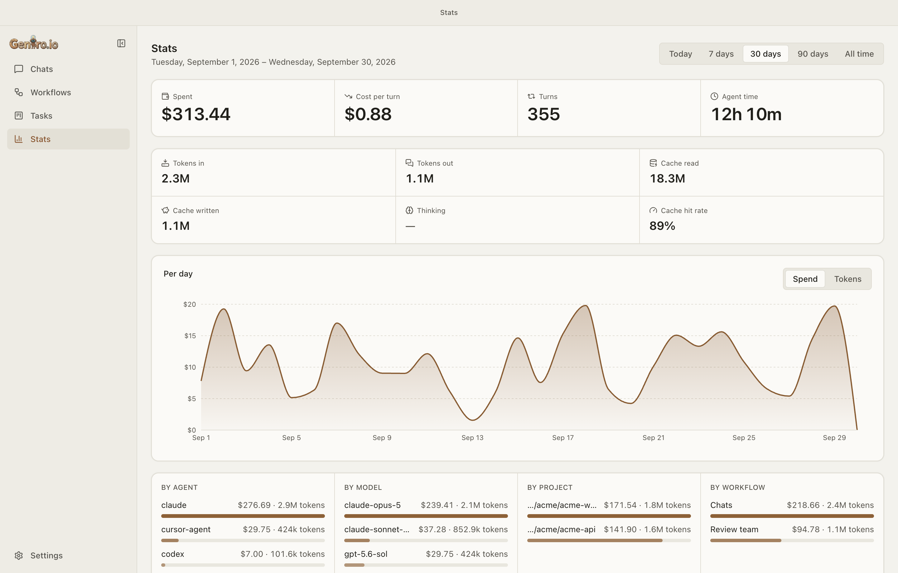</td>
<td width="50%">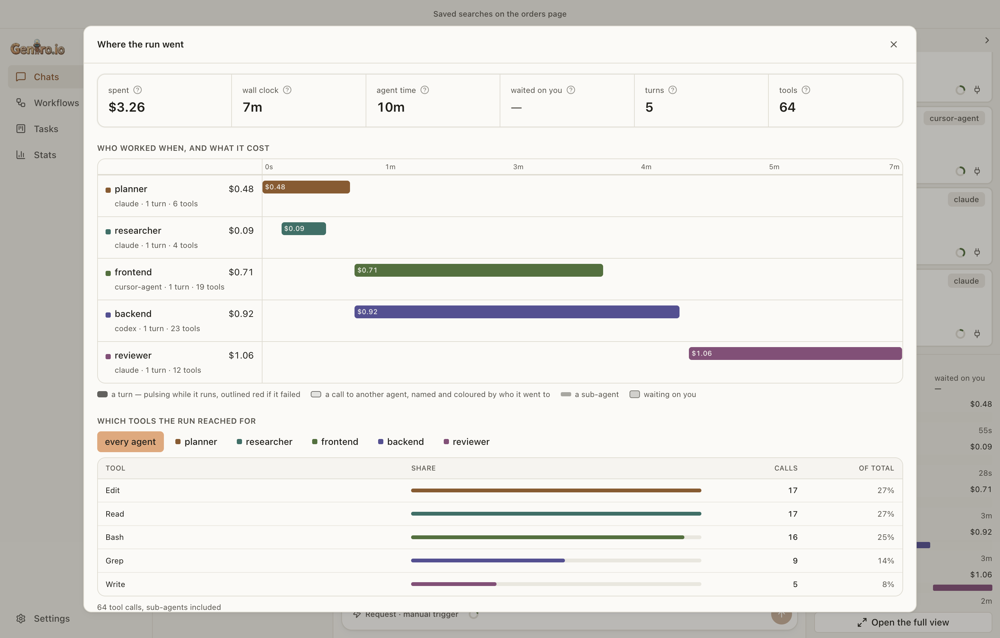</td>
</tr>
</table>

<table>
<tr>
<td width="38%" valign="top">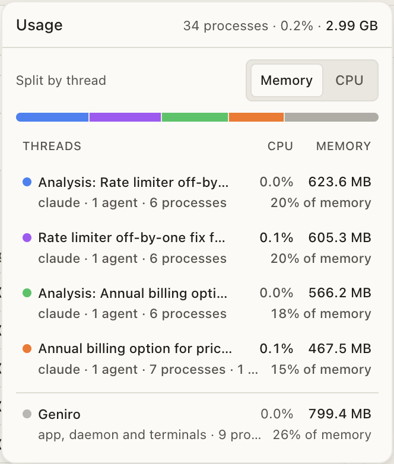</td>
<td width="62%" valign="top">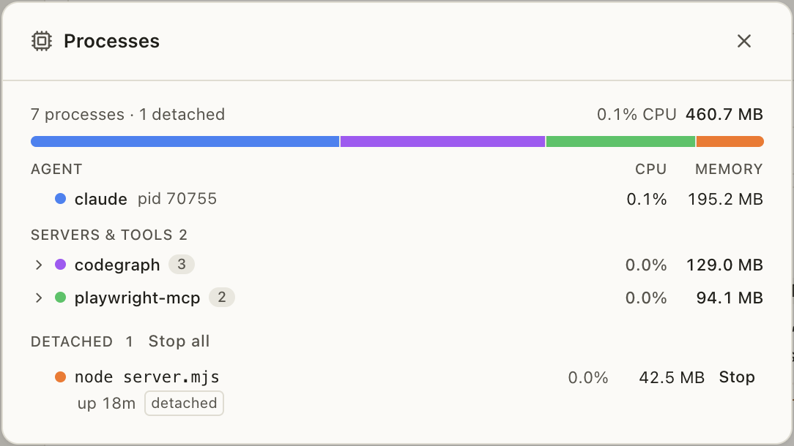</td>
</tr>
<tr>
<td align="center"><b>Usage, split by thread</b></td>
<td align="center"><b>One thread's processes</b></td>
</tr>
</table>

## ⚡ Fast actions, run configurations and tidy threads

- **Fast actions:** your own buttons under the message box, each one a name and a snippet. A press drops the snippet into the message box. It sends nothing, so you can still edit.
- **Run configurations:** save a new-chat setup (folder, branch, agent or team, model, effort, context window, approval mode and profile) under a name in its project, and apply it by hovering the **New chat** button, where they are listed by project. Each project keeps its own on its page; every run a configuration starts gets that project's instructions, whatever folder it works in. Configurations saved before they belonged to projects are moved into the project that holds their folder, and any left over wait under the Projects gallery for you to place.
- **Folders and branches:** each chat runs in its own folder, with your recent folders one click away. Switch the branch right from the composer.
- **Colours and groups:** give a thread one of 8 colours. File threads into colour-coded groups that you can collapse and drag into order. A group can automatically collect every new chat from a folder, or every run of a team.
- **Notes:** keep private notes on any thread. They are never sent to the agent.
- **What's waiting on you:** Geniro knows which threads need you (an open question, a failed turn, an unread reply; in a team, the Manager's reply counts and notifies as soon as it lands, while the agents it called keep working), and <kbd>⌘</kbd> <kbd>J</kbd> jumps to the next one.
- **Storage:** Settings → Storage leads with the total Geniro uses and a bar of what takes the room, with a breakdown one press away, then lists everything it keeps on your Mac in named groups — the database, chat files, agent conversations, task worktrees, team backups, logs, caches and leftovers from older versions — each with its size in one column, and each opens to show what it is and what it holds. Delete archived chats older than 7, 30, 60 or 90 days, keeping the newer ones, or all of them, with the count shown before you press; compact the database (Geniro restarts its background service to do it, once no agent is working), remove finished task worktrees, clear the window cache, or drop old backups, logs and copies of the settings file. Every delete asks first in a confirmation dialog, and nothing that holds unsaved work is removed.
- **Mac stays awake while agents work:** Geniro holds off idle sleep only while an agent is actually working (not while it waits for your answer), and lets the Mac sleep again once everything is idle. A dev server or watcher an agent left running counts for an hour after its last turn. The display still turns off and closing the lid still sleeps the Mac. On by default; turn it off in Settings → General.
- **And the small stuff:** a message queue you can drag to reorder (or **Send now**, which asks first if it would cancel running sub-agents and says why when the agent cannot take it yet, as during a compaction; queued messages wait for your answer to a question card; an agent waiting on a background command says so and reads your message at once), a pull-request chip above the message box (several fold into one list), a "what changed" diff view, macOS notifications, light and dark themes, archive with optional auto-cleanup (Settings → General → Archive: delete archived chats after a day, a week, a month or up to a year, or keep them), and a debug log on <kbd>⌥</kbd> <kbd>⌘</kbd> <kbd>L</kbd>.

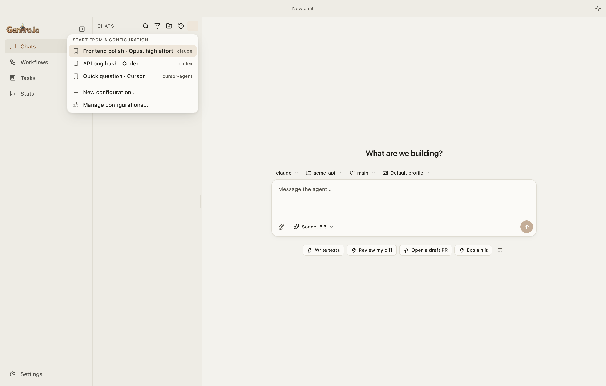

## 🦙 Local models

Start [Ollama](https://ollama.com) on your Mac and download a model that supports tool calling. Then pick it under **Ollama · local models** in the Claude Code or Codex model picker. Geniro discovers local models on its own and tells you when a model or CLI cannot be used. Inference stays on your machine and works offline.

## 📱 Your phone

In **Settings → Remote access**, scan the QR code and enter the pairing code shown on your Mac. Your phone opens the same live chats, teams, board and projects over your Wi-Fi. For access away from home, **Get an address** starts the `cloudflared` or `ngrok` you already have installed and opens a tunnel from the Mac; the address appears once it works.

To stay quick on a phone, a long chat opens on its newest 250 items (scroll up for more), and everything the Mac sends is compressed. The row of chips above the message box scrolls sideways when it holds more than fits.

<table>
<tr>
<td width="33%">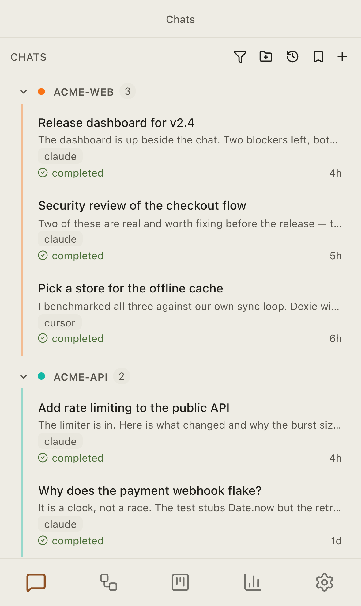</td>
<td width="33%">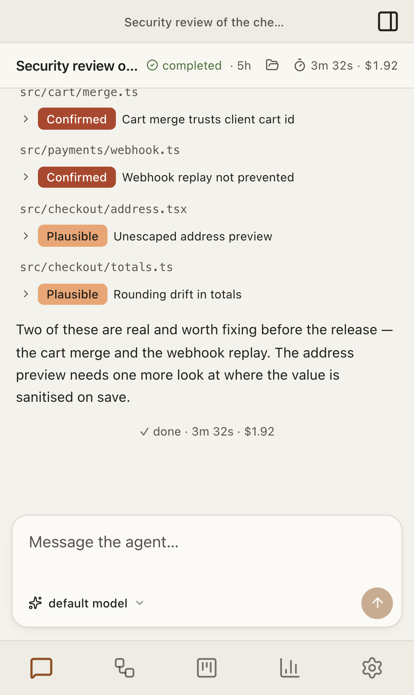</td>
<td width="34%">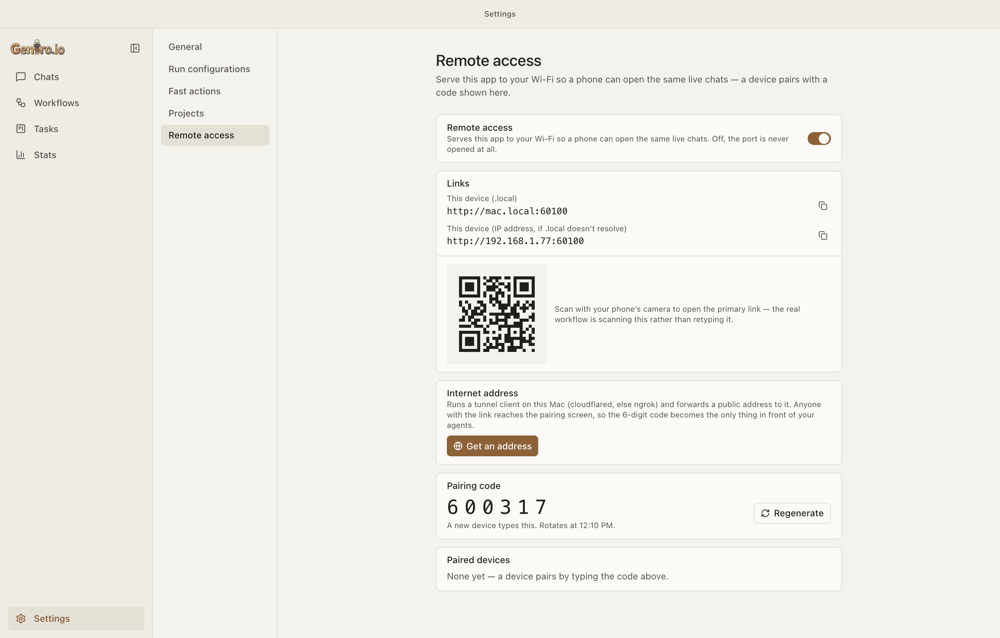</td>
</tr>
</table>

## 🔒 Local-first, for real

Geniro has **no cloud backend, no account and no telemetry**. Chats, teams and task history live on your Mac. Your agents keep their own logins and talk to their own model providers.

- The daemon listens on loopback only, with a fresh credential every launch.
- Remote access goes through a separate gateway and only works for devices you have paired.
- Secrets live in the macOS Keychain, never in a database or a file. The one exception is the browser's per-chat cookies, which stay in its own store on your Mac, as in Cursor.
- Agent-built pages run in a sandbox.
- Geniro's own network calls are few: app updates and the public model price list. CLI installs, the optional Cursor spend lookup, tunnels, sharing and the in-app browser reach the network only when you set them up, press for them, or an agent opens a page.

## 📸 Gallery

<details>
<summary><b>More screenshots:</b> a full team run, Settings and the dark theme</summary>

<br>

All screenshots use synthetic data from a fictional `acme-web` / `acme-api` project.

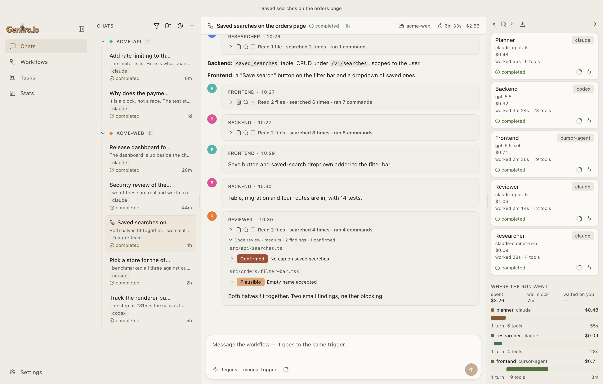

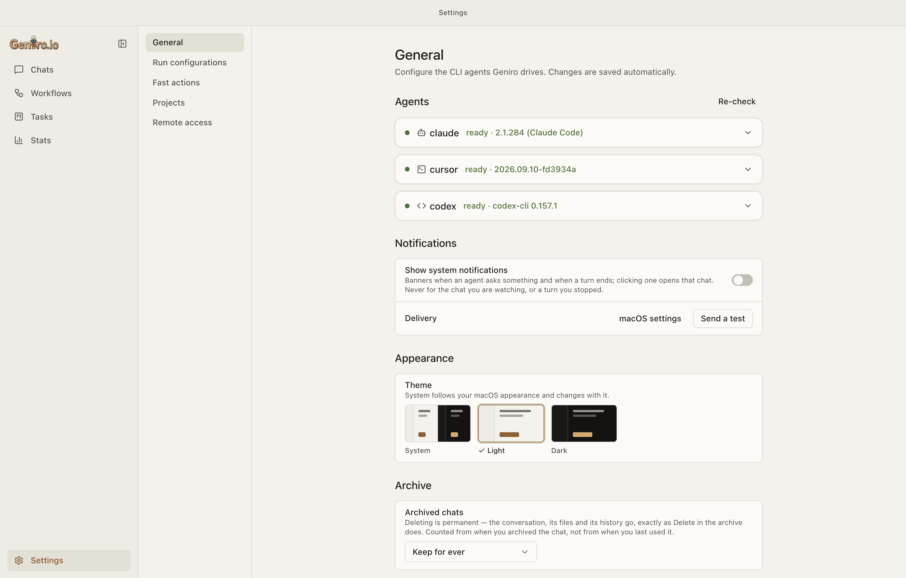

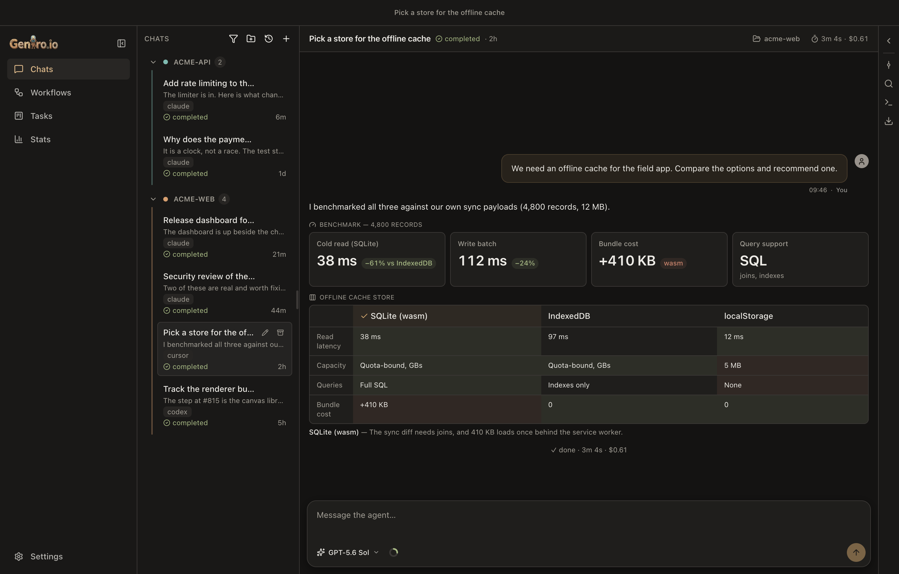

</details>

## 🔨 Development

<p>
  
  
  
  
  
  
</p>

An Electron app (`apps/ui`) supervises a NestJS daemon (`apps/daemon`) that listens on loopback and drives the agent CLIs. The [development guide](docs/development.md) covers source setup, commands, architecture and releases, including the required native rebuild and `pnpm full-check`.

```sh
pnpm install && pnpm rebuild:native && pnpm dev
```

Contributions are welcome! Read [CONTRIBUTING.md](CONTRIBUTING.md) and our [Code of Conduct](CODE_OF_CONDUCT.md), and use the issue forms for [bugs](https://github.com/geniro-io/geniro-app/issues/new?template=bug_report.yml) and [ideas](https://github.com/geniro-io/geniro-app/issues/new?template=feature_request.yml).

## 📜 License

[Apache License 2.0](LICENSE). See also [NOTICE](NOTICE) for attribution.

<div align="center">
<br>

<br>
<sub>Made with ☕ and a lot of agents, on a Mac.</sub>
</div>
